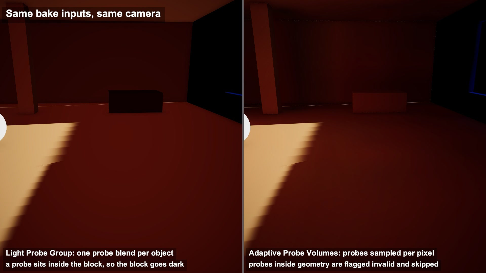

# Adaptive Probe Volumes vs Light Probe Groups

Old light probes give each object one blend of bounce light.

Adaptive Probe Volumes sample a 3D probe grid per pixel.

Same room, same bake, both ways in Unity 6 URP.

## The problem

Baked bounce light has to reach things that are not lightmapped. A Light Probe Group gives each renderer one probe blend, taken at the centre of its bounds. A ball, a block or a whole floor gets one set of SH coefficients. If a probe in that blend sits inside a box, the object turns dark.

## How it works

I read the APV code in Unity's SRP Core package (17.3). Nothing from it is copied into my project.

1. The bake places probes in bricks of 4x4x4. A brick is 3^n times the minimum spacing, so detailed areas get small bricks and empty space gets big ones.

2. Bricks are packed into a 3D texture pool on the GPU. A world-space index grid tells each position which brick it is in.

3. The lit shader takes the pixel's world position, nudged a little along the normal and toward the camera, finds its brick and samples the pool with trilinear filtering. Every pixel gets its own SH.

4. During the bake, probes that see too many back faces are flagged invalid. The leak reduction in the shader avoids them.

A Light Probe Group instead builds a tetrahedral mesh of the probes and interpolates once per object.

## What I hit

URP's probe system is one project-wide switch, so the two methods cannot render in the same frame. I captured the room twice with the same camera path and joined the left and right halves.

URP's brick wireframe is an editor gizmo and never shows in a capture, so the debug shot uses the probe spheres instead (set by reflection, the setting is internal).

My first room was almost black: the sun only lit a patch of floor. A low 9° sun through a wider window onto the red wall gave the bounce light something to work with.

On my 1.5 m legacy grid one probe lands inside the block. The block blends it in and goes dark. APV flags that probe invalid.

## My build

Room 10 x 4 x 14 m: red wall, blue wall with a window, pillar, block and shelf, all static and taking GI from probes (no lightmaps). One moving ball.

Sun in mixed mode, indirect only. GPU lightmapper, 3 bounces.

Light Probe Group: 189 probes on a 1.5 m grid.

APV: one global volume, 1 m minimum spacing. 8,448 probes in 132 bricks, 8 cells. Each bake took 1 to 2 s on the M4 for this small room.

URP reports 98.7 MB of GPU memory for APV. Most of it is the pool reserved by the default memory budget, not this room's data.

## Trade-offs

Sampling per pixel means texture lookups in every lit pixel instead of a few per-object constants.

Probes are still 1 m apart here, so no sharp contact shading. Lightmaps or SSAO still do that job.

Leaks need tuning: validity, dilation and virtual offset settings.

The pool reserves GPU memory up front.

## When to use it

Big static meshes that lightmap badly, moving objects crossing bright and dark areas, levels you rebake often.

## Credits

Technique source: Adaptive Probe Volumes in Unity's Scriptable Render Pipeline Core package (com.unity.render-pipelines.core 17.3.0) with the Universal Render Pipeline 17.3.0, as shipped in Unity 6.3 LTS. Source: Unity-Technologies/Graphics, https://github.com/Unity-Technologies/Graphics. License: Unity Companion License (the source stays inside Unity; none of it is copied into this project).

Code reused: none. I read ProbeBrickPool.cs (4x4x4-probe bricks), ProbeReferenceVolume.cs and ProbeReferenceVolume.Debug.cs (memory cost, probe debug drawing) and ProbeVolume.hlsl (index lookup, pool sampling, leak reduction) to describe it correctly. The probe lighting in the video is Unity's own bake and URP's own shaders.

The comparison side uses Unity's built-in Light Probe Group.

My own code: the room builder, the two bake setups (probe grid, APV baking set), stats readout, camera path, labels and the step that joins the two captures.

Engine: Unity 6.3 LTS, Universal Render Pipeline 17.3, Metal.

No external models, textures or images.

## Files

- `ApvDirector.cs`
- `Editor/BuildScene.cs`

## Build the scene

In the Unity editor: **Vidar Game Lab > Techniques**, then **Build** next to `adaptive-probe-volumes`. From the command line: `tools/capture.sh adaptive-probe-volumes GameTech.Posts.ApvScene.Build`.

`Build` makes the APV version. `GameTech.Posts.ApvScene.BuildLegacy` makes the Light Probe Group version. Both switch the project's light probe system on the active URP asset, so switch it back afterwards. The split shots in the video join one capture of each.
