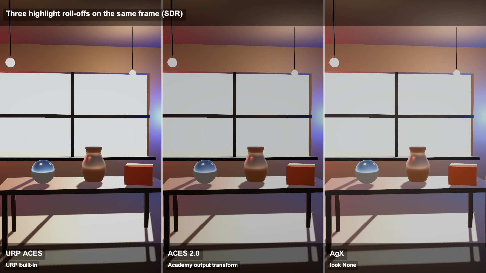

# AgX tone mapping

Push a bright room 3 stops and URP's ACES maxes out a colour channel on 40% of the pixels. AgX: 1.5%. Here is AgX added to URP through a renderer feature, without editing the URP package.

## The problem

A tone mapper squeezes HDR scene colour into the range a screen can show. Where the curve runs out, bright surfaces go flat: a sunlit floor, a window, the glow around a lamp lose their shape and colour. URP ships Neutral and ACES and has no API for adding your own curve.

## How it works

This follows aki-null's Custom Tone Mapping for URP package, used unchanged.

1. Every frame URP bakes a colour grading LUT. With URP's own Tonemapping set to None, that LUT holds graded but not yet tone mapped colour.

2. A renderer feature adds one pass right after that bake. It runs every LUT texel through a second LUT holding the chosen curve, here AgX, baked in C# from the volume settings.

3. The rest of URP's post stack reads the new LUT as its own. The extra work is one small LUT pass, not a full-screen one.

4. AgX itself: pull the colour primaries slightly inwards, encode in log2, apply an S-curve, then undo the rotation. Pulling the primaries in is what lets very bright saturated colours move towards white instead of pinning one channel.

## What I hit

The renderer feature only works with HDR colour grading. My project grades in LDR, so this scene runs on a copy of the URP asset with HDR grading, swapped in at runtime. Every curve in the video uses that copy.

I first copied the package code into the Assets folder and AgX rendered black: its shaders include files by package path. As an embedded package it worked with no changes.

AgX with no look is flat next to ACES at the same exposure. The look presets put contrast back on top of the same base curve.

## My build

Unity 6.3, URP 17.3, Apple M4 Mac mini, Metal. Package at commit 2735f90, renderer feature on a copy of the project's renderer.

A room built from code: a window onto a bright sky, sun through it, red and blue neon tubes, two bare bulbs, chrome, copper and saturated props, a stand-in mannequin.

Same bloom, vignette and a +0.3 EV base exposure for every curve, no other grading.

Compared: URP ACES, AgX, ACES 2.0 from the same package, AgX Low and High Contrast looks.

SDR output only, no HDR display tested.

Pixels with a channel at 250 or above, same frame:

Base exposure: 0% for both.

+3 EV on top: URP ACES 40.3%, AgX 1.5%.

No frame times measured.

## Trade-offs

AgX without a look is low contrast; most scenes want a look on top.

Very bright saturated colours lose saturation on purpose. If a red neon must stay deep red at full brightness, AgX works against you.

The renderer feature route needs HDR grading; cameras grading in LDR are skipped.

## When to use it

Scenes with strong or coloured light: windows, neon, fire, sunsets. Anywhere ACES turns highlights into flat patches.

## Credits

Technique source: Custom Tone Mapping for URP by aki-null (Akihiro Noguchi), https://github.com/aki-null/CustomToneMappingURP, commit 2735f902586ec44c619299dea8bdd93089b1e0a1, MIT License, Copyright (c) 2025 Akihiro Noguchi. Used unchanged, installed as a package: its Custom Tone Mapping renderer feature and LUT pass, the AgX and ACES 2.0 volume components, LUT bakers and tone mapping shaders. As the package README states, AgX was designed by Troy Sobotka and the package's AgX LUT generation is based on Eary Chow's version. Parts of the package derive from OpenColorIO, Colour and the ACES 2.0 aces-core transform, under the licences in the package's third-party notices.

Engine: Unity 6.3 LTS (6000.3.28f1) with the Universal Render Pipeline 17.3. Used for rendering, its post-processing stack and its built-in ACES tone mapping as the comparison. It is not the source of the technique.

My own code: the room, lights and props built from code, the stand-in mannequin's idle pose, the copy of the URP asset with HDR grading and the renderer feature, the per-curve volumes, the band cameras and compositor, the exposure sweep, the timeline, labels and video.

No external models or assets.

## Requirements

The scene needs the Custom Tone Mapping for URP package by aki-null, pinned in this repository's `Packages/manifest.json` to commit `2735f90`:
`https://github.com/aki-null/CustomToneMappingURP.git#2735f902586ec44c619299dea8bdd93089b1e0a1`. The package is used unchanged and is not copied here.

## Files

- `AgXCompose.shader`
- `AgXDirector.cs`
- `Editor/BuildScene.cs`

## Build the scene

In the Unity editor: **Vidar Game Lab > Techniques**, then **Build** next to `agx-tonemapping`. From the command line: `tools/capture.sh agx-tonemapping GameTech.Posts.AgXScene.Build`.
