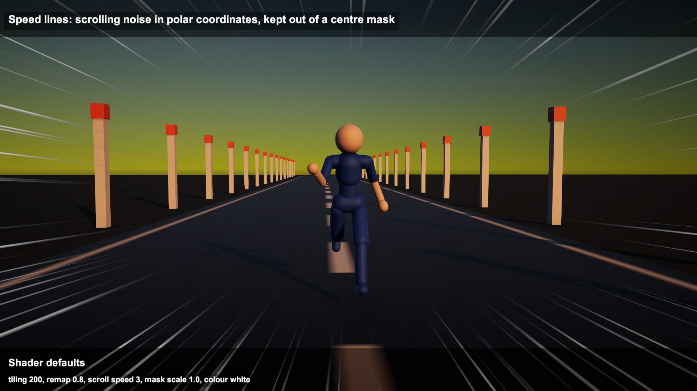

# Anime Speed Lines

Anime speed lines as one full-screen pass: scrolling noise in polar coordinates, cut by a threshold and kept out of a centre mask, so the runner stays clear while the edges rush.

## The problem

Speed lines sell motion in one frame: thin streaks converging on the subject from the edges. As sprites or particles they need art per shot. A screen pass works over any shot, but it must leave the subject readable.

## How it works

This follows Mirza Beig's Anime Speed Lines shader for URP.

1. Centre the screen coordinates and turn them into polar form: distance from the centre, and the angle around it.

2. Sample 2D simplex noise with distance (times a small radial scale) on one axis and angle (times the tiling) on the other. The angle axis changes fast, the distance axis slowly, so the noise becomes long radial streaks.

3. Add time times the scroll speed to the distance axis, so the streaks run along the radius.

4. Remap: noise below 0.8 is cut, the rest stretched back to 0 to 1, so only thin lines survive.

5. Mask: (distance / mask scale) to the power of 5, so the lines are almost gone near the centre and at full strength at the mask radius.

6. Blend the scene towards the line colour, weighted by line strength times the colour's alpha.

## What I hit

The angle jumps from minus half a turn to plus half a turn straight below the centre, and the noise does not wrap across that jump, so a seam can appear there.

The coordinates are not corrected for aspect ratio. On 16:9 the mask is an ellipse: mask scale 1 means full strength at the middle of each screen edge.

The blend moves the scene towards the line colour, so white lines read well over a dark scene and get lost over a bright one.

The source runs it as a URP render pass. I blit the same shader once per band from a script, to show three settings on one frame.

## My build

Unity 6.3 with URP on an Apple M4 Mac mini, Metal. The shader is the source's, unchanged except its name.

A stand-in mannequin runs on the spot, run cycle at 1.6 Hz. The road texture and two rows of posts every 4 m stream past at 14 m/s, and the camera pushes in from 3.8 m to 2.3 m over 26 s.

Shader defaults: tiling 200, radial scale 0.1, remap 0.8, scroll speed 3, mask scale 1, hardness 0, mask power 5, white.

Comparisons: off / on; tiling 80 / 200 / 500; scroll speed 0 / 3 / 10; alpha 0.35 / 0.7 / 1.0; mask scale 0.6 / 1.0 / 1.4.

From the mask formula: halfway out from the centre the lines are at 0.5 to the power of 5, about 3% strength.

1920 x 1080 at 30 fps, 780 frames. I did not measure frame times.

## Trade-offs

One noise evaluation per pixel and no extra textures, but it runs over the whole frame.

The lines know nothing about the scene: they cross the subject unless the mask keeps them off it.

Higher tiling gives thinner, denser lines.

## When to use it

Dashes, sudden zooms, impacts. Fade the alpha in for the strongest second of an action and back out, rather than leaving it on.

## Credits

Technique source: Anime Speed Lines by Mirza Beig (TheMirzaBeig), https://github.com/MirzaBeig/Anime-Speed-Lines, commit 77463647b5afa0af76ee7197fd9281f5385b498e, released under the Unlicense (public domain dedication). Used: the Anime Speed Lines shader (copied unchanged except its name) and the idea of its URP render pass, a full-screen blit of the camera colour through the material (re-done here as one blit per comparison band from a script). The repo's demo scenes and other files are not used.

Engine: Unity 6.3 LTS (6000.3.28f1) with the Universal Render Pipeline 17.3. Used for rendering. It is not the source of the technique.

My own code: the scene built from code (road, posts, dusk sky), the stand-in mannequin's run cycle, the camera push-in, the band compositor, the timeline, labels and video.

No external models or assets.

## Files

- `AnimeSpeedLines.shader`
- `Editor/BuildScene.cs`
- `SpeedLinesCompose.shader`
- `SpeedLinesDirector.cs`

## Build the scene

In the Unity editor: **Vidar Game Lab > Techniques**, then **Build** next to `anime-speed-lines`. From the command line: `tools/capture.sh anime-speed-lines GameTech.Posts.SpeedLinesScene.Build`.
