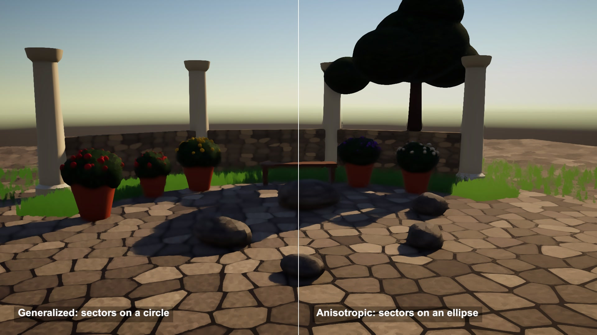

# Anisotropic Kuwahara filter

A sunlit courtyard turned into a painting by one post-process. The brush in this Kuwahara filter stretches along each edge, so the joints between the cobbles stay sharp while the texture melts.

## The problem

A blur removes detail but smears every edge. A painted look needs flat patches of colour inside a shape and a clean border between shapes.

## How it works

This follows Garrett Gunnell's Post-Processing shaders for Unity. All three versions look at the pixels around the current one and keep the colour of the calmest neighbourhood.

The basic filter splits the window into 4 overlapping squares, measures the mean and the variance of each, and outputs the mean of the square with the lowest variance. Next to an edge, one square sits fully on one side, so the edge survives.

The generalized filter uses 8 sectors on a disc with smooth weights. Each sector mean counts by 1 / (1 + (1000 x hardness x variance)^(sharpness / 2)), so sectors blend instead of one winning.

The anisotropic filter first finds the local direction. Sobel gradients build a structure tensor, a Gaussian blur smooths it, and its eigenvector gives the edge angle. Anisotropy A = (l1 - l2) / (l1 + l2) stretches the disc into an ellipse with radii r(1 + A) along the edge and r / (1 + A) across it. The strokes now follow the edges.

## What I hit

The basic shader's kernel size is a radius. The other two take a diameter. To compare them at the same 10 px radius I ran basic at 10 and the others at 20.

My first courtyard was too clean: flat colours left the filter nothing to remove, and both halves of the split looked the same. I added grain to the stones and leaf textures to the plants.

The anisotropy is close to 1 almost everywhere, even in faint noise, because any gradient has a direction. For the debug view I multiply it by the edge strength from the unblurred tensor.

## My build

Unity 6.3 with URP on an Apple M4 Mac mini, Metal. The source runs in OnRenderImage, which URP never calls. I render the scene camera into a texture, run the same chain of full-screen passes from LateUpdate, and a second camera shows the result.

The three filter shaders are unchanged. Sharpness 8, hardness 8, zero crossing 0.58, 8 sectors (fixed in the source).

Reads per pixel at radius 10: basic 4 x 121 = 484. Generalized 441, each added to 8 sector sums. Anisotropic 12 for the gradients, 2 x 11 for the blur, then about 314 inside the ellipse.

Anisotropic is 4 passes for one filter run. The last section repeats the filter up to 3 times.

## Trade-offs

Cost grows with the square of the radius.

Each frame is filtered on its own. Nothing ties a stroke to the surface, so fine texture can crawl when the camera moves.

Detail smaller than the radius is gone: thin lines and text turn into blobs.

UI has to be drawn after it.

## When to use it

A painted look for stills, menus, photo modes and cut-scenes. Scale the radius with the output resolution, or the strokes change size.

## Credits

Technique source: Post-Processing by Garrett Gunnell, https://github.com/GarrettGunnell/Post-Processing, commit 871a7ffcc44174f237b4c0127db51026c438d7a4, MIT License, Copyright (c) 2022 Garrett Gunnell. Its three Kuwahara filter shaders (basic, generalized, anisotropic) are used unchanged, and the full-screen pass chains and parameter values from their C# scripts are ported to Unity's Universal Render Pipeline. The repo's other effects, scenes and assets are not used.

Engine: Unity 6.3 LTS (6000.3.28f1) with the Universal Render Pipeline 17.3. Used for rendering. It is not the source of the technique.

My own code: the URP port of the pass chain, the split-screen display, the structure tensor debug view, the courtyard built from code with generated stone and leaf textures, the timeline, labels and video.

No external models or assets.

## Files

- `AnisotropicKuwahara.shader`
- `Editor/BuildScene.cs`
- `GeneralizedKuwahara.shader`
- `Kuwahara.shader`
- `KuwaharaCompose.shader`
- `KuwaharaDirector.cs`
- `TensorView.shader`

## Build the scene

In the Unity editor: **Vidar Game Lab > Techniques**, then **Build** next to `anisotropic-kuwahara`. From the command line: `tools/capture.sh anisotropic-kuwahara GameTech.Posts.KuwaharaScene.Build`.
