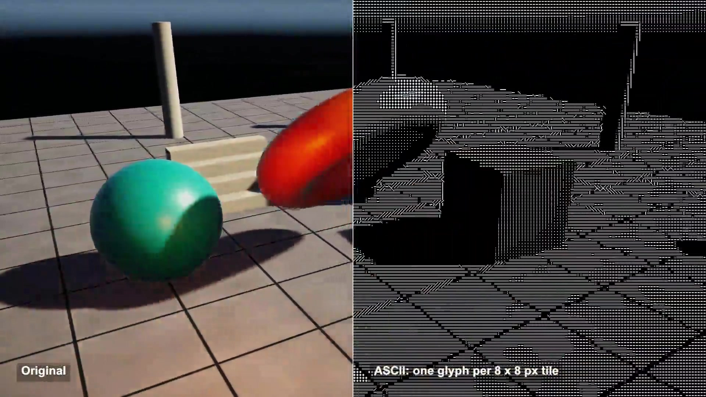

# ASCII render

Every 8 x 8 pixel tile of this scene becomes one character. Brightness picks the glyph, and an edge pass draws | - / \ along the outlines so the shapes still read.

## The problem

Mapping brightness to characters is easy. On its own it turns a scene into grey noise, because a tile only knows how bright it is, not where the shape ends. Outlines are what make ASCII art readable.

## How it works

This follows Garrett Gunnell's Post-Processing shaders for Unity.

Fill: the image is halved three times with point sampling, so each 8 x 8 tile gets one colour and one luminance (0.299 R + 0.587 G + 0.114 B). The luminance picks 1 of 10 glyphs from a small atlas, darkest to brightest.

Edges: two Gaussian blurs of the luminance (sigma 2 and 3.2) are subtracted, and anything above 0.005 becomes an edge pixel. A Sobel pass on that mask gives each pixel an angle, rounded to 4 directions.

A compute pass runs one 8 x 8 thread group per tile. The 64 threads vote on a direction, and if at least 8 pixels agree, the tile draws the edge glyph for that direction instead of the fill glyph.

Colour: each glyph can be tinted by its tile colour.

## What I hit

The effect reads linear colour (the source project is set to linear too), so in my scene the midtones came out dark and most tiles picked a blank glyph. The source has an attenuation exponent on the luminance; I set it to 1 / 2.2, close to display brightness.

Small bugs in the source, fixed and marked in the code: pixels with no edge vote into bucket -1; the dispatch used the width for both axes (240 x 240 groups for a 240 x 135 tile grid); the edge glyph rows were flipped and one row off; and a Sobel weight read 3 + lum instead of 3 x lum.

The colour tint was commented out in the source. Here it is a switch.

## My build

Unity 6.3 with URP on an Apple M4 Mac mini, Metal. OnRenderImage does not run in URP, so I render the camera into a texture and run the same chain from LateUpdate: 9 full-screen passes and 1 compute dispatch.

At 1920 x 1080 that is 240 x 135 = 32,400 glyphs. Running the chain at 960 x 540 and scaling up 2x gives 16 px tiles, 120 x 68 glyphs.

I drew the glyphs myself as 8 x 8 bitmaps. Ink pixels per fill glyph: 0, 4, 8, 12, 16, 20, 26, 28, 32, 34. The 5-glyph version reuses every other glyph.

## Trade-offs

Resolution drops to one value per tile. Anything smaller than 8 px survives only as an edge glyph, or not at all.

Edges get misclassified: the vote only keeps the most common of 4 directions, so curves turn into runs of | and -, and floor lines in perspective flip between horizontal and diagonal from tile to tile. Texture and shadow borders become outlines too.

One point sample per tile means glyphs can flicker as the camera moves.

## When to use it

A terminal or retro mode, a photo mode filter, menu backgrounds. Keep the tile size fixed in pixels and draw the UI after it.

## Credits

Technique source: Post-Processing by Garrett Gunnell, https://github.com/GarrettGunnell/Post-Processing, commit 871a7ffcc44174f237b4c0127db51026c438d7a4, MIT License, Copyright (c) 2022 Garrett Gunnell. Its ASCII effect is used: the image-effect shader (luminance, difference of Gaussians, Sobel, pack and downscale passes) and the compute shader that picks one glyph per 8 x 8 tile, copied with small changes marked in the code, and the pass chain and parameter values from its C# script, ported to Unity's Universal Render Pipeline. The repo's glyph texture files and its other effects, scenes and assets are not used.

Engine: Unity 6.3 LTS (6000.3.28f1) with the Universal Render Pipeline 17.3. Used for rendering. It is not the source of the technique.

My own code: the URP port of the pass chain, the 8 x 8 glyph bitmaps and atlases, the colour switch, the split-screen display, the scene built from code, the timeline, labels and video.

No external models, fonts or assets.

## Files

- `ASCII.compute`
- `ASCII.shader`
- `AsciiCompose.shader`
- `AsciiDirector.cs`
- `Editor/BuildScene.cs`

## Build the scene

In the Unity editor: **Vidar Game Lab > Techniques**, then **Build** next to `ascii-render`. From the command line: `tools/capture.sh ascii-render GameTech.Posts.AsciiScene.Build`.
