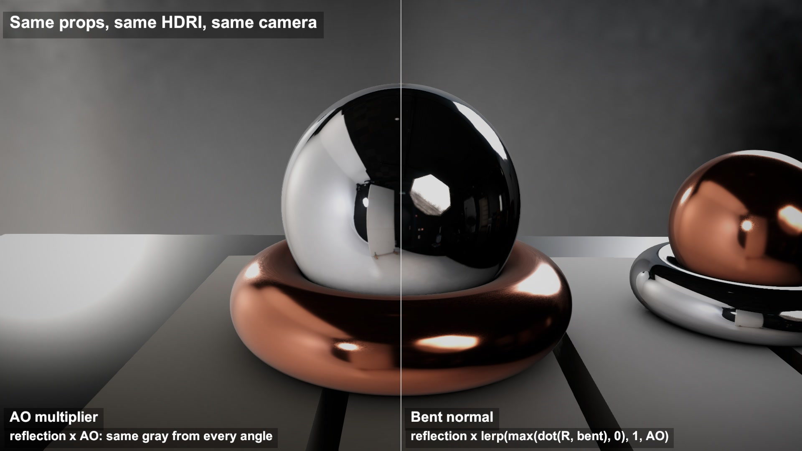

# Bent Normal and AO Baking

Same chrome, same copper, same studio. Left: AO darkens every reflection by the same amount from every angle. Right: a baked bent normal decides which reflections can still get out.

## The problem

A baked AO map stores one number per point: how much of the sky it can see. Multiply reflections by it and a crevice gets darker, but always the same gray, whatever direction you look from. Reflections are directional. A point deep in a gap can be blocked toward the wall and wide open toward the opening.

## How it works

This follows Felix Westin's open-source BNAO baker for Unity.

1. Every texel of the texture stores its surface position and normal.

2. Pick 1024 directions spread evenly over the sphere. For each one, render a depth view of the props from that side.

3. Each texel checks: is anything in front of me in this direction? Directions behind its own surface count as blocked.

4. AO = the share of directions it can see. Bent normal = the average of the directions it can see: it points where the point is most open.

5. When shading, sample the ambient light along the bent normal and scale the reflection by how well the reflection direction lines up with it: lerp(max(dot(R, bent), 0), 1, AO).

Where AO is 1 nothing changes. In a crevice, a reflection pointing out of the gap stays bright and one pointing into the wall goes dark.

## What I hit

The source is an editor window on the built-in pipeline that saves PNGs. I run the same bake at start in Unity 6.3 URP with a compute pass, and store bent normals in world space because the props never move.

It needs unwrapped UVs with no overlaps. The props are built from parametric surfaces, each with its own place in one atlas, so the position and normal of every texel come straight from the shape.

My first prop was a row of flat chrome fins. Flat mirrors just showed flat gray, so the difference was hard to read. Spheres resting on rings work much better.

## My build

Unity 6.3 URP. Studio HDRI from Poly Haven (CC0) as a 256 px cubemap, no lights.

Atlas 2048 x 2048, 496 texels per metre, 64% used. 27 surfaces, 76,598 vertices.

1024 directions, 2048 px depth views, baked in about 1.1 s on the GPU at start.

The bake includes every prop, so the ring darkens the sphere above it and the sphere darkens the ring.

Left side: reflection and ambient both multiplied by AO. Right side: the bent normal version. Same shader otherwise.

## Trade-offs

Static only: move a prop and the bake is wrong.

Two extra texture channels per surface, and unique UVs.

The dot product is a rough guess at the open cone, not a real visibility test, so it never darkens more than AO alone.

Nearby surfaces block the reflection but are not reflected: the blocked part goes dark instead of showing the other object.

## When to use it

Static props with metal or glossy parts, lit by probes or a cubemap: crevices, bowls, bolted panels, jewellery. Cheap at runtime: one texture read and a dot product.

## Credits

Technique source: Fewes/BNAO, https://github.com/Fewes/BNAO, commit bb5dc55fd7fe456dbbb87e82af08938eedb429ce. License: MIT, Copyright (c) 2019 Felix Westin.

Code reused: yes, ported. The bake follows the source's BNAO editor tool and shaders: evenly spread directions on the sphere (PointsOnSphere), one orthographic depth view per direction, a per-texel visibility test with directions clamped to the hemisphere, AO as the visible share divided by the AO bias 0.5, and the bent normal as the normalised sum of visible directions. The shading follows the source's Shader Implementation Example (ambient along the bent normal, reflection occlusion lerp(max(dot(R, bentNormal), 0), 1, AO)). Changed for Unity 6.3 URP: the bake runs at start with a compute pass instead of the editor window, the position/normal cache is filled from the procedural shapes, and the result stays on the GPU in world space.

Environment map: "Studio Small 09" by Poly Haven, https://polyhaven.com/a/studio_small_09, CC0.

Engine: Unity 6.3 LTS, Universal Render Pipeline.

My own code: the procedural props and their UV atlas, the split-screen comparison, cameras and labels.

## Files

- `BNDirector.cs`
- `BNGeometry.cs`
- `Editor/BuildScene.cs`
- `Shaders/BNBake.compute`
- `Shaders/BNComposite.shader`
- `Shaders/BNDepth.shader`
- `Shaders/BNLit.shader`
- `Shaders/BNSky.shader`

## Build the scene

In the Unity editor: **Vidar Game Lab > Techniques**, then **Build** next to `bent-normal-ao`. From the command line: `tools/capture.sh bent-normal-ao GameTech.Posts.BNScene.Build`.
