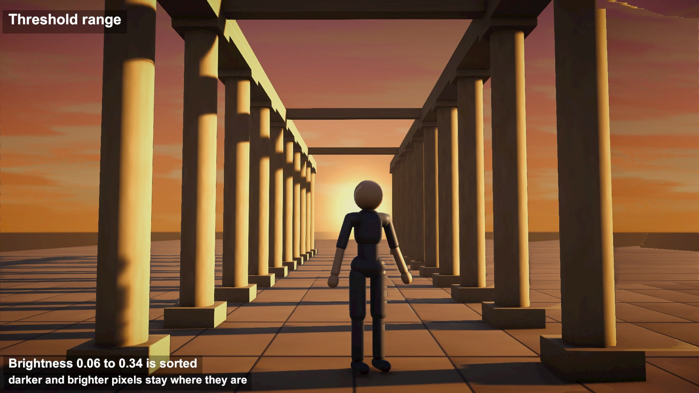

# Bitonic Pixel Sort on the GPU

Every row of this frame gets re-sorted by brightness on the GPU, every frame. Only pixels inside a brightness window move, so the scene stays readable while lit edges smear into streaks.

## The problem

Pixel sorting is a glitch-art look: pick the pixels in a brightness range and reorder them along a row or column. Done on the CPU it is a still-image filter. To run it on a live game frame you have to sort thousands of rows of up to 2048 pixels, every frame, without stalling the GPU.

## How it works

This uses ruccho's BitonicPixelSorter, an open-source compute shader for Unity.

1. One thread group handles one whole row (or column). The row is loaded into shared memory as packed keys: brightness in the low 16 bits, original pixel index in the high 16.

2. Each pixel is marked in or out of the threshold window. Two prefix scans across the group find where every in-range run starts and ends.

3. A bitonic sorting network runs inside each run. Bitonic sort is a fixed pattern of compare-and-swap steps, so every thread does the same work and no thread waits on another's data.

4. The sorted keys only carry indices, so the last step copies the original colours to their new places.

Pixels outside the window act as walls: runs never cross them.

## What I hit

My first scene was a back-lit silhouette. The sort ran, about a third of the pixels moved, and you could not see it: a run of near-identical orange sky looks the same in any order. Pixel sorting needs runs with real variation inside them, so I relit the scene with a side sun that puts bright faces and dark shadows on every column.

The shader reads the camera image as linear values, so the thresholds below are linear brightness.

The source ships a URP renderer feature. My capture renders cameras by hand, so I call the same compute shader with the same parameters from a script instead.

## My build

Unity 6.3 URP. A procedural stone colonnade, a low sun from the side, a stand-in mannequin.

The scene renders to a texture, the unmodified compute shader sorts it, and a full-screen quad shows original and sorted halves.

Rows, ascending, window 0.06 to 0.60. The threshold shot sweeps the top of the window from 0.10 to 1.00. Then rows vs columns with the same window.

1920 px rows fit the shader's default 2048-pixel variant. No GPU timings measured.

## Trade-offs

Shared memory caps a line at 4096 pixels.

The window is the whole look: too narrow and nothing visibly moves, too wide and the image dissolves.

Runs are sorted per frame with no history, so moving edges shimmer.

## When to use it

Music videos, title screens, damage or glitch moments, stylised flashbacks. Drive the window from gameplay so it opens when something breaks.

## Credits

Technique source: ruccho/BitonicPixelSorter, https://github.com/ruccho/BitonicPixelSorter, commit 70ebaa3a5d13af119ab275c8059ab92d0017b1ba. License: MIT, Copyright (c) 2020 ruccho.

Code reused: yes. The sorting compute shader (BitonicPixelSorter.compute) is copied unmodified. The dispatch follows the source's BitonicPixelSorter.Execute: one thread group per line, the 4096 keyword above 2048 pixels, the same direction, ordering and threshold parameters. The source's URP renderer feature is not used; my script calls the shader on the scene camera's texture.

Engine: Unity 6.3 LTS, Universal Render Pipeline.

My own code: the procedural colonnade, textures and sky, the scene-to-texture and display setup, the split and threshold animation, cameras, lighting and labels. The figure is a plain stand-in mannequin built in code.

No external models or assets.

## Files

- `Compute/BitonicPixelSorter.compute`
- `Editor/BuildScene.cs`
- `PixelSortDirector.cs`
- `Shaders/SortComposite.shader`

## Build the scene

In the Unity editor: **Vidar Game Lab > Techniques**, then **Build** next to `bitonic-pixel-sort`. From the command line: `tools/capture.sh bitonic-pixel-sort GameTech.Posts.PixelSortScene.Build`.
