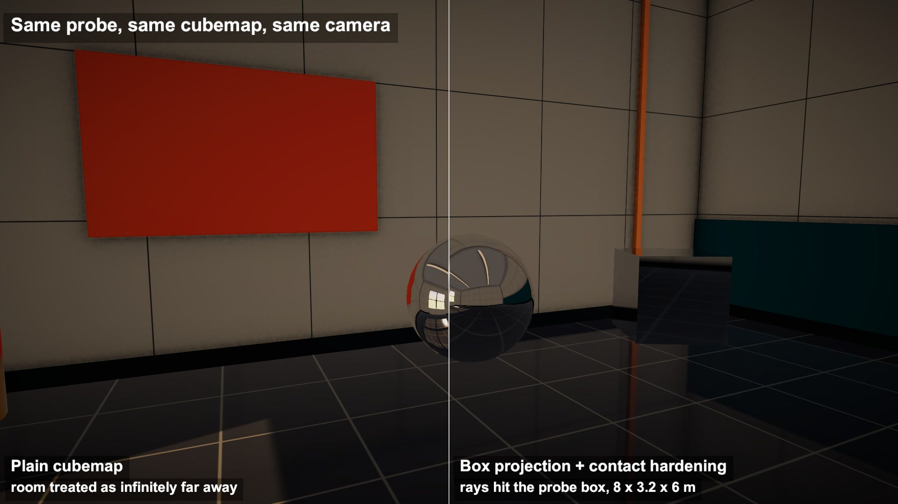

# Improved Box-Projected Reflections

One cubemap, one room. Left: the reflection treats the room as if it were infinitely far away, so the window lands in the wrong place on the chrome. Right: the same cubemap, projected onto the room's box.

## The problem

A reflection probe takes one 360-degree snapshot of a room from one point. A plain cubemap lookup only uses the reflection direction, so every surface sees the room as if it were at infinity. That works for a distant sky. Indoors, near a wall, the reflections slide around and line up with nothing.

## How it works

This follows frostbone25's open-source improved box projection for Unity.

1. Box projection: the probe gets a box that matches the room. Each pixel shoots its reflection ray from its own position to that box, finds where it hits the wall, and looks up the cubemap in the direction of that hit point as seen from the probe. Now the reflected wall sits where the real wall is.

2. Contact hardening: the same intersection gives a distance. A normal lookup uses one blur level per material. Here the blur level drops when the reflected wall is close, so reflections get sharper near contact and softer further away, closer to what a ray tracer would show. It is a cheap hand-tuned approximation, clamped as in the source.

The mip-level view near the end shows the difference: one flat blur level on the left, a gradient that follows distance on the right.

## What I hit

The source is a built-in pipeline shader. I moved the projection and mip maths into a URP shader and kept URP's own lighting for the rest.

Baking the probe from a batch build gave me an empty cubemap, so the probe is rendered once at start from its position, with the props hidden like a baked probe would see the room.

A texture helper I used for the tiles used Unity's SmoothStep, which is an interpolation, not GLSL smoothstep. The whole wall came out as one seam colour.

## My build

Unity 6.3 URP. Room and probe box 8 x 3.2 x 6 m, probe in the middle at 1.6 m.

Cubemap 256 px, 9 mips. The mips are box-filtered, not GGX-filtered.

Floor smoothness 0.9, chrome sphere 0.96, steel block 0.93, gold column 0.9.

Low sun through a window, two ceiling light strips, one warm wall strip.

No GPU timings measured.

## Trade-offs

It is only right for box-shaped rooms. Columns, alcoves and furniture are not in the box, so their reflections still drift.

The cubemap is from one point. Things behind objects from the probe's view are missing.

Contact hardening is an approximation tuned by eye. It does not stretch reflections the way real rough surfaces do.

Objects that move need the probe to be re-rendered.

## When to use it

Interiors: corridors, rooms, garages, anywhere with walls close to shiny floors and props.

Mobile and low-end targets where screen-space or ray-traced reflections are too expensive.

As the fallback under screen-space reflections, so the off-screen part still lines up.

## Credits

Technique source: frostbone25/Unity-Improved-Box-Projected-Reflections, https://github.com/frostbone25/Unity-Improved-Box-Projected-Reflections, commit 435915eb9019bb56a25accd05296f948e869d251. License: MIT, Copyright (c) 2023 David Matos.

Code reused: yes, ported. The box projection (Unity's default box-projected cubemap direction, extended to return the hit distance) and the "approximated" contact hardening (mip level scaled by the clamped hit distance) follow the source's shader and include files. Changed for Unity 6.3 URP: the maths sits in a URP shader that uses URP's own BRDF, shadows and ambient for everything except the probe lookup, and the probe is rendered once at start instead of baked.

Engine: Unity 6.3 LTS, Universal Render Pipeline.

My own code: the room, window, light strips and props built in code, the tile and wall-panel textures, the probe capture, the sky behind the window, the split-screen and mip view, cameras, lighting and labels.

No external models or assets.

## Files

- `BoxDirector.cs`
- `Editor/BuildScene.cs`
- `Shaders/BoxComposite.shader`
- `Shaders/BoxReflect.shader`
- `Shaders/BoxSky.shader`

## Build the scene

In the Unity editor: **Vidar Game Lab > Techniques**, then **Build** next to `box-projected-reflections`. From the command line: `tools/capture.sh box-projected-reflections GameTech.Posts.BoxScene.Build`.
