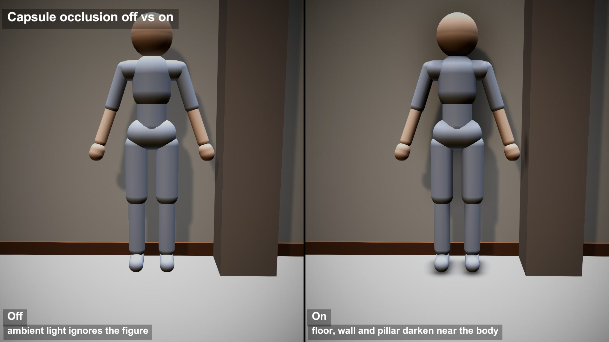

# Capsule occlusion

No shadow map, no screen-space AO. The soft darkening on the wall and floor around this figure comes from 18 capsules on its bones, evaluated analytically per pixel in Unity URP.

## The problem

In shade there is no sun shadow, and a character looks pasted onto the floor. Screen-space AO needs a depth pass and only knows what is on screen, which is awkward in forward rendering with MSAA. Baked AO cannot follow anything that moves.

## How it works

This is a port of Fewes' CapsuleOcclusion. The body is approximated by capsules attached to its bones.

1. For a shaded point, find the closest point on a capsule's axis. Call the vector from there to the point d.

2. That capsule's occlusion is -dot(d, normal) x r³ / |d|⁴. Close, thick capsules in front of the surface occlude a lot. A surface facing away gets zero, so the figure can take occlusion from its own capsules without darkening itself everywhere.

3. Fade each term to zero about 4 radii out, add them up, and multiply the ambient light by 1 / (1 + 10 x sum).

4. Clusters. The view is cut into 64 x 64 x 32 cells, and each cell keeps a list of the capsules that can reach it. A pixel only loops over its own cell's list.

## What I hit

The package hooks a camera callback that URP never calls, and its preferred clustering pass writes buffers from a fragment shader. I moved the work into URP's per-camera begin event and used the package's other path, a compute shader.

That compute path built its lists with atomics on 3D integer textures. Each thread owns one cell anyway, so I build the list in registers and write it once to a plain buffer. It also stops writing at the end of the buffer, which the source lists as a known bug.

For the lookup I compute the cell from the world position and the same camera matrix the cells were built from. Screen UVs flip on some platforms, and a flipped lookup reads another cell's list.

## My build

Unity 6.3 URP, my own small lit shader: main light with shadows, plus spherical-harmonics ambient multiplied by the occlusion.

18 capsules, the same ones the stand-in figure is built from.

Source defaults: intensity 10, range 4 radii, 64 x 64 x 32 cells. I cut the cluster range from 50 m to 12 m to fit the room.

Cluster buffers: 17 MB per camera. Capsule entries in the cells: about 9,000 to 68,000 per frame, depending on how much of the frame the figure fills.

Ambient factor, same formula on the CPU: floor under the standing figure 0.52, wall right behind its back 0.30, floor half a metre away 1.00.

No frame times measured.

## Trade-offs

It is an approximation: capsules only stand in for the body, and the terms are summed, so overlapping capsules can darken more than one solid body would.

It only darkens ambient light. Direct light still needs a shadow map.

The cell lists have a fixed size, and the camera range has to be set by hand.

## When to use it

Characters in forward or mobile pipelines, shaded or overcast scenes, anywhere SSAO does not fit.

## Credits

Technique source: Fewes/CapsuleOcclusion, https://github.com/Fewes/CapsuleOcclusion, commit 1c144323cbf3e602ed1a8c01613894a663c6092a. License: MIT, Copyright (c) 2024 Felix Westin.

Code reused: yes. The capsule component (gathering, culling, sorting, parameter arrays), the occlusion and debug-colour shader functions, the cluster helpers and the compute clustering kernel are the source's code, with marked changes: clusters are stored in a 1D buffer instead of 3D integer textures, the compute kernel builds each cell's list without texture atomics and stops at the end of the data buffer, and cluster positions are signed and range-checked. The source's camera component is replaced by my URP version of it (same steps, run from URP's per-camera begin event, compute path only). The rasterized clustering pass, the source's mesh and material are not used. The source credits Inigo Quilez for the capsule intersection and occlusion functions and Noah Zuo for the segment distance function; those functions are included in the source files used here.

Engine: Unity 6.3 LTS, Universal Render Pipeline.

My own code: the URP camera component, the lit shader that applies the occlusion to ambient light, the per-camera comparison switches, the scene, the stand-in mannequin's capsules and motion, the comparison layout and labels.

No external models or assets. Character: a stand-in mannequin built from code.

## Files

- `CapsuleDirector.cs`
- `CapsuleOcclusion/CapsuleOcclusion.compute`
- `CapsuleOcclusion/CapsuleOcclusion.hlsl`
- `CapsuleOcclusion/CapsuleOcclusionBuildClusters.hlsl`
- `CapsuleOcclusion/CapsuleOcclusionShared.hlsl`
- `CapsuleOcclusion/CapsuleOcclusionURP.cs`
- `CapsuleOcclusion/LICENSE.txt`
- `CapsuleOcclusion/OcclusionCapsule.cs`
- `CapsuleOcclusion/ShaderIDs.cs`
- `CapsuleOcclusion/Utils.cs`
- `Editor/BuildScene.cs`
- `Shaders/CapsuleLit.shader`

## Build the scene

In the Unity editor: **Vidar Game Lab > Techniques**, then **Build** next to `capsule-occlusion`. From the command line: `tools/capture.sh capsule-occlusion GameTech.Posts.CapsuleScene.Build`.
