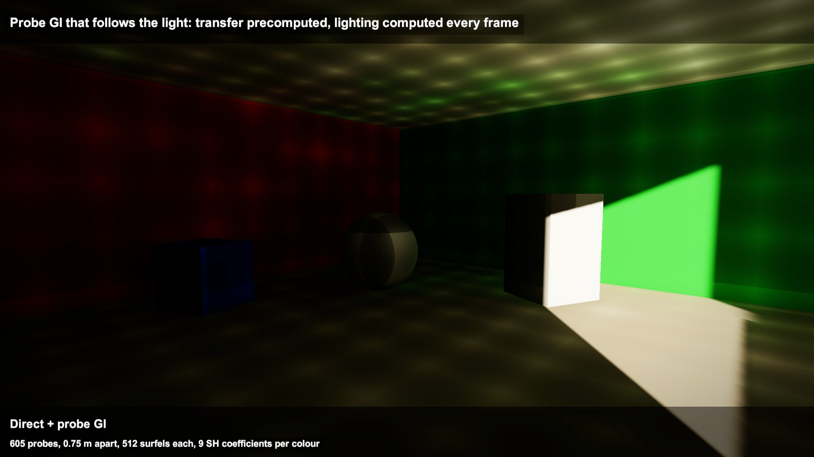

# Casual PRT

Move the sun and the red and green bounce light follows in the same frame. Nothing is baked: each probe stores what it sees, and only the lighting is redone every frame.

## The problem

Baked lightmaps give soft colour bleeding, but they freeze it. Move the sun or change its colour and the bounce stays where it was. Screen-space or voxel GI follows the light, but traces the scene again every frame.

## How it works

This follows AKGWSB's CasualPRT, a light take on precomputed radiance transfer.

1. A grid of probes fills the room. Once, at load, each probe looks in 512 random directions and stores what it sees in each: a surfel with position, normal and colour, or open sky.

2. Every frame, a compute shader lights those surfels with the current sun (colour, angle, shadow) plus the previous frame's probe light, which gives further bounces.

3. It folds the 512 results into 9 spherical harmonics coefficients per colour channel, per probe.

4. Each pixel blends its 8 nearest probes, weighted by how much each one faces the surface, and adds that as indirect light.

## What I hit

The source relights inside URP's frame and reads URP's sun shadow map. In Unity 6 I dispatch it from a script, so the sun direction, colour and a per-surfel shadow (one ray toward the sun) come from the script. The SH projection and bounce feedback are the source's code.

One GI strength drives both the final image and the bounce feedback. At 6 the coarse grid ran away to white; I use 3.5.

Probes close to a wall print a soft grid of dots on it, because each probe's weight depends on how directly it faces the surface. Keeping them 25 cm off the walls softened it.

## My build

Unity 6.3, URP, Apple M4 Mac mini, Metal. The source's SH, relight and G-buffer shaders.

A room built from code: 8 x 8 x 3.3 m, red and green walls, a window, a white sphere and block, a blue cube. One sun, no ambient, nothing baked.

Fine grid: 605 probes, 0.75 m apart. Coarse: 32 probes, 2.5 m apart. 512 surfels per probe; capturing them all took 0.19 s.

Measured on the video frames:

Direct light only: 90% of the frame is near black. With probe GI: 30-37%.

As the sun moves from the green wall to the red one, the ceiling's red/green ratio climbs from 1.11 to 1.85 with GI relit every frame, and stays at 1.06-1.10 with GI frozen.

When the sun turns orange, green in the indirect light drops from 21 to 2 (of 255).

No frame times measured.

## Trade-offs

Geometry is frozen into the probes: move a wall and they must be captured again.

Only one main light is relit, as in the source.

Probe spacing sets the detail: coarse grids smear the bounce, fine grids cost memory and compute.

There is no visibility test between probe and pixel, so light can leak through thin walls.

## When to use it

Interiors and levels with static geometry and a moving or changing sun: time-of-day cycles, weather, a sunset.

## Credits

Technique source: CasualPRT by AKGWSB, https://github.com/AKGWSB/CasualPRT, commit ac5e3217d231fce6360e76e8e234d54c2b213f01. License: MIT (the repository's LICENSE.md; its copyright line is the unfilled template "Copyright (c) [year] [fullname]"). Used: the SH functions and probe-volume lookup (SH.hlsl) and the world-position and normal G-buffer shaders, unchanged; the surfel relight compute shader with its light and shadow inputs changed to script parameters; the probe grid layout, surfel format, direction sampling and the composite's per-pixel lookup, rewritten for Unity 6.

Engine: Unity 6.3 LTS (6000.3.28f1) with the Universal Render Pipeline 17.3. Used for rendering, compute dispatch and physics ray casts. It is not the source of the technique.

My own code: the room and props built from code, the ray-cast surfel capture, the per-surfel sun shadow rays, the script that runs the relight and the composite, the frozen-GI and probe-spacing comparisons, the band compositor, the timeline, labels and video.

No external models or assets.

## Files

- `Editor/BuildScene.cs`
- `PRTCompose.shader`
- `PRTComposite.shader`
- `PRTDirector.cs`
- `Shaders/GbufferNormal.shader`
- `Shaders/GbufferWorldPos.shader`
- `Shaders/SH.hlsl`
- `Shaders/SurfelReLightCS.compute`

## Build the scene

In the Unity editor: **Vidar Game Lab > Techniques**, then **Build** next to `casual-prt`. From the command line: `tools/capture.sh casual-prt GameTech.Posts.PRTScene.Build`.
