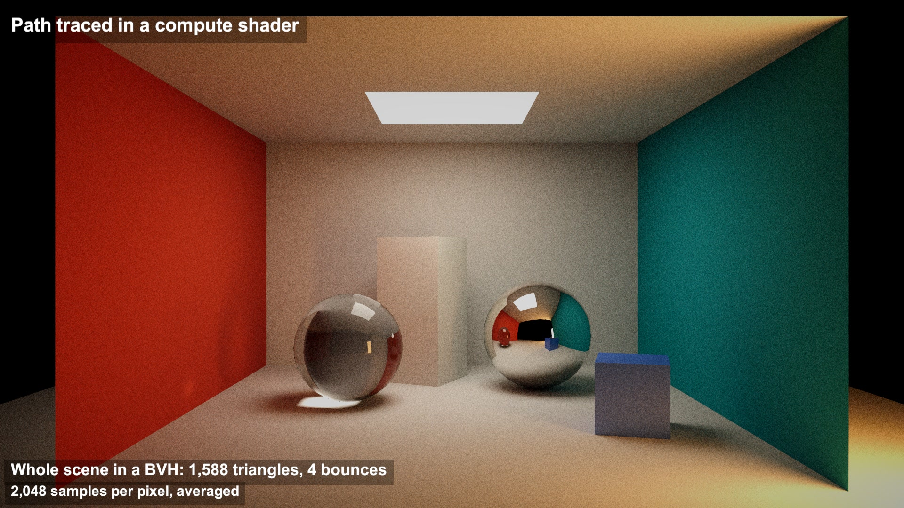

# Compute Path Tracer

Same room, same camera. Left: Unity's normal raster lighting with shadow maps and a reflection probe. Right: every ray of light traced through the whole scene on the GPU.

## The problem

Raster rendering fakes most of what light does. Shadows come from maps, reflections from a probe captured once, and light bouncing off a red wall onto the floor needs extra systems. Screen-space tricks only know what is on screen, so anything outside the frame is invisible to them.

## How it works

This follows Sebastian Lague's open-source Ray-Tracing project for Unity.

1. Every pixel shoots a ray into the scene.

2. A bounding volume hierarchy (boxes inside boxes) finds the closest triangle fast.

3. At the hit, the ray picks a new direction: random for matte surfaces, mirrored for shiny ones, reflected or refracted by the Fresnel equations for glass.

4. Up to 4 bounces. Any light-emitting surface it hits adds light, tinted by every surface on the way.

5. One random path per pixel per frame is pure noise. Averaging thousands of frames gives the clean image.

Soft shadows, colour bleeding from the walls, the bright spot under the glass ball and the reflections all come out of that one loop.

## What I hit

The source's structs use float3 fields. I padded everything to float4 so the GPU buffers line up on Metal.

The scene never moves, so I store triangles in world space and skip the per-object matrices.

My first lamp outside the frame was too weak to see. At 4x the brightness its orange light clearly reaches the room.

Single-sided walls let light leak in from outside, so the right wall and ceiling got an outer face.

## My build

Unity 6.3 URP, one compute shader. 13 objects, 1,588 triangles, 3,127 BVH nodes.

Source settings: 4 bounces, 1 ray per pixel, small jitter for anti-aliasing.

One sample at 1920 x 1080 takes about 23 ms on an Apple M4 Mac mini (Metal, GPU timed waiting for the result). The clean frames are 2,048 samples, about 48 s each.

The raster side uses the same meshes with URP materials, a point light, a spot light at the hidden lamp and a reflection probe.

## Trade-offs

Thousands of samples per frame is offline speed. Real-time path tracing needs denoisers, temporal reuse and hardware ray tracing.

The camera has to stay still for the average to build up.

No textures, no sky and no denoiser in this version.

## When to use it

Reference images to check your real-time lighting against, baked lightmaps, product shots, and learning what light actually does.

## Credits

Technique source: SebLague/Ray-Tracing, https://github.com/SebLague/Ray-Tracing, commit e8981eae5e4bc392070a6fdbc7e1a74e295c86fa. License: MIT, Copyright (c) 2023 Sebastian Lague.

Code reused: yes, ported to one Unity compute shader. From the repo's ray tracing shader code (RayCommon.hlsl and the ray tracing shader): the PCG random numbers, camera ray with jitter, the Trace loop with up to 4 bounces, diffuse / specular mix by specular probability and smoothness, glass with Fresnel reflect or refract and absorption, Russian roulette, the BVH stack traversal, ray-triangle and ray-box tests, and the running average of samples. From BVH.cs: the surface area heuristic BVH build (split tests per axis, cost = half surface area x triangle count, max depth 32).

My own code: the room scene and materials, the orange lamp placed outside the camera view, the raster comparison (URP lights, shadows and reflection probe), buffer structs padded to float4, triangles stored in world space, sample timing, split-screen comparison and labels.

Engine: Unity 6.3 LTS, Universal Render Pipeline.

No external models, textures or images.

## Files

- `Editor/BuildScene.cs`
- `PTBVH.cs`
- `PTDirector.cs`
- `PTObject.cs`
- `Shaders/PTComposite.shader`
- `Shaders/PathTrace.compute`

## Build the scene

In the Unity editor: **Vidar Game Lab > Techniques**, then **Build** next to `compute-path-tracer`. From the command line: `tools/capture.sh compute-path-tracer GameTech.Posts.PTScene.Build`.
