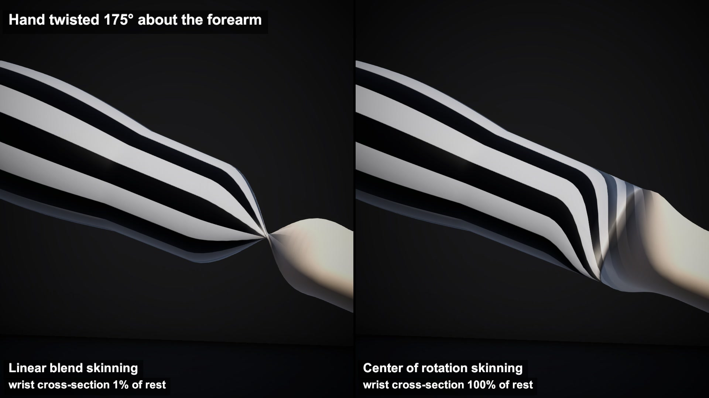

# CoR Skinning

Twist a hand 175° and linear blend skinning pinches the wrist to 1% of its cross-section. Center of rotation skinning keeps 100%, same bones and weights. The fix: one point per vertex, computed once.

## The problem

Most characters are skinned by blending bone matrices with per-vertex weights. Where two bones share a vertex, the blended matrix isn't a rotation any more. Twist a wrist and the vertices halfway between forearm and hand meet in the middle: the candy wrapper. Bend an elbow far and the joint thins out. Rigs patch this with twist bones and corrective shapes.

## How it works

This follows Milk-Drinker01's CoR-Skinning.

1. Precompute, once per mesh: for every vertex, look at all triangles and score how similar their bone weights are to the vertex's own. The vertex's center of rotation is the area and similarity weighted average of those triangle centres.

2. At runtime, per vertex: blend the bone rotations as quaternions into one rotation, move the center of rotation with ordinary linear blending, then rotate the vertex about that moved centre.

3. A vertex bound to one bone has no centre and gets plain linear blending.

It is not dual quaternion skinning: the key is the precomputed centre per vertex.

## What I hit

The source targets the built-in pipeline with a Shader Graph material. In URP I wrote a shader that reads the skinned positions and normals from the compute output by vertex id, shadow pass included.

The precompute kernel took its buffers as entry-point parameters. On Metal I made them globals and added a bounds check.

The source has one global CoR weight. I made it per figure, so the left side is the same kernel at weight 0. At weight 0 every measurement matches linear blending exactly.

My stand-in mannequin is rigid capsules, so nothing blends. I built arms as continuous tubes with blended weights at shoulder, elbow and wrist.

## My build

Unity 6.3, URP 17.3, Metal on an M4 Mac mini. 1920x1080, 30 fps.

Figure: 18,170 vertices, 34,720 triangles, 17 bones. 5,166 arm vertices have blended weights and get a centre.

Precompute on the GPU in the editor: 93 ms, kernel width 0.1.

Measured on the skinned vertices, read back every frame, left arm vs rest pose:

Hand twisted 175°: wrist cross-section 1% (linear) vs 100% (CoR).

Elbow bent 150°: elbow cross-section 26% vs 100%, arm volume 96% vs 99.5%.

Elbow 115° plus 170° twist: arm volume 94% vs 99.8%.

No frame times measured.

## Trade-offs

The precompute compares every vertex with every triangle. Fast on a GPU, slow on a CPU for big meshes, and it reruns when weights change.

One extra point per vertex in memory, plus a quaternion blend per vertex.

Normals are still blended linearly in this version.

It keeps volume, not anatomy: no skin sliding, no muscle bulge.

## When to use it

Characters with painted weights at shoulders, elbows, wrists and hips, especially twisting limbs, when you'd rather not add twist bones or corrective shapes.

## Credits

Technique source: CoR-Skinning by Milk-Drinker01, https://github.com/Milk-Drinker01/CoR-Skinning, commit a25a9a07921effd1e6b1b0a77b27d951153cf15c. License: MIT, Copyright (c) 2022 Milk-Drinker01. Used: the precompute scripts (CorAsset, BWeight, TWeight, CSSimilarity) and the two compute shaders (similarity precompute and CoR skinning), with small changes for Metal; the runtime buffer setup and GPU skinning logic ported into one component per figure.

Engine: Unity 6.3 LTS (6000.3.28f1) with the Universal Render Pipeline 17.3. It is the renderer, not the source of the technique.

My own code: the URP shader that draws the skinned output, the procedural figure with blended arm weights (based on my stand-in mannequin), the poses, the cross-section and volume measurements, cameras, labels and video.

No external models or assets.

## Files

- `CoR/BWeight.cs`
- `CoR/CSSimilarity.cs`
- `CoR/CorAsset.cs`
- `CoR/CorGpuSkinner.cs`
- `CoR/LICENSE.txt`
- `CoR/Resources/CorSimilarity.compute`
- `CoR/Resources/CorSkinning.compute`
- `CoR/TWeight.cs`
- `CorDirector.cs`
- `Editor/BuildScene.cs`
- `Shaders/CorFigure.shader`

## Build the scene

In the Unity editor: **Vidar Game Lab > Techniques**, then **Build** next to `cor-skinning`. From the command line: `tools/capture.sh cor-skinning GameTech.Posts.CorScene.Build`.
