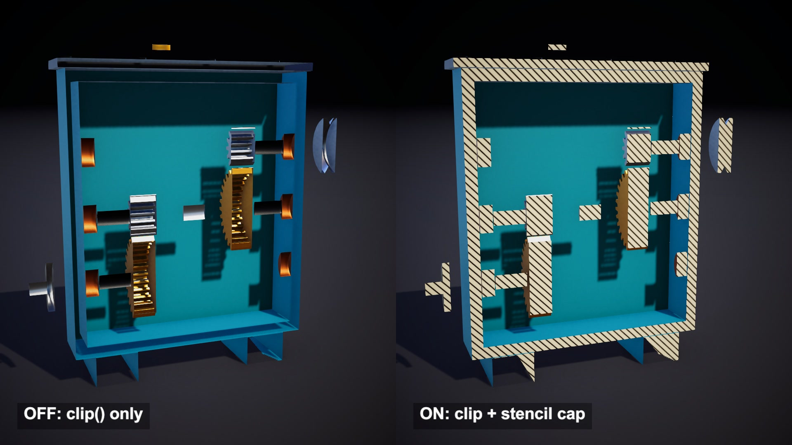

# Cross-section shader with solid, hatched caps

A plane slices a gearbox open and the cut faces look solid, hatched like an engineering drawing. The mesh is never edited: 19,252 triangles before and after.

## The problem

Discarding the pixels on one side of a plane takes one line in a fragment shader. But a mesh is a thin shell, so the cut shows the inside of that shell: hollow shafts and paper-thin walls. A real section view fills the cut.

## How it works

This follows Abdullah Aldandarawy's cross-section shaders for Unity. Each cut object draws twice. The front-face pass is lit as usual and writes 0 to the stencil buffer. The back-face pass writes 255. Both passes discard everything on the positive side of the plane and both are depth tested, so every pixel keeps the value of the nearest surviving surface. If that surface is a back face, the view ray entered the scene inside a solid.

Then one quad is placed on the plane and drawn with the stencil test Equal 255. It lands on exactly the pixels where a solid was opened. With three planes, a pixel is discarded only when it is in front of all three, which removes a corner.

## What I hit

In my first gearbox the parts touched: lid on housing, bearings on shafts. Where two parts share a surface, a front face and a back face sit at the same depth and the stencil value flips between them. The cap came out with torn stripes and a missing piece of the bottom wall. I left a 4 mm gap between all 30 parts and the cap came out clean.

The quad also has to face the removed side. Unity's quad faces its local negative Z, so that axis must point along the plane normal.

## My build

Unity 6.3 with URP, rendered on an Apple M4 Mac mini. The source targets the built-in pipeline with surface shaders, so I rewrote it in HLSL. The front pass is the forward lit pass and the back pass uses the unlit light mode, so URP draws both. The shadow pass uses the same discard, so the removed half casts no shadow. The hatching is procedural, 45 degree lines every 45 mm, where the source samples a texture. In three-plane mode each of the three quads is trimmed by the other two planes. One script sends the plane positions and normals to the shader as global vectors.

The gearbox is generated from code: 30 closed meshes, 16 and 32 tooth gears, a 4 to 1 reduction.

## Trade-offs

Every mesh must be closed. A hole in the mesh means missing back faces, and that part of the cut gets no cap. Solids that touch or intersect break the test, as above. All parts share one hatch pattern because the test checks a single stencil value. Each cut object is drawn twice. The cap is only a picture of a solid: collision and the mesh itself are unchanged.

## When to use it

Cutaway views of machines and buildings, or a section tool in an editor. If gameplay needs the cut geometry itself, use a mesh boolean.

## Credits

Technique source: Unity3DCrossSectionShader by Abdullah Aldandarawy (Dandarawy), https://github.com/Dandarawy/Unity3DCrossSectionShader, BSD-3-Clause license, Copyright (c) 2018 Abdullah Aldandarawy, commit d2cdae134eede1acee8b8689f8b97a35b1e93e8e. Rewritten for URP from its OnePlaneBSP, GenericThreePlanesBSP and StencilledUnlitTexture shaders and its plane controller scripts. The plane discard, the stencil values written by front and back faces, the flat back-face colour and the stencil-tested quad follow the source.

Engine: Unity 6.3 LTS (6000.3.28f1) with the Universal Render Pipeline 17.3. Used for rendering. It is not the source of the technique.

My own code: the URP shader passes, the procedural hatching, the trimming of the three cap quads, the procedural gearbox, the debug views, camera moves, labels and video. No external models or assets.

## Files

- `CrossSectionCap.shader`
- `CrossSectionDirector.cs`
- `CrossSectionLit.shader`
- `Editor/BuildScene.cs`
- `GearSpin.cs`
- `StencilOverlay.shader`

## Build the scene

In the Unity editor: **Vidar Game Lab > Techniques**, then **Build** next to `cross-section`. From the command line: `tools/capture.sh cross-section GameTech.Posts.CrossSection.Build`.
