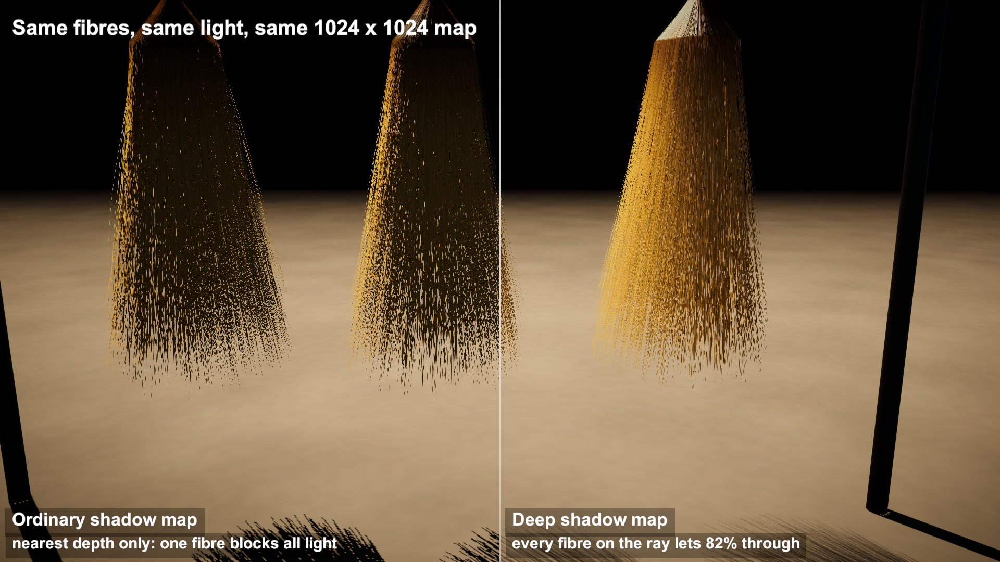

# Deep Shadow Maps

Same light, same 4,200 fibres. Left: an ordinary shadow map, where one fibre blocks all the light. Right: a deep shadow map, where light thins out fibre by fibre and the shadow turns soft.

## The problem

A normal shadow map stores one depth per texel: the first thing the light hits. Behind that, everything is in full shadow. That is right for walls and boxes. For hair, fur, fibres or smoke it is wrong: a single strand is mostly see-through, but the map treats it like a brick. Shadows come out as solid black blobs, and the inside of a hair volume goes black too.

## How it works

This follows ecidevilin's open-source deep shadow map for Unity, after the GPU Pro 4 real-time deep shadow maps chapter.

1. From the light, every fibre fragment is written into a list for its texel: its depth and how opaque it is. An atomic counter per texel gives each fragment a slot, up to 16 per texel here.

2. To shade a point, look up its texel and walk the list. Every fragment closer to the light than the point multiplies the light by (1 - opacity).

3. One fibre lets 82% through. Ten fibres let about 14% through. So the shadow gets darker the deeper you go, instead of switching off at the first fibre.

The same lookup shades the floor and the fibres themselves, so the inside of each tassel gets darker towards the core instead of going black.

## What I hit

The source is a built-in pipeline project that rasterizes the casters from the light. My casters are generated fibres, so a compute shader splats each fibre into the light's view as points about one texel apart, and skips a point that lands in the same texel as the one before. Otherwise one fibre would count several times.

The ordinary map on the left is built from the same splat: it only keeps the nearest depth per texel. Both sides use the same 2x2 filter, so the only difference is one depth vs the whole list.

## My build

Unity 6.3 URP. Map 1024 x 1024 texels, up to 16 fragments per texel, 128 MB for the fragment lists.

3 tassels x 1,400 fibres, 256 points per fibre, rebuilt and re-splatted every frame while they sway.

Fibre shading: tangent-based diffuse, two highlights and light passing through when back-lit.

No GPU timings measured.

## Trade-offs

Memory: a list per texel is many times the size of a normal shadow map.

The list has a cap. Past 16 fragments, the rest are dropped and the shadow comes out a little too light.

Fragments are not sorted, so every lookup walks the whole list, four times with filtering.

Opacity per fibre is a single number here; real hair varies.

## When to use it

Hair and fur close-ups, fibre-heavy props like tassels, brushes and grass clumps, thin smoke or foliage cards, anywhere solid shadows make soft things look like cardboard.

## Credits

Technique source: ecidevilin/DeepShadowMap, https://github.com/ecidevilin/DeepShadowMap, commit 3ce9a6a3bf2d728476ca54f05fe66b70f47b167b. License: MIT, Copyright (c) 2019 Khaos. The source cites GPU Pro 4, "Real-Time Deep Shadow Maps".

Code reused: yes, adapted. The per-texel fragment lists (atomic counter per texel, fixed number of (depth, opacity) slots) and the resolve (multiply 1 - opacity for every stored fragment closer to the light) follow the source's DeepShadowMap shader and resolve compute shader, and the fibre highlights follow its Kajiya-Kay shading. Changed for Unity 6.3 URP: fibres are splatted into the light's view by a compute shader instead of rasterized, the lookup runs per pixel in the fibre and floor shaders with a 2x2 filter instead of a screen-space resolve and blur, and an ordinary one-depth map is built from the same data for the comparison.

Engine: Unity 6.3 LTS, Universal Render Pipeline.

My own code: the fibre tassels generated on the GPU, the frame, floor and lighting, the split-screen and fragment-count view, cameras and labels.

No external models or assets.

## Files

- `DSMDirector.cs`
- `Editor/BuildScene.cs`
- `Resources/DSMFibres.compute`
- `Shaders/DSMCommon.hlsl`
- `Shaders/DSMComposite.shader`
- `Shaders/DSMFibre.shader`
- `Shaders/DSMGround.shader`

## Build the scene

In the Unity editor: **Vidar Game Lab > Techniques**, then **Build** next to `deep-shadow-map`. From the command line: `tools/capture.sh deep-shadow-map GameTech.Posts.DSMScene.Build`.
