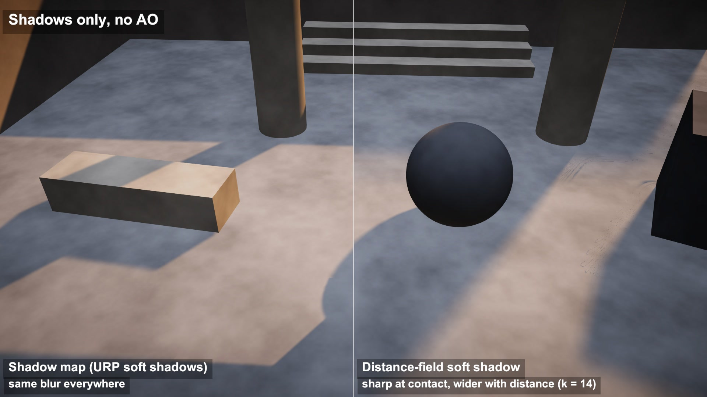

# Distance-field AO and soft shadows

Same courtyard, same sun. Left: a shadow map, no AO. Right: distance fields. Soft contact darkening under every prop, and shadows that start sharp and widen with distance.

## The problem

Shadow maps give every shadow the same blur, whether the caster touches the ground or floats a metre above it. Screen-space AO only knows what the camera sees, so a big object that leaves the frame stops darkening the floor next to it.

## How it works

This follows ZephyrL's open-source DFAO for Unity, which works on two levels of distance fields.

1. Each prop gets its own small signed distance field: every cell stores how far it is to the nearest surface.

2. A coarse global field covers the whole scene. Each cell takes the smallest distance from the props around it, so one lookup answers "how far to anything?".

3. AO: step a few times along the surface normal. If the field says a surface is closer than the distance travelled, that point is occluded.

4. Soft shadow: sphere-trace from the surface toward the sun. Each step jumps by the distance in the field. Keep the smallest ratio of "distance to geometry" over "distance travelled". A ray that grazes a prop far away gives a wide penumbra; near the contact it stays sharp.

None of this reads a shadow map or the depth buffer.

## What I hit

The source bakes the local fields with a bundled tool and evaluates AO as a full-screen pass. I baked the props' fields from their exact shapes at start and evaluate both terms in the surface shader.

Big fixed steps made banded penumbras. Clamping the step to 2-25 cm and estimating the closest approach between two samples fixed it. That estimate breaks when the previous step was shorter than the current distance, which turned the whole floor black for one build, so it falls back to the plain ratio there.

## My build

Unity 6.3 URP. 9 local fields of 48 x 48 x 48, baked in 121 ms on the CPU.

Global field 140 x 48 x 120 over 14 x 4.8 x 12 m, 10 cm cells, rebuilt every frame on the GPU because the boulder rolls.

AO: 5 samples, 10 cm apart. Shadow: up to 128 steps, softness k = 14.

Left side: URP soft shadow map. Same scene, same sun, same camera on both halves.

No GPU timings measured.

## Trade-offs

Only rigid props: a field is baked per shape, so skinned characters do not fit.

Detail is limited by cell size: thin things under 10 cm get soft or lost.

Many marching steps per pixel. Moving props mean field updates.

In exchange: soft shadows whose penumbra depends on distance, and AO from geometry the camera cannot see.

## When to use it

Static or slow-moving hard-surface scenes: architecture, rocks, ruins, props. Large outdoor areas where shadow-map cascades get blurry far away. Anywhere you want contact darkening that does not vanish at the screen edge.

## Credits

Technique source: ZephyrL/DFAO-unity, https://github.com/ZephyrL/DFAO-unity, commit 08040a7dbc2b59d5c7849df0a5f5259959b3cf24. License: MIT, Copyright (c) 2019 OUTBOUNDS. The repository bundles the SDFr distance-field baking tool (Assets/SDFr), covered by the same LICENSE.md.

Code reused: yes, ported. The global field build (smallest distance over the props' volumes, with the AABB distance outside a volume), the atlas lookup, the AO formula (steps along the normal) and the sphere-traced soft shadow follow GDFTexturing, GDFUpdate, GDFCameraScreenAO and GDFCameraRMAO. Changed for Unity 6.3 URP: the global field is built by a compute shader every frame, both terms are evaluated in the surface shader, and the soft shadow uses a clamped step with a closest-approach estimate. SDFr was not used for baking: the local fields are computed from the props' exact shapes.

No external models or assets.

Engine: Unity 6.3 LTS, Universal Render Pipeline.

My own code: the courtyard and props, the analytic field bake, the split-screen comparison, cameras and labels.

## Files

- `DFDirector.cs`
- `Editor/BuildScene.cs`
- `Shaders/DFBuild.compute`
- `Shaders/DFCommon.hlsl`
- `Shaders/DFComposite.shader`
- `Shaders/DFLit.shader`

## Build the scene

In the Unity editor: **Vidar Game Lab > Techniques**, then **Build** next to `dfao`. From the command line: `tools/capture.sh dfao GameTech.Posts.DFScene.Build`.
