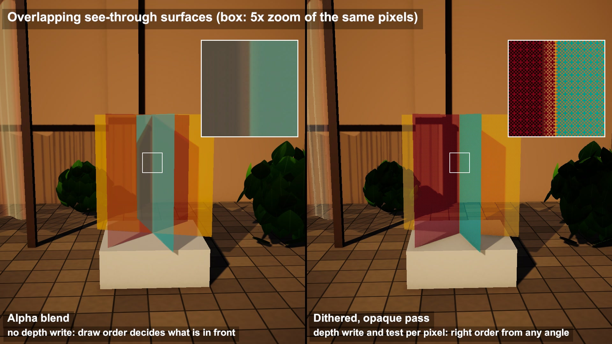

# Dithered Transparency

Transparent curtains, tinted glass and leaves, all drawn in Unity's opaque pass. Each pixel is kept or thrown away by alpha, so depth sorting stops mattering and shadows can see through too.

## The problem

Alpha blending needs surfaces drawn back to front and does not write depth. Unity sorts transparent objects one object at a time, so two panes that cut through each other cannot both be right, and triangles inside one mesh (curtain folds, leaf cards) draw in index order from every angle. The usual shadow pass treats them as solid or skips them.

## How it works

This follows gkjohnson's unity-dithered-transparency-shader, rewritten for URP.

1. The material stays opaque: depth write and depth test on.

2. Each pixel looks up a threshold from a pattern fixed to the screen: a 4x4 matrix of 16 values (1/17 to 16/17), or a tiled texture.

3. If alpha is below the threshold, the pixel is discarded. Alpha 0.55 keeps about 55% of the pixels; the gaps show whatever is behind.

4. The depth prepass and the shadow caster run the same test, so a surface at alpha 0.4 blocks roughly 40% of the sun.

5. The texture version centres the texture on screen and repeats it every N pixels.

## What I hit

In the source, the shadow pass calls the dither test with a screen position that its vertex shader never fills in. My shadow caster uses the shadow map pixel directly.

Two overlapping surfaces with the same alpha get the same threshold at each pixel, so the back one is kept exactly where the front one is. Two 55% panes still let 45% of the background through, where blending would leave about 20%.

Video compression smears a one-pixel pattern, so the comparison shots show the finished pixels 5x larger.

Soft shadow filtering averages the dithered shadow map into an even, lighter shadow.

## My build

Unity 6.3, URP 17.3, Forward+, Metal on an M4 Mac mini. My own URP shader with the source's two threshold functions ported to HLSL; PBR lighting instead of the source's vertex Lambert.

A courtyard built from code: two swaying sheer curtains (alpha 0.34 to 0.54), three intersecting tinted panes (alpha 0.55), leaf-card bushes, an urn that fades out.

Blue-noise texture from the repo, 470 x 470, point sampled: N = 470 gives one texel per pixel, N = 1880 gives four pixels per texel.

Sun shadow map 4096, 20 m shadow distance, soft shadows.

The wall behind the curtains (mean video luma, 0 to 255): lit 107, under the ordinary shadow pass 22, under the dithered shadow pass 85.

No frame times measured.

## Trade-offs

The pattern is visible up close and stays fixed to the screen while surfaces move under it. Games usually hide it with temporal anti-aliasing; this capture has no AA.

Only 17 levels with the matrix. Equal-alpha layers cover each other instead of adding up.

## When to use it

Fading out objects that block the camera, LOD cross-fades, foliage and fabric that must sort correctly and cast shadows, anywhere sorting errors look worse than grain.

## Credits

Technique source: unity-dithered-transparency-shader by gkjohnson (Garrett Johnson), https://github.com/gkjohnson/unity-dithered-transparency-shader, commit 238119a790a455d93adbabbca5bf547d666158a5. License: MIT, Copyright (c) 2017 Garrett Johnson. Used: the two dither threshold functions (4x4 matrix and tiling texture) from the dither functions include, ported to HLSL for URP, and the repo's blue-noise texture (unchanged). The repo's built-in pipeline shaders, Amplify and Shader Forge examples and its other two textures are not used.

Engine: Unity 6.3 LTS (6000.3.28f1) with the Universal Render Pipeline 17.3, Forward+. It is the renderer, not the source of the technique.

My own code: the URP dithered lit shader (lighting, shadow caster, depth passes), the alpha-blend comparison shader, the courtyard and its meshes and textures built from code, the per-camera dither settings, the 5x pixel zoom boxes, the timeline, labels and video.

No external models or assets.

## Files

- `BlendLit.shader`
- `DitherCommon.hlsl`
- `DitherDirector.cs`
- `DitheredLit.shader`
- `Editor/BuildScene.cs`
- `LICENSE-dither.txt`
- `Textures/blue-noise.png`
- `Zoom.shader`

## Build the scene

In the Unity editor: **Vidar Game Lab > Techniques**, then **Build** next to `dithered-transparency`. From the command line: `tools/capture.sh dithered-transparency GameTech.Posts.DitherScene.Build`.
