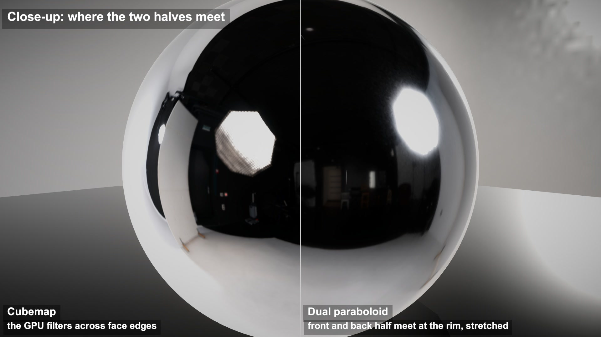

# Dual Paraboloid Reflections

Same studio, same chrome. Left: a cubemap, six square faces. Right: a dual paraboloid map, the whole world squeezed into two round images. 2 renders to update instead of 6. Look at the edge of the sphere.

## The problem

Shiny objects need a picture of everything around them. The standard answer is a cubemap: six square renders, one per direction. If that picture has to be updated live, for a moving car or a changing room, six renders every update is a lot.

## How it works

This follows 526077247's open-source dual paraboloid reflection mapping for Unity.

1. Split the world into a front half and a back half along one axis.

2. Each half is stored as one round image. A direction (x, y, z) lands at x / (1 + |z|), y / (1 + |z|): straight ahead is the centre, the sideways directions are the rim.

3. To shade, take the reflection direction, pick front or back by the sign of z, and read that image.

4. For rough surfaces the source keeps blurrier copies in the same atlas, 8 levels in a 4 x 4 grid, and blends between the two nearest levels.

So a live update is 2 renders instead of 6. The catch is that texels are not spread evenly: the centre of each half is sharp, the rim is stretched, and the two halves meet in a ring.

## What I hit

The source bakes a static cubemap into the atlas from an editor tool on the built-in pipeline. I bake the same atlas at start with the same mapping and read it from a URP shader.

At high resolution the two look almost the same, so I compared equal tile sizes: 256 x 256 per cube face and 256 x 256 per half. Then the rim of the paraboloid side is visibly softer.

In the close-up, the colour view shows the front half in orange and the back half in blue. The ring where they meet sits right next to the split line.

## My build

Unity 6.3 URP. Environment: a CC0 studio HDRI from Poly Haven, imported as a cubemap with 256 px faces and 9 mips.

Cubemap: 6 x 256 x 256 = 393k texels per level. Dual paraboloid: 2 x 256 x 256 = 131k texels per level, 1024 x 1024 atlas with 8 levels.

Chrome sphere smoothness 0.97, gold torus 0.94, brushed sphere 0.72 (that one reads the blurrier levels). Same shading code on both sides; only the lookup changes.

No GPU timings measured.

## Trade-offs

Uneven resolution: sharp at the centre of each half, stretched at the rim.

A seam ring where the halves meet, which can show up on mirror-like surfaces.

Linear interpolation across the rim is slightly wrong, because the mapping is curved.

In exchange: 2 renders per update instead of 6, and a plain 2D texture that works where cube textures are awkward.

## When to use it

Live reflections on hardware where six renders per probe are too expensive, rough or mostly-diffuse materials where the rim softness does not show, and point-light shadow maps (the same trick turns 6 shadow renders into 2).

## Credits

Technique source: 526077247/Dual-Paraboloid-Reflection-Mapping, https://github.com/526077247/Dual-Paraboloid-Reflection-Mapping, commit 50882185f787cb9dd589a52b057978f010cf4d8a. License: MIT, Copyright (c) 2023 大大的奥斯卡.

Code reused: yes, ported. The atlas layout (4 x 4 tiles, two LOD levels per row, back and front paraboloid per level), the bake from a cubemap and the lookup with LOD blending follow the source's DualParaboloidGenerate and DualParaboloid shaders. Changed for Unity 6.3 URP: the atlas is baked at start instead of by the editor tool, and the lookup sits in a URP shader that also has a cubemap path for the comparison.

Environment map: "Studio Small 09" by Poly Haven, https://polyhaven.com/a/studio_small_09, CC0.

Engine: Unity 6.3 LTS, Universal Render Pipeline.

My own code: the props, plinth and floor, the shared image-based shading, the split-screen and colour view, cameras and labels.

## Files

- `DPDirector.cs`
- `Editor/BuildScene.cs`
- `Shaders/DPComposite.shader`
- `Shaders/DPGenerate.shader`
- `Shaders/DPReflect.shader`
- `Shaders/DPSky.shader`

## Build the scene

In the Unity editor: **Vidar Game Lab > Techniques**, then **Build** next to `dual-paraboloid-reflections`. From the command line: `tools/capture.sh dual-paraboloid-reflections GameTech.Posts.DPScene.Build`.
