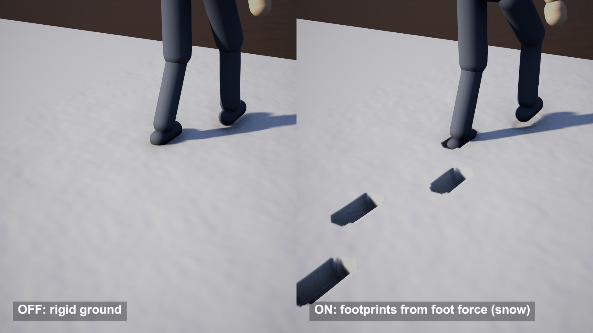

# Dynamic footprints from foot pressure

Footprints computed from force: body weight plus the impulse of each landing foot, pressed into a heightmap. Same walk, snow sinks 4.7 cm and dry sand 1.4 cm.

## The problem

A footprint decal is a stamp. It has the same shape and depth whoever walks and whatever the ground is made of. The foot also stays on the original surface, so the boot never sits inside its own print.

## How it works

This follows the Unity project by Eduardo Alvarado and co-authors for their paper "Real-Time Locomotion on Soft Grounds with Dynamic Footprints".

Each foot gets a force. One part is its share of the body weight. The other is a momentum term: its share of the mass times the foot's landing speed, divided by a characteristic time τ of the ground.

The heightmap cells under the sole are counted, which gives a contact area, and force over area gives pressure. Compression is linear: depth = pressure × 0.3 m / E, where E is Young's modulus and 0.3 m is the assumed thickness of the soft layer. The cells sink at depth / τ per second while the foot is down.

The Poisson ratio ν decides how much of the displaced volume moves sideways. A volume of 2ν × area × depth is spread over a ring of cells around the contact area and rises as a rim. Optional 3 x 3 Gaussian passes soften the print.

Leg IK then places the foot on the lowered cells.

## What I hit

Mud is softer than dry sand in the source presets, 350 kPa against 600 kPa, yet both prints came out 1.4 cm deep. Mud has τ = 0.8 s and my walk keeps a foot down for 0.6 s, so the foot lifts before the print reaches its 2.1 cm.

The source subtracts a full step while a cell is above its limit. At 30 fps with τ = 0.2 s one step is a sixth of the depth, and my first snow prints read up to 5.5 cm where the formula gives 4.7. I clamp the last step.

## My build

Unity 6.3 with URP, rendered on an Apple M4 Mac mini. The ground is my own heightfield mesh with 1.25 cm cells, about 250,000 samples, where the source edits a Unity Terrain. The contact shape comes from the triangles of the character mesh within 3.5 cm of its lowest point, 170 cm² per boot. The source raycasts against foot colliders.

There are no animation clips. The walk is procedural: feet planted in world space, two-bone IK, 40 kg at 0.7 m/s. Weight moves linearly from one foot to the other during double support, where the source reads the animator. E, τ, ν and the blur passes are the source presets for snow, mud and dry sand. Rim on or off per strip is my choice. The balance controller from the paper is not in my build.

## Trade-offs

Every contact cell sinks by the same amount, so the print has a flat floor and the heel-to-toe roll leaves no trace. The print only grows while the foot is down. Detail is limited by cell size: one boot covers 109 cells here.

## When to use it

Snow, sand or mud where characters of different weight should leave different tracks. For shallow marks on hard ground a decal is enough.

## Credits

Technique source: unity-footprints by Eduardo Alvarado (edualvarado), https://github.com/edualvarado/unity-footprints, MIT license, Copyright (c) 2021 Eduardo Alvarado, commit 8a7396dedd3ed25582c30d98f0c067f7dcddcd79. It is the code for the paper "Real-Time Locomotion on Soft Grounds with Dynamic Footprints" by Eduardo Alvarado, Chloé Paliard, Damien Rohmer and Marie-Paule Cani (Frontiers in Virtual Reality, 2022). Rewritten from its DeformTerrainMaster and PhysicalFootprint scripts: the force model (weight share plus momentum force), contact area from heightmap cells, pressure, linear compression with Young's modulus, the Poisson ring volume, the per-frame brush and the 3 x 3 Gaussian filter, with the preset values for snow, mud and dry sand. Its characters, animations, terrains and balance controller are not used.

Engine: Unity 6.3 LTS (6000.3.28f1) with the Universal Render Pipeline 17.3. Used for rendering. It is not the source of the technique.

My own code: the heightfield mesh, the sole contact shape taken from the character mesh, the procedural walk and leg IK, the debug overlay, camera moves, labels and video. No textures or other external assets.

## Files

- `Editor/BuildScene.cs`
- `FootWalker.cs`
- `FootprintDirector.cs`
- `SoftGround.cs`

## Build the scene

In the Unity editor: **Vidar Game Lab > Techniques**, then **Build** next to `dynamic-footprints`. From the command line: `tools/capture.sh dynamic-footprints GameTech.Posts.FootprintScene.Build`.

The character in the video is not included in this repository. Without it the scene builds a simple stand-in mannequin. To use your own model, see the main README.
