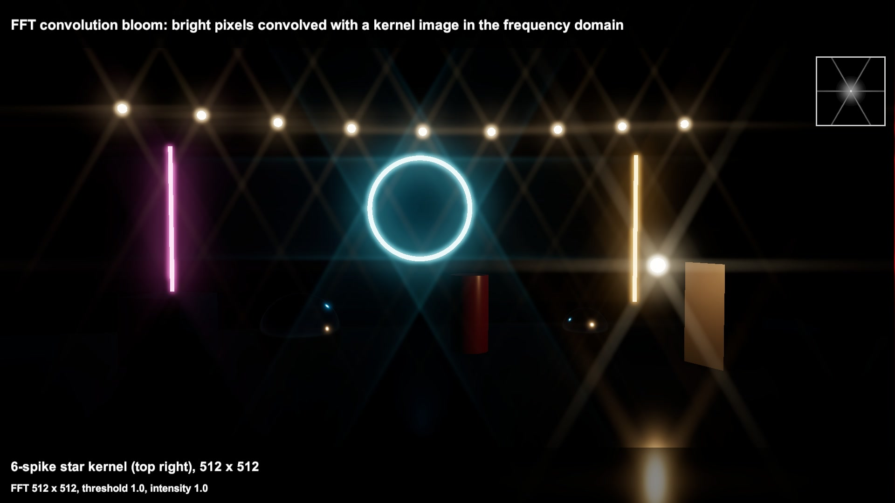

# FFT Convolution Bloom

Bloom that takes any shape you draw: turn the bright pixels and a kernel image into frequencies with an FFT, multiply them, and turn the result back. Stars, crosses or a soft glow cost the same.

## The problem

Usual bloom blurs a chain of half-size copies of the frame and adds them back. It is cheap, but the glow can only be round and soft. Star glints and long streaks need a convolution with a big kernel, and done pixel by pixel that grows with the kernel's area.

## How it works

This follows AKGWSB's FFT convolution bloom for URP.

1. Keep the pixels above the threshold and shrink the frame into a 512 x 512 texture (the image fills 512 x 288).

2. Shift the kernel image so its centre sits in the corner.

3. 2D FFT of both: 512 row FFTs, then 512 column FFTs, two colour channels packed into one complex FFT.

4. Multiply the two spectra, one complex multiply per frequency.

5. Inverse FFT, stretch back to the frame and add it.

A convolution in pixels is a plain multiply in frequencies, so the kernel can be as large as the texture.

## What I hit

With a kernel that sums to 1, only 0.0020 of the bright light came back. The FFT pair scales the result by 1/512. I scale every kernel to sum to 512. Measured after that: 14107.1 in, 14107.1 out.

The shaders read the frame size from the screen size. Run as plain blits into a 512 x 512 texture, that size is 512 x 512, so I pass the frame size in.

The source flips the image upside down when it reads the camera. In my chain the glow lines up without it, so I left it out.

The image fills the full width, so there is no empty margin left and right. Light near one edge wraps around to the other.

## My build

Unity 6.3 with URP on an Apple M4 Mac mini, Metal. The compute shader is the source's, unchanged.

The scene renders without post-processing into a half-float texture, the FFT bloom is added, then ACES tonemapping.

Three kernels drawn in code: glow, cross (4 spikes) and star (6 spikes), each 512 x 512. Threshold 1.0, intensity 1.0.

URP's own Bloom for comparison: threshold 1.0, intensity 1, scatter 0.7, same ACES.

Kernel scale 0.5 / 1 / 2 with intensity 4 / 1 / 0.25, so the total light stays the same.

I did not measure frame times.

## Trade-offs

The cost is fixed: a big kernel costs the same as a small one, and that fixed cost is higher than a mip-chain blur.

The glow is computed at 512 x 288, so fine detail in it is lost.

Without a margin, light can wrap around the edges.

The kernel's FFT is redone every frame. It only needs redoing when the kernel changes.

## When to use it

Star glints on lights, lens-like streaks, stylised glare in cut-scenes and photo modes. Keep the mip-chain bloom when a round soft glow is all you need.

## Credits

Technique source: FFTConvolutionBloom by AKGWSB, https://github.com/AKGWSB/FFTConvolutionBloom, commit 3be9c3c19d58437295d633e2f4f341866e083779, MIT License (the licence file's copyright line is the unfilled template "Copyright (c) [year] [fullname]"; the repository author is AKGWSB). Used: the FFT compute shader and its common include (copied unchanged), the source generate, kernel generate and final blit shaders (copied with changes marked in the code: names, sampler lines, the frame size passed in instead of the screen size, the vertical flip made optional), and the convolution bloom render pass with its settings and defaults (ported to a script-driven chain of blits and compute dispatches). The repo's README images and project settings are not used; the repo ships no kernel image, so the kernels are my own.

Engine: Unity 6.3 LTS (6000.3.28f1) with the Universal Render Pipeline 17.3. Used for rendering, and its built-in Bloom for the comparison. It is not the source of the technique.

My own code: the three procedural kernels (glow, cross, star) and their scaling, the energy check, the band compositor with ACES and kernel previews, the scene built from code, the timeline, labels and video.

No external models or assets.

## Files

- `Editor/BuildScene.cs`
- `FFTBloomChain.cs`
- `FFTBloomCompose.shader`
- `FFTBloomDirector.cs`
- `FFTBloomFinal.shader`
- `FFTBloomKernel.shader`
- `FFTBloomKernels.cs`
- `FFTBloomSource.shader`
- `FFTCS.compute`
- `FFTCommon.hlsl`

## Build the scene

In the Unity editor: **Vidar Game Lab > Techniques**, then **Build** next to `fft-convolution-bloom`. From the command line: `tools/capture.sh fft-convolution-bloom GameTech.Posts.FFTBloomScene.Build`.
