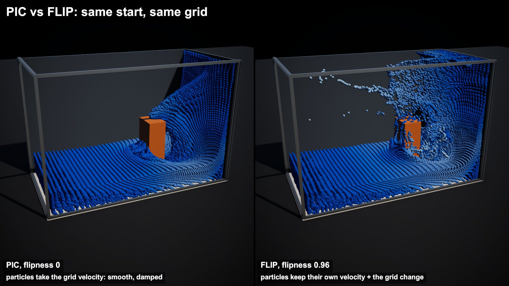

# FLIP Fluid: PIC vs FLIP

Same water, same grid, one number changed. Flipness 0: the wave rolls in smooth and dies down. Flipness 0.96: it slams the pillar and keeps spraying. FLIP fluid, 126,000 particles, Unity URP.

## The problem

Particles carry liquid well: they never smear and splashes keep their shape. Grids do the hard part: a pressure solve that keeps the flow incompressible. FLIP uses both, passing velocity back and forth every step. The catch is how that velocity comes back to the particles.

## How it works

This is a port of abecombe's FLIP-Fluid-for-Unity compute passes. Each step:

1. Sort particles into grid cells and splat their velocity onto a staggered grid (fluid, air and solid cells marked).

2. Gravity on the grid.

3. Pressure projection: divergence, then Jacobi iterations, then subtract the pressure gradient.

4. Grid back to particles. PIC copies the new grid velocity. FLIP keeps the particle's own velocity and adds only the change the grid made. Flipness blends the two: 0 is pure PIC, 1 is pure FLIP.

5. Move the particles through the grid velocity.

6. Density projection: a second solve that nudges particles apart where they bunch up, so the volume does not drift.

Not SPH (no particle-to-particle forces), not a smoke grid (the liquid lives on the particles).

## What I hit

The source runs in HDRP with VFX Graph. I kept the solver passes and parameters, dropped the UI panel and mouse force, and wrote a URP shader that draws one sphere per particle.

Absolute include paths broke every compute shader once the folder moved; relative paths fixed it.

The box area had no obstacles. I added a solid pillar through the source's own solid-cell hooks; zero particles ended up inside it in any logged frame.

At flipness 0.96 a few particles never calm down. They keep flying and touch the lid of the domain for the whole run. That is FLIP noise.

## My build

Unity 6.3 URP. Domain 12 x 8 x 6 units, the source's gravity 9.8 and time step 1/60, 2 steps per video frame.

High: grid 60x40x30, 126,000 particles. Low: grid 30x20x15, 17,160 particles. 15 pressure and 30 density iterations.

Mean particle speed 6 s after release: PIC 0.65, FLIP 1.49 units/s. Fastest particle: 2.9 vs 10.7.

Low vs high grid 5 s in: fastest particle 5.7 vs 12.1.

Main buffers about 17.7 MiB (high). The whole 780-frame capture run (three simulations, editor start, encode) took 51 s on an M4 Mac mini. No frame times measured.

## Trade-offs

PIC is stable and smooth but acts like thick liquid: each transfer averages motion away. FLIP keeps energy and small swirls but adds noise and stray drops. The source scene uses 0.96.

Halving the cell size here means 8x the cells and 7x the particles.

Spheres are not a water surface; that needs surface reconstruction, not done here.

## When to use it

Big splashy volumes: tanks, pours, dam breaks, waves on obstacles. For small droplets or many moving bodies, SPH or position-based fluids fit better. Raise flipness for energy, lower it when noise matters.

## Credits

Technique source: abecombe/FLIP-Fluid-for-Unity, https://github.com/abecombe/FLIP-Fluid-for-Unity, commit e9fc5837e6770eb75e65f2a4805458b2726991b4. License: Apache-2.0 (the repository's LICENSE leaves the copyright line as the unfilled template; credit goes to the repository and its GitHub owner, abecombe). No NOTICE file in the source.

Code reused: yes. The simulation compute shaders (particle to grid, external force, viscosity, pressure projection, grid to particle with flipness, advection, density projection, rendering prep), the grid sort helper and the bundled GPU utility and radix sort packages are the source's code, with marked changes: relative include paths and an optional static box obstacle for the cube area. The simulation driver is my port of the source's FLIPSimulation script: same buffers, passes, order and parameter values, without the HDRP/VFX Graph rendering, UI panel, FPS helpers and mouse force. The source's comments credit dli/fluid for the external force step and the 2019 TVCG paper on implicit density projection (RWTH Aachen) for the density projection.

Engine: Unity 6.3 LTS, Universal Render Pipeline.

My own code: the URP instanced particle shader, the box domain and pillar setup, the tank scene, the three side-by-side simulations and cameras, the comparison layout and labels.

No external models or assets. Character: none.

## Files

- `Editor/BuildScene.cs`
- `FLIP/ComputeShaders/Bit.hlsl`
- `FLIP/ComputeShaders/Constant.hlsl`
- `FLIP/ComputeShaders/GridData.hlsl`
- `FLIP/ComputeShaders/GridHelper.hlsl`
- `FLIP/ComputeShaders/Hash.hlsl`
- `FLIP/ComputeShaders/SharedMemoryUtil.hlsl`
- `FLIP/ComputeShaders/Simulation/BoundaryCondition.hlsl`
- `FLIP/ComputeShaders/Simulation/Common.hlsl`
- `FLIP/ComputeShaders/Simulation/FLIPParticle.hlsl`
- `FLIP/ComputeShaders/Simulation/GridParamsSampling.hlsl`
- `FLIP/ComputeShaders/Simulation/GridType.hlsl`
- `FLIP/ComputeShaders/Simulation/KernelFunc.hlsl`
- `FLIP/ComputeShaders/Simulation/Obstacle.hlsl`
- `FLIP/ComputeShaders/Simulation/Resources/DensityProjectionCS.compute`
- `FLIP/ComputeShaders/Simulation/Resources/DiffusionCS.compute`
- `FLIP/ComputeShaders/Simulation/Resources/ExternalForceCS.compute`
- `FLIP/ComputeShaders/Simulation/Resources/GridToParticleCS.compute`
- `FLIP/ComputeShaders/Simulation/Resources/ParticleAdvectionCS.compute`
- `FLIP/ComputeShaders/Simulation/Resources/ParticleInitCS.compute`
- `FLIP/ComputeShaders/Simulation/Resources/ParticleToGridCS.compute`
- `FLIP/ComputeShaders/Simulation/Resources/PressureProjectionCS.compute`
- `FLIP/ComputeShaders/Simulation/Resources/RenderingCS.compute`
- `FLIP/ComputeShaders/Sort/GridSortHelper.hlsl`
- `FLIP/ComputeShaders/Sort/Resources/GridSortHelperCS.compute`
- `FLIP/LICENSE.txt`
- `FLIP/Packages/GPUBufferOperators/GPUFiltering.cs`
- `FLIP/Packages/GPUBufferOperators/GPUFiltering.hlsl`
- `FLIP/Packages/GPUBufferOperators/GPUPrefixScan.cs`
- `FLIP/Packages/GPUBufferOperators/GPUPrefixScan.hlsl`
- `FLIP/Packages/GPUBufferOperators/GPURadixSort.cs`
- `FLIP/Packages/GPUBufferOperators/GPURadixSort.hlsl`
- `FLIP/Packages/GPUBufferOperators/Resources/FilteringCS.compute`
- `FLIP/Packages/GPUBufferOperators/Resources/PrefixScanCS.compute`
- `FLIP/Packages/GPUBufferOperators/Resources/RadixSortCS.compute`
- `FLIP/Packages/GPUUtil/DispatchHelper.hlsl`
- `FLIP/Packages/GPUUtil/GPUUtil.cs`
- `FLIP/Packages/GPUUtil/Resources/GPUUtil.compute`
- `FLIP/Scripts/Sort/GridSortHelper.cs`
- `FLIPDirector.cs`
- `FLIPFluid.cs`
- `Shaders/FLIPParticle.shader`

## Build the scene

In the Unity editor: **Vidar Game Lab > Techniques**, then **Build** next to `flip-fluid`. From the command line: `tools/capture.sh flip-fluid GameTech.Posts.FLIPScene.Build`.
