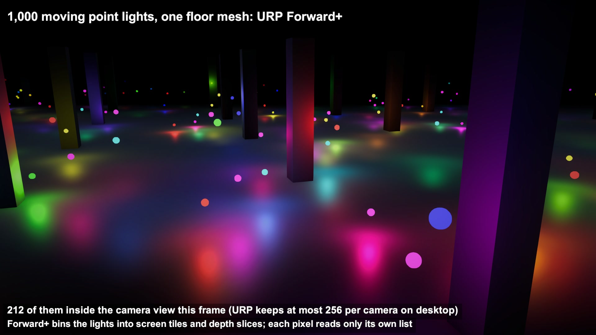

# URP Forward vs Forward+ with 1,000 lights

1,000 moving lights over one floor. Classic Forward lights that floor with 8 of them. Forward+ lights it with all of them.

Same Unity scene, one renderer setting changed.

## The problem

Classic forward rendering picks a short light list per object, because the shader loops over that list for every pixel of the object. URP caps it at 8. A big floor is one object, so 8 lights win and the other hundred-plus in view vanish from it.

## How it works

This is URP's own Forward+ in Unity 6.3 (URP 17.3). I read its C# and shader source; nothing is copied.

1. Each frame, jobs on the CPU find each visible light's depth range.

2. Depth bins: view depth is split into bins (log2 spaced for a perspective camera), each storing which lights reach it.

3. Screen tiles: the screen is cut into tiles, each with a bitmask of lights whose volume overlaps it.

4. In the shader, a pixel takes its tile mask AND its depth bin mask and loops only over those lights.

So there is no per-object list at all. The floor gets whatever lights touch each pixel.

## What I hit

URP keeps at most 256 visible lights per camera on desktop in both paths. My first camera saw 270-296 lights, so I shortened the view distance (30 m, with fog) to stay at about 200.

The tile size is not fixed: URP starts at 8 px and doubles it until the tile masks fit a fixed buffer. With about 200 lights at 1080p that lands on 32 px tiles.

The project's URP asset had a per-object limit of 4. I set it to 8, URP's maximum, so Forward gets its best case.

## My build

A 80 x 80 m plaza, one floor mesh, 169 pillars, 1,000 point lights (range 3.5 m, no shadows) moving on small circles, glowing markers.

Split 1: same camera, Forward vs Forward+.

Split 2: the old fix for Forward, the floor cut into 1,600 tiles of 2 m, vs Forward+ on the single floor.

The scene builder adds a Forward copy of the renderer, so both paths render in the same frame.

## Trade-offs

Forward+ pays for the light binning every frame and reads a light mask per pixel; for scenes with a handful of lights, plain Forward is simpler.

Cutting meshes for Forward works, but it multiplies objects (1,600 instead of 1) and lights still pop when the top 8 change.

Frame times were not measured for this video.

## When to use it

Many small dynamic lights: neon streets, festivals, spell effects, muzzle flashes. Turn Forward+ on in the URP renderer before you start cutting floors into pieces.

## Credits

Technique source: Unity's Universal Render Pipeline, Forward+ rendering path, as shipped in Unity 6.3 LTS (com.unity.render-pipelines.universal 17.3.0). Source: Unity-Technologies/Graphics, https://github.com/Unity-Technologies/Graphics. License: Unity Companion License (the source stays inside Unity; none of it is copied into this project).

Code reused: none. I read URP's ForwardLights.cs (light min/max depth, z-binning and tiling jobs), UniversalRenderPipeline.cs (256 visible additional lights on desktop, 8 per object) and the light loop in the shader library to describe it correctly. The rendering in the video is URP itself.

My own code: the plaza scene builder (floor, tiled floor copy, pillars, 1,000 lights and markers), the step that adds a Forward copy of the renderer and sets the per-object limit to 8, light motion, the visible-light count, cameras and labels.

Engine: Unity 6.3 LTS, Universal Render Pipeline 17.3, Metal.

No external models, textures or images.

## Files

- `Editor/BuildScene.cs`
- `ManyLightsDirector.cs`

## Build the scene

In the Unity editor: **Vidar Game Lab > Techniques**, then **Build** next to `forward-plus-many-lights`. From the command line: `tools/capture.sh forward-plus-many-lights GameTech.Posts.ManyLightsScene.Build`.
