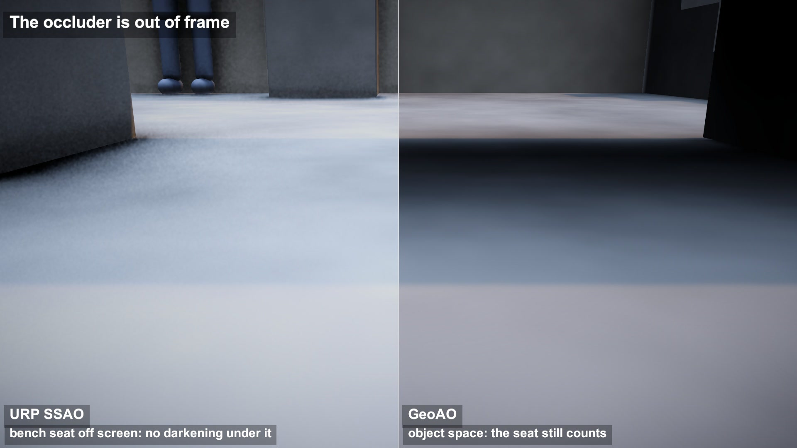

# GeoAO: Vertex Ambient Occlusion

Left: screen-space AO. Right: AO baked into every vertex. The bench seat is just above the frame, so SSAO never sees it and the floor under it stays lit. The vertex version still knows the seat is there.

## The problem

Ambient occlusion darkens the places sky light cannot reach: under a bench, in a corner, where a body touches a wall. Screen-space AO works from the depth buffer of the current frame, so it only knows about what is on screen. Move the camera so the occluder leaves the frame, and the darkening goes with it.

## How it works

This follows nezix's open-source GeoAO for Unity, itself based on wwwtyro's geo-ambient-occlusion.

1. Put a camera on a sphere of directions around the scene, one at a time.

2. From each direction, render an orthographic depth image of all the meshes.

3. For every vertex, project it into that depth image. If nothing sits in front of it, the vertex can see that direction.

4. Add up the visible directions per vertex. That fraction is the AO value, and it is stored per vertex.

The scene shader then multiplies the sky light by that value. Nothing depends on the camera, so an occluder off screen still counts.

## What I hit

The source runs on an older URP with a custom Blit feature and a shader that compares depth through camera constants. I moved the per-vertex test to a compute shader that reads one depth view at a time, with my own matrices.

The source samples the full sphere and doubles the count. My scene is a courtyard under an open sky, so I sample only the upper hemisphere and weight each direction by its angle to the surface normal.

Vertex AO is only as fine as the mesh. A plain quad floor would get four values. Every surface here is a grid with 5 cm spacing.

URP's built-in SSAO is used for the comparison, with its value squared in my shader to make it stronger.

## My build

Unity 6.3 URP. 9 meshes, 47,531 vertices, 89,116 triangles, stand-in mannequin baked to a static mesh.

256 directions, 2048 x 2048 depth view each.

Computed once at start: 58 ms on a Mac mini including the read-back (second run, after shaders were loaded). Not per frame.

Floor point under the bench: about 7% sky visible. Open floor away from the walls: about 80%.

## Trade-offs

Static geometry only. Move the bench and the AO is wrong until you bake again.

Detail is limited by vertex density: a crease between two vertices is smoothed away.

It knows nothing about small surface detail, which is where screen-space AO is still useful.

In exchange: off-screen and behind-the-camera occluders count, there is no noise, and the runtime cost is one value per vertex.

## When to use it

Procedural or user-built static geometry that has no baked lightmaps: generated levels, editors, voxel or CAD scenes. Bake once at load, then combine it with a small-radius screen-space AO for the fine detail.

## Credits

Technique source: nezix/Unity-GeoAO, https://github.com/nezix/Unity-GeoAO, commit e2f69662162ddd9ce3e07e4d310bdc27f7d7c9ca ("Update GeoAO for URP !"). License: MIT, Copyright (c) 2017 Xavier Martinez.

Algorithm background: wwwtyro/geo-ambient-occlusion (read for context only, no code used).

Code reused: yes, ported. The bake follows the source's geoAO.cs and VertexAOCompute shader: an orthographic camera placed on a Fibonacci sphere of directions around the scene bounds, one depth view per direction, a per-vertex visibility test against that depth view, and the visible directions summed per vertex. Changed for Unity 6.3 URP: the depth views are drawn with a command buffer and my own matrices instead of the source's Blit renderer feature, the per-vertex test runs in a compute shader, the directions cover the upper hemisphere with cosine weighting instead of the full sphere with a doubled count, and the result is read by the scene shader from a per-vertex buffer.

Comparison: Unity URP's built-in Screen Space Ambient Occlusion renderer feature.

Engine: Unity 6.3 LTS, Universal Render Pipeline.

No external models or assets. The mannequin, props and materials are generated in code.

## Files

- `Editor/BuildScene.cs`
- `GeoAODirector.cs`
- `Shaders/GeoAOBake.compute`
- `Shaders/GeoAODepth.shader`
- `Shaders/GeoAOLit.shader`
- `Shaders/GeoComposite.shader`

## Build the scene

In the Unity editor: **Vidar Game Lab > Techniques**, then **Build** next to `geo-ao`. From the command line: `tools/capture.sh geo-ao GameTech.Posts.GeoAOScene.Build`.
