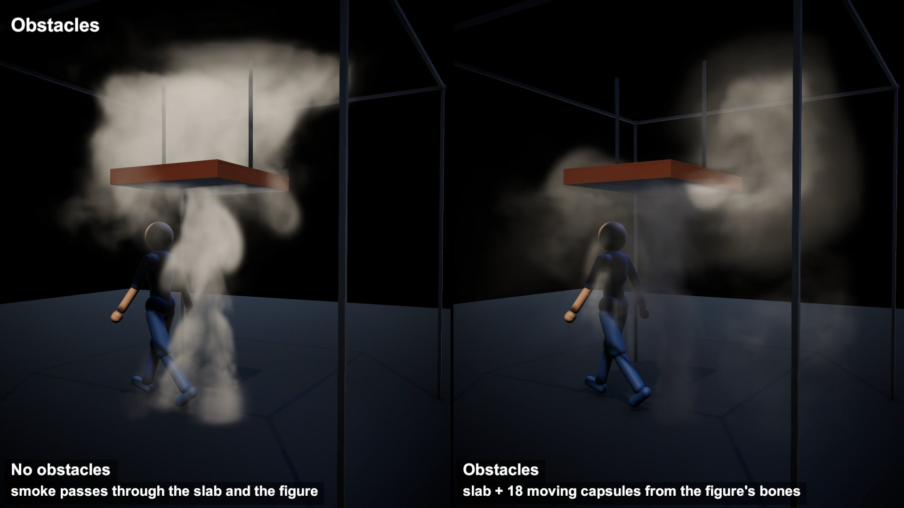

# GPU 3D smoke with moving obstacles

Smoke on a 128³ grid, solved on the GPU in Unity. A walking figure goes into the solver as 18 moving capsules every frame, so it shoves the plume aside instead of ghosting through it.

## The problem

Flipbook smoke plays the same clip and passes through whatever stands in it. Smoke that piles up under a ceiling and swirls around a person walking through has to be simulated as moving air.

## How it works

This is a port of Scrawk's GPU-GEMS-3D-Fluid-Simulation for Unity. Velocity, density and temperature live on a 3D grid, and each step is a chain of compute passes:

1. Advect. Each cell looks back along its velocity and takes what it finds there.

2. Buoyancy. Hot cells rise, dense cells sink a little.

3. Emit. Density and heat are added in a small ball near the floor.

4. Vorticity confinement. Find where the flow curls and push it to curl tighter. It puts back swirls the grid smears out.

5. Projection. Measure how much each cell squeezes the flow, solve for pressure with Jacobi iterations, subtract the pressure gradient.

Solid cells act as walls in the pressure solve. A ray march through the density draws it.

## What I hit

In the source, solid cells have zero velocity, so a moving body only blocks. I added an obstacle velocity per cell: each capsule writes its own speed, and the divergence and projection passes use it at the walls. Now the figure drags and pushes smoke.

The domain is a closed box. At the source's density fade of 0.999 per step it filled up within the clip and every comparison turned into fog. I use 0.995.

The smoke looked flat. An extra pass walks each column from the top and stores how much light is left, so the underside goes darker.

The ray march stops at the scene depth, so the figure sits inside the smoke instead of on top of it.

## My build

Unity 6.3 URP, compute shaders.

128 x 128 x 128 cells (2,097,152) in a 2.4 m cube, 10 Jacobi iterations, one step per frame. Both are the source defaults.

23 compute dispatches per step plus 1 lighting pass.

ComputeBuffers, one float or float3 per cell, about 176 MB per solver. The result is copied into a 3D texture for drawing.

Obstacles: one slab and 18 capsules built from the figure's bones, rebuilt every step.

Four solvers run side by side with the same emitter, so each split shows the same moment.

With the solver off, the density in the grid keeps climbing (3.9x from 2 s to 24 s). With it on, it stays between 6,100 and 8,100 units.

No frame times measured.

## Trade-offs

Cost grows with the cube of the resolution, and 10 of the 23 dispatches are the pressure solve.

A fixed number of Jacobi iterations leaves some compression in the flow.

Detail is capped by the cell size, about 1.9 cm here. Confinement adds swirl, not resolution. At 0 vs 1 the difference is visible but small.

The smoke does not push back on the figure.

## When to use it

Hero smoke or fog in a bounded space that has to react to moving things. For background puffs, particles are far cheaper.

## Credits

Technique source: Scrawk/GPU-GEMS-3D-Fluid-Simulation, https://github.com/Scrawk/GPU-GEMS-3D-Fluid-Simulation, commit 6d676c61c85126f35246ebc90568f4957f0a2ce0. License: MIT, Copyright (c) 2017 Justin Hawkins.

Code reused: yes. All nine simulation compute shaders (advection, buoyancy, impulse, vorticity, confinement, divergence, Jacobi, projection, obstacles) are the source's files, with marked changes in three of them: obstacles also write a per-cell obstacle velocity, and divergence and projection use it at solid cells. The simulation component is a port of the source's SmokeFluidSim (same buffers, time step and pass order), changed to rebuild obstacles every step from boxes and moving capsules, with a solver-off switch, a pre-roll and a 3D texture output. The source's ray-cast shader is replaced by my own URP ray-march shader that follows the same idea. The source's scene is not used.

Engine: Unity 6.3 LTS, Universal Render Pipeline.

My own code: obstacle velocity, the capsule and box obstacle input, the top-down light pass, the URP smoke shader with depth clamp, the scene, the stand-in mannequin and its walk, the four-solver comparison layout and labels.

No external models or assets. Character: a stand-in mannequin built from code.

## Files

- `Editor/BuildScene.cs`
- `FluidDirector.cs`
- `FluidSim3D/ApplyAdvection.compute`
- `FluidSim3D/ApplyBuoyancy.compute`
- `FluidSim3D/ApplyImpulse.compute`
- `FluidSim3D/ComputeConfinement.compute`
- `FluidSim3D/ComputeDivergence.compute`
- `FluidSim3D/ComputeJacobi.compute`
- `FluidSim3D/ComputeObstacles.compute`
- `FluidSim3D/ComputeProjection.compute`
- `FluidSim3D/ComputeVorticity.compute`
- `FluidSim3D/LICENSE.txt`
- `FluidSim3D/SmokeSim.cs`
- `Shaders/SmokeLight.compute`
- `Shaders/SmokeVolume.shader`

## Build the scene

In the Unity editor: **Vidar Game Lab > Techniques**, then **Build** next to `gpu-3d-smoke`. From the command line: `tools/capture.sh gpu-3d-smoke GameTech.Posts.FluidScene.Build`.
