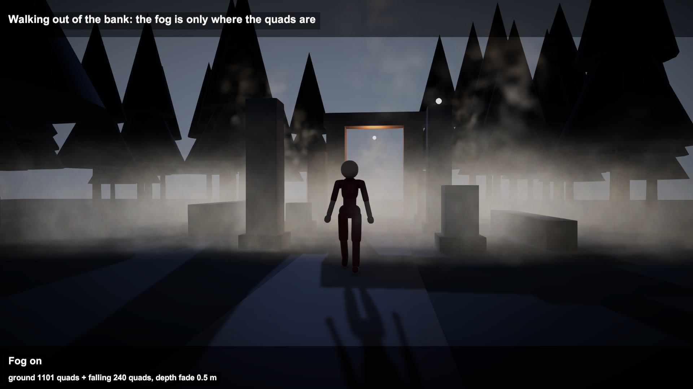

# GPU Fog Particles

Fog you can walk through, and not one texture in it. Every puff is a plain particle quad; the shader draws its shape from three layers of noise.

## The problem

Atmospheric fog usually means smoke textures on particles, or a volumetric pass over the whole view. Textures repeat and look flat up close. A volumetric pass costs every frame, even when the fog only hugs the ground in one corner.

## How it works

This follows MirzaBeig's GPU Fog Particles: one unlit, transparent URP shader on an ordinary particle system.

1. Each particle is a camera-facing quad with no texture. A radial mask from its UVs turns it into a soft disc.

2. The fragment shader multiplies three noise layers into the alpha: value noise, 3D simplex noise and Voronoi. Each layer has its own amount, scale and remap, and scrolls over time. A stable random value per particle offsets the noise, so no two quads match.

3. The shader reads the scene depth and fades a quad where it comes within 0.5 m of geometry, so quads do not cut hard lines into the ground. It also fades quads close to the camera.

4. The particle system does the rest: spawn in a box, random size and lifetime, fade in and out.

## What I hit

URP 17 already declares the depth texture's texel size, and the shader declares it again, so it would not compile on Metal. Commenting out those three lines was the only change to the shader.

The per-particle noise offset arrives through a custom vertex stream, so the particle renderer needs the same stream list as the source prefabs.

With the noise layers off, the same quads read as a flat white wall. The noise is what makes the bank look like fog.

## My build

Unity 6.3, URP, Apple M4 Mac mini, Metal. The source's URP shader with that one fix, on particle systems created from code. Emitter and noise values start from the source's ground fog and falling fog setups.

Forest ruins built from code: a path through a broken colonnade and an arch, pines, lanterns, moonlight. A stand-in mannequin walks through.

Ground fog: one 13 x 12 m box, 160 quads per second, 1-3 m quads living 4-10 s, about 1,100 alive.

Falling fog: 6 small emitters, 10 per second each, 1 m quads living 4 s, 240 alive.

Ground noise: value 0.8, simplex 0.5, Voronoi 0.6.

Measured on the video frames: at 12 s the costume shows 6,258 red pixels behind the falling fog alone and 419 behind the ground fog, so the bank hides about 93% of it.

No frame times measured.

## Trade-offs

The fog is unlit. Its colour is fixed in the material, so the lanterns and the moon do not light it.

It is a stack of overlapping transparent quads: overdraw grows with screen coverage, worst when the camera is inside the bank.

It needs the depth texture enabled.

Nothing casts shadows into it, and it casts none.

## When to use it

Ground mist, swamps, ruins, cave floors: scenes where a full volumetric pass is too heavy and textured smoke would repeat.

## Credits

Technique source: GPU Fog Particles by MirzaBeig, https://github.com/MirzaBeig/GPU-Fog-Particles, commit 324e6ce9444b997293644d3b049f891365999743. License: Unlicense (public domain dedication, as stated in the repository's LICENSE.txt; https://unlicense.org). Used: the URP fog shader, with three duplicate declarations of the depth texture's texel size commented out so it compiles on URP 17; and the values of the repository's ground fog and falling fog particle setups and fog materials as starting parameters.

Engine: Unity 6.3 LTS (6000.3.28f1) with the Universal Render Pipeline 17.3. Used for rendering, its particle system and post-processing. It is not the source of the technique.

My own code: the forest ruins, pines and lights built from code, the stand-in mannequin's walk, the particle systems created from code and their scene-scaled settings, the band cameras and compositor, the timeline, labels and video.

No external models or assets.

## Files

- `Editor/BuildScene.cs`
- `FogCompose.shader`
- `FogDirector.cs`
- `Shaders/GPUFogURP.shader`

## Build the scene

In the Unity editor: **Vidar Game Lab > Techniques**, then **Build** next to `gpu-fog-particles`. From the command line: `tools/capture.sh gpu-fog-particles GameTech.Posts.FogScene.Build`.
