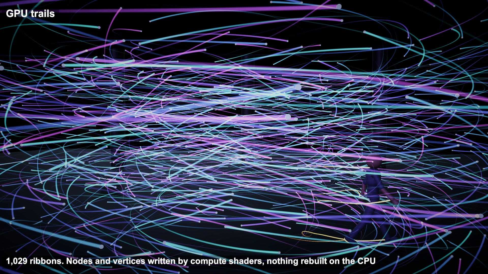

# GPU Trails

1,029 glowing trails and the CPU never rebuilds a mesh. Compute shaders append the trail points, build the ribbons, cull what the camera can't see and thin out the far ones.

## The problem

A standard trail component is one object per trail, and its strip is built on the CPU every frame. For a sword or a car that is fine. For a thousand particles it means a thousand objects and a thousand strips rebuilt each frame. When the moving points already live on the GPU, the trails should too.

## How it works

This follows fuqunaga's GpuTrail.

1. Each trail owns a ring of nodes in a GPU buffer: position, time, colour. Every frame only the newest positions are uploaded. An append kernel writes them in as nodes if they moved far enough.

2. A culling kernel tests each trail's nodes against the camera's four side planes and appends the visible trail indices to a list.

3. A LOD kernel finds each visible trail's nearest node and puts the trail in a distance band.

4. A vertex kernel walks each trail from newest to oldest node (every node, or every 2nd or 4th) and writes two vertices per node: a strip facing the camera that narrows with age.

5. One indirect draw per band. The instance count is copied from the GPU's list, so nothing is read back.

These are ribbon meshes kept on the GPU, not particle sprites and not a full-screen speed-line effect.

## What I hit

The source already supports URP, but two kernels failed on Metal. The LOD kernel asked a buffer for its size, which Metal does not allow, so I pass the count in. The culling kernel read the frustum normals as a 4x3 matrix and on Metal culled every trail. Three plain vectors fixed it.

Indirect draws go to every camera, so I added a render layer per trail system for the split screens.

The input side is mine: 4 positions per trail per frame, so fast curves stay smooth at 30 fps.

## My build

Unity 6.3, URP 17.3, Metal on an M4 Mac mini. 1920x1080, 30 fps.

1,029 trails: 1,024 points circling, plus the hands, feet and head of a walking stand-in mannequin. 1.6 s life at 120 inputs per second, so 192 nodes per trail, about 198,000 nodes.

Counts read back from the draw arguments for the labels:

Culling, camera in the middle looking out: 184 to 203 of 1,029 trails drawn.

LOD from the orbit camera: about 480, 400 and 140 trails in the three bands. A far trail draws 96 vertices instead of 384.

No frame times measured.

## Trade-offs

Every trail reserves its full node ring, used or not.

The ribbons face one camera. Seen from another angle they turn edge-on.

Culling and LOD work per trail. One node in view keeps the whole trail.

Additive blending only. Alpha-blended trails would need sorting.

## When to use it

Particle swarms, projectiles, magic and sci-fi VFX, any case with hundreds or thousands of trails whose points are already on the GPU. For a few trails on a character, the standard trail component is simpler.

## Credits

Technique source: GpuTrail by fuqunaga, https://github.com/fuqunaga/GpuTrail, commit 057f559a67c049134b20d2f43dd4c988f24ba6eb. License: MIT, Copyright (c) 2019 fuqunaga. Used: the package's runtime scripts (GpuTrail, GpuTrailAppendNode, GpuTrailRenderer, GpuTrailRendererLod, GpuTrailRendererCulling, GpuTrailRendererCalcLod, GpuTrailIndexDispatcher and their data types) and compute shaders (GpuTrailAppendNode, GpuTrailUpdateVertex, GpuTrailCulling, GpuTrailCalcLod, GpuTrailIndexDispatcher and their includes), with small changes for Metal and per-layer drawing. The vertex buffer include is used by my URP trail shader.

Engine: Unity 6.3 LTS (6000.3.28f1) with the Universal Render Pipeline 17.3, Forward+. It is the renderer, not the source of the technique.

My own code: the input feeder (swarm motion and body points with sub-frame steps), the URP trail shader, the scene, the stand-in mannequin walk, the split-screen and overhead comparisons, labels and video.

No external models or assets.

## Files

- `Editor/BuildScene.cs`
- `GpuTrail/LICENSE.txt`
- `GpuTrail/Scripts/ComputeShaderUtility.cs`
- `GpuTrail/Scripts/GpuTrail.cs`
- `GpuTrail/Scripts/GpuTrailAppendNode.cs`
- `GpuTrail/Scripts/GpuTrailIndexDispatcher.cs`
- `GpuTrail/Scripts/GpuTrailRenderer.cs`
- `GpuTrail/Scripts/GpuTrailRendererCalcLod.cs`
- `GpuTrail/Scripts/GpuTrailRendererCulling.cs`
- `GpuTrail/Scripts/GpuTrailRendererLod.cs`
- `GpuTrail/Scripts/GraphicsBufferUtility.cs`
- `GpuTrail/Scripts/IGpuTrailAppendNode.cs`
- `GpuTrail/Scripts/Node.cs`
- `GpuTrail/Scripts/Trail.cs`
- `GpuTrail/Scripts/Vertex.cs`
- `GpuTrail/Shaders/GpuTrailAppendNode.compute`
- `GpuTrail/Shaders/GpuTrailCSInclude.hlsl`
- `GpuTrail/Shaders/GpuTrailCalcLod.compute`
- `GpuTrail/Shaders/GpuTrailCulling.compute`
- `GpuTrail/Shaders/GpuTrailIndexDispatcher.compute`
- `GpuTrail/Shaders/GpuTrailIndexInclude.hlsl`
- `GpuTrail/Shaders/GpuTrailShaderInclude.hlsl`
- `GpuTrail/Shaders/GpuTrailUpdateVertex.compute`
- `GpuTrail/Shaders/GpuTrailVertex.hlsl`
- `Shaders/GpuTrailURP.shader`
- `TrailCountLabels.cs`
- `TrailDirector.cs`
- `TrailSwarm.cs`

## Build the scene

In the Unity editor: **Vidar Game Lab > Techniques**, then **Build** next to `gpu-trail`. From the command line: `tools/capture.sh gpu-trail GameTech.Posts.TrailScene.Build`.
