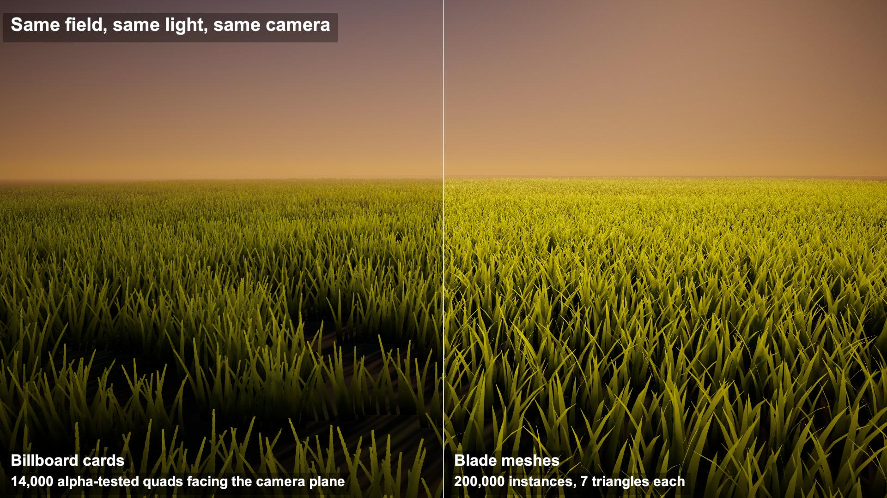

# Billboard Cards vs Blade Meshes

Same field, same sun. Left: 14,000 flat cards with a grass picture. Right: 200,000 real blade meshes. From the side they look close. Then the camera looks down.

## The problem

A real field has millions of blades, and you cannot draw each one as its own object. So you cheat. Which cheat you pick decides how the grass looks up close, from above, and what the GPU pays.

## How it works

This follows Daniel Ilett's open-source Unity grass project, which draws one field six different ways. I took two of them and put them side by side.

1. Billboard cards: each instance is one quad with a picture of a grass tuft on it. Pixels outside the blades are cut away with an alpha test. The quad turns around its vertical axis to face the camera plane, so you never see it edge-on from the side.

2. Blade meshes: each instance is a small real mesh, one blade, 7 triangles, tapered to a tip and bent forward.

Both come from one instance buffer each and are drawn with a single instanced call. Same field, same random seed, same sway, same lighting shader. The only variable is what gets drawn at each point.

## What I hit

One of the source's methods grows blades in a geometry shader. Metal does not support geometry shaders, and this build runs on a Mac, so that version was out. Cards vs mesh instances is the pair that runs everywhere, so that is what you see.

The source billboard shader is unlit. Next to lit blades that would not be a fair fight, so both sides here use the same lit shader: ambient, sun with shadows, a bit of light through the blades, fog. Normals are bent halfway towards the sky so a flat card does not go black under back light.

## My build

Unity 6.3 URP. Field about 32 by 33 m.

Cards: 14,000 instances x 2 triangles = 28,000 triangles. Each card is a procedural texture of 14 curved blades.

Blades: 200,000 instances x 7 triangles = 1.4 million triangles.

Both cast and receive shadows from the same sun.

No ground or grass textures from the source repo; the card texture, blade mesh and ground are generated in code.

No GPU timings measured.

## Trade-offs

Cards are cheap in triangles and look dense from far away. But they are flat. From above, the camera-plane trick runs out, and the field turns into thin strips with gaps between them.

Cards also overdraw: every cut-away pixel is still processed before it gets discarded.

In my build the card side also reads darker at the same light. I did not isolate the exact cause.

Blades keep their shape from any angle and react to light per blade, but you pay in vertices: 50 times more triangles here.

## When to use it

Cards: distant grass, low-end hardware, a camera that stays near the ground.

Blade meshes: hero grass near the camera, top-down or free cameras, anywhere the grass has to hold up from above.

A common setup mixes them: blades near the camera, cards further out.

## Credits

Technique source: daniel-ilett/shaders-6grass, https://github.com/daniel-ilett/shaders-6grass, commit d60b9bb2336d226742a1b4866f82683ba39da99d. License: MIT, Copyright (c) 2022 Daniel Ilett.

Code reused: yes, adapted. The billboard method follows the source's BillboardGrass shader and script (alpha-tested tuft quad, rotated around the vertical axis to face the camera plane), and the blade-mesh method follows its MeshGrass approach (one small blade mesh per instance, lit, casting and receiving shadows). Changed for Unity 6.3: both methods are drawn as GPU instances from a buffer in one call each instead of one object per tuft, the cards turn in the vertex shader, and both share one lit shader so the comparison uses the same lighting.

Engine: Unity 6.3 LTS, Universal Render Pipeline.

My own code: the instance buffers and field layout, the lit grass shader, the procedural tuft texture, blade mesh and ground, the sky gradient, the split-screen, cameras, lighting and labels.

No external models or assets.

## Files

- `Editor/BuildScene.cs`
- `GrassDirector.cs`
- `Shaders/GrassComposite.shader`
- `Shaders/GrassInstanced.shader`
- `Shaders/SkyGradient.shader`

## Build the scene

In the Unity editor: **Vidar Game Lab > Techniques**, then **Build** next to `grass-drawing-methods`. From the command line: `tools/capture.sh grass-drawing-methods GameTech.Posts.GrassScene.Build`.
