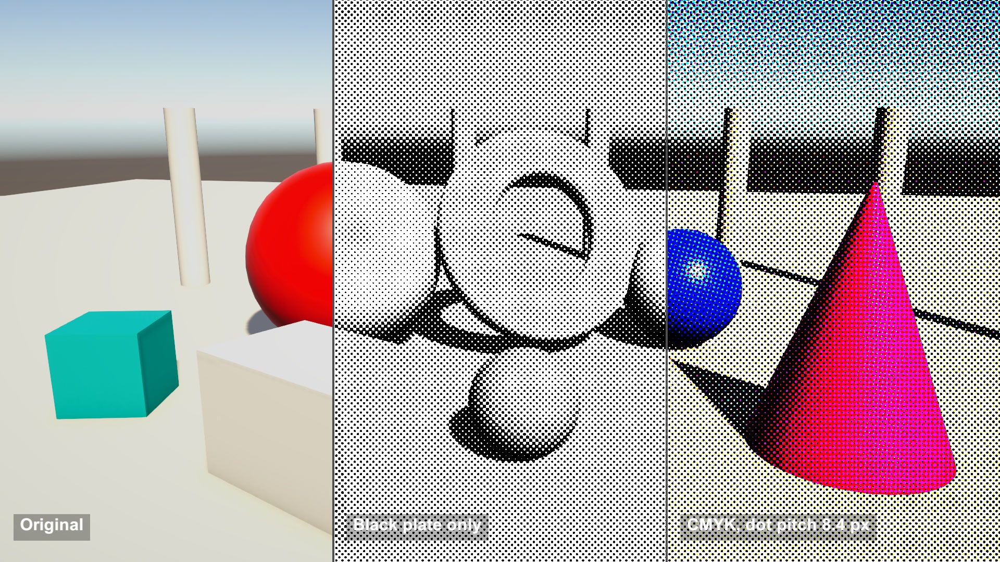

# Halftone comic

Brightness turned into printed dots. Each ink gets its own rotated dot grid, darker areas get bigger dots, and the four inks overlap into colour. One post-process, two passes.

## The problem

Print has no grey ink. It fakes tone with dots of one ink at different sizes, and fakes colour by overlapping cyan, magenta, yellow and black dots on rotated grids. A shader can do the same on every frame.

## How it works

This follows Garrett Gunnell's Post-Processing shaders for Unity.

Pass 1 converts each pixel to CMYK: black K = 1 - max(R, G, B), and the other three inks are what is left once black is taken out.

Each ink gets a dot pattern (sin x + sin y) / 2 on a grid rotated to its own angle: cyan 15, magenta 75, yellow 0, black 45 degrees. A pixel gets that ink when the pattern is below a threshold set by the ink amount, so more ink means a bigger dot.

Pass 2 prints the plates: start from white and subtract each ink, each read with an optional pixel offset to fake misregistration.

## What I hit

The source compares the pattern, which runs from -1 to 1, with the ink amount, which runs from 0 to 1. Zero ink still covers half of every cell, so white paper came out dark. I remap the threshold to 2 x ink - 1. Coverage now runs from 0% to 100%, though not linearly: 25% ink gives about 18% coverage.

The source rotates UV coordinates, not pixels. On a 16:9 screen its 45 degree grid becomes two waves at 61 and 119 degrees with pitches of 4.4 and 7.7 px, so the dots stretch. I rotate in pixel space.

Its black ink uses a curve exponent of 0.15. With the remap, that inked almost everything, so I use 1.

The edge smoothing term is computed in the source but never used. Here it is a switch.

## My build

Unity 6.3 with URP on an Apple M4 Mac mini, Metal. OnRenderImage does not run in URP, so I render the camera into a texture and run the 2 passes from LateUpdate.

The "dot size" setting is a frequency: pitch = 2 pi / size pixels. My default 0.75 gives 8.4 px, the source's 1.0 gives 6.3 px.

Per pixel: 4 inks x 2 sines, then 4 texture reads to print.

## Trade-offs

The grid is fixed to the screen, not to the objects. When the camera moves, the scene slides behind a still pattern, like looking through a screen door.

At small pitches (2 to 3 px) the dots get close to the pixel size and can beat against the pixel grid and fine textures into moiré. Lower output resolutions hit this sooner.

Hard thresholds alias at the dot edges, and smoothing softens the dots.

## When to use it

Comic-style cut-scenes, menus, stills and photo modes. Scale the pitch with the resolution, and keep it at 6 px or more.

## Credits

Technique source: Post-Processing by Garrett Gunnell, https://github.com/GarrettGunnell/Post-Processing, commit 871a7ffcc44174f237b4c0127db51026c438d7a4, MIT License, Copyright (c) 2022 Garrett Gunnell. Its halftone effect is used: the two-pass shader (RGB to CMYK with a rotated dot threshold per ink, then printing with per-ink offsets) and the parameters from its C# script, ported to Unity's Universal Render Pipeline. The shader is copied with changes marked in the code: the grid is rotated in pixel space, the threshold is remapped to the range of the dot pattern, the black curve and screen angles are properties, and the unused edge smoothing term is wired to a switch. The repo's other effects, scenes and assets are not used.

Engine: Unity 6.3 LTS (6000.3.28f1) with the Universal Render Pipeline 17.3. Used for rendering. It is not the source of the technique.

My own code: the URP port of the pass chain, the split-screen and zoom display, the brightness ramp test, the scene built from code, the timeline, labels and video.

No external models or assets.

## Files

- `Editor/BuildScene.cs`
- `Halftone.shader`
- `HalftoneCompose.shader`
- `HalftoneDirector.cs`

## Build the scene

In the Unity editor: **Vidar Game Lab > Techniques**, then **Build** next to `halftone-comic`. From the command line: `tools/capture.sh halftone-comic GameTech.Posts.HalftoneScene.Build`.
