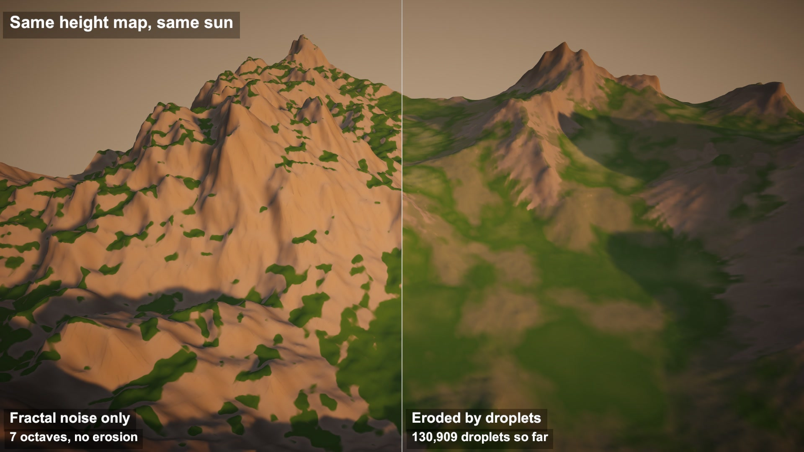

# Hydraulic Erosion

Same hills, same low sun. Left: raw fractal noise. Right: the same map after 131,072 simulated raindrops carved valleys and dropped sediment in the low ground.

## The problem

Noise makes hills that look like noise: soft round bumps, every slope the same, no sign that water ever ran over them. Real terrain has sharp ridges, branching gullies and flat valley floors filled with what washed down. That shape comes from water, so the cheapest way to get it is to simulate water.

## How it works

This follows Sebastian Lague's open-source Hydraulic-Erosion project for Unity.

1. Drop a raindrop at a random spot with speed 1 and water 1.

2. Each step, read the height and slope under it. Its direction is 30% old direction, 70% downhill (inertia 0.3). Move one cell.

3. How much mud it can carry depends on how steep the drop was, how fast it moves and how much water is left.

4. Carrying too much, or moving uphill: drop some sediment into the 4 cells around it.

5. Carrying too little: dig out of the cells within a small radius, weighted toward the centre.

6. Speed up on downhill steps, lose 1% of the water, and stop after 30 steps.

Thousands of these, each one tiny, add up to drainage: drops follow the same paths, deepen them, and leave the mud where the slope flattens.

## What I hit

More rain is not better. With 1 million drops on a 256 map the hills melted into soft blobs. About 2 drops per cell kept the ridges sharp.

The source's compute version indexes its brush with the inner map size, not the width with the border, so the brush lands slightly off. I index with the full width.

Drops run in parallel with no locks, as in the source, so two can write the same cell. Results shift a little between runs: 1.42% vs 1.44% total height change.

Raw noise hills were too round, so I raise the heights to the power 1.8 before eroding. Both sides of the split use the same map.

## My build

Unity 6.3 URP. 256 x 256 height map plus a 3-cell border, 7 octaves of noise.

Source settings unchanged: inertia 0.3, capacity 3, erode 0.3, deposit 0.3, evaporate 0.01, gravity 4, brush radius 3.

131,072 drops in 4 ms on the GPU of an Apple M4 Mac mini (radius 1: 2 ms), timed waiting for the result.

The terrain mesh reads the height map straight from the GPU, with normals per pixel. Colours are mine: rock on steep slopes and where material was removed, sand where sediment landed.

The height change view: orange went down, teal went up.

## Trade-offs

Height map only: no overhangs, caves or cliffs that lean out.

No standing water. Drops evaporate, so there are no lakes or rivers, only the shapes they would cut.

The number of drops has to match the map size, and the brush radius changes the look: radius 1 cuts thin deep lines, radius 3 wider softer channels.

## When to use it

Procedural landscapes, as a pass after the noise: valleys, ridges and sediment fans that noise alone does not make. Fast enough to run once at load, or in an editor tool while you tweak the seed.

## Credits

Technique source: SebLague/Hydraulic-Erosion, https://github.com/SebLague/Hydraulic-Erosion, commit f245576d204978e3186f41c8abbd75c326c6857e. License: MIT, Copyright (c) 2019 Sebastian Lague.

Code reused: yes, ported. The erosion kernel follows the source's Erosion.compute nearly line for line: droplet start values, bilinear height and gradient, inertia, sediment capacity, deposit into the 4 surrounding cells, erosion with a weighted brush, speed and evaporation, maximum lifetime. Source default parameters are used unchanged. Changed: the work is split into batches, the brush and droplet indices use the bordered map width, and the brush radius 1 run is added for comparison.

My own code: the height map (Unity Perlin fbm with the source's octave settings, then raised to the power 1.8), the terrain mesh and shading, sky and fog, split-screen comparison, cameras and labels.

Engine: Unity 6.3 LTS, Universal Render Pipeline.

No external models, textures or HDRIs.

## Files

- `Editor/BuildScene.cs`
- `ErosionDirector.cs`
- `Shaders/Erosion.compute`
- `Shaders/ErosionComposite.shader`
- `Shaders/ErosionSky.shader`
- `Shaders/ErosionTerrain.shader`

## Build the scene

In the Unity editor: **Vidar Game Lab > Techniques**, then **Build** next to `hydraulic-erosion`. From the command line: `tools/capture.sh hydraulic-erosion GameTech.Posts.ErosionScene.Build`.
