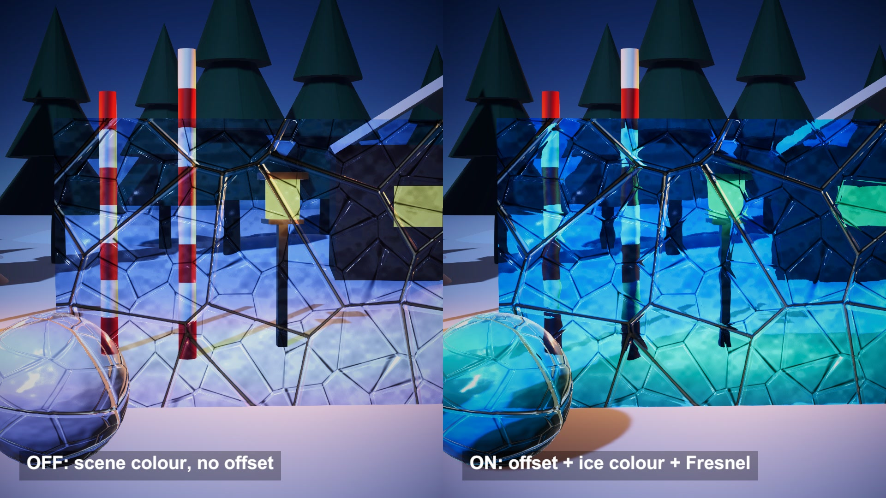

# Ice refraction from the opaque texture

Ice that bends whatever sits behind it, after Daniel Ilett's ice shader. It reads the rendered scene and shifts the lookup with a cracked-ice normal. A tint and a rim finish it.

## The problem

Real refraction means following a ray through the block and out the far side. A plain transparent material skips all of that. The background shows through unchanged, so the block reads as tinted glass.

## How it works

This is an approximation, and the author says so. URP keeps a copy of the frame as it looked after the opaque objects were drawn. The ice shader samples that copy at the pixel's own screen position, plus a small offset.

The offset comes from a normal. A height map of the ice is sampled three times, and the two differences give a tangent-space normal with a strength of 8. Its X and Y are multiplied by the refract strength and added to the screen UV.

The shifted colour is multiplied by an HDR ice colour. A Fresnel term is added, with a power of 1 divided by the Fresnel strength. The sum goes into the albedo of a lit material, with the same normal for highlights.

## What I hit

The ice colour is 0.12, 1.32, 2.0. It removes almost all red, so a warm lantern turns green behind the ice.

The scene colour becomes albedo, so it gets lit a second time. The view through the shaded side of a block is darker.

The offset is in screen UV. On a 16:9 frame the same value moves up to 38 pixels across and 22 down, and it does not shrink with distance.

The copy of the frame holds opaque objects only. One ice block seen through another is missing.

The project copied the frame at half size. I switched it to full size for a sharper image.

## My build

Unity 6.3 with URP on an Apple M4 Mac mini. The source is a Shader Graph. I rewrote it node for node in HLSL and kept its values: refract strength -0.02, Fresnel strength 0.2, metallic 0.25, smoothness 0.8. The height map is my own, made from code at 1024 pixels: crack lines along cell borders over soft noise. Seven ice pieces share it, mapped at 2 m per tile. The video also shows tiling 3 and Fresnel strength 1.0.

## Trade-offs

Nothing checks depth. An object in front of the ice can be pulled into the shifted lookup. At the screen border the lookup runs out of image. Light does not bend twice, and thickness changes nothing.

## When to use it

Ice or frosted glass on mid-size props, where a cheap and stable look matters more than accuracy.

## Credits

Technique source: shaders-ice by Daniel Ilett, https://github.com/daniel-ilett/shaders-ice, commit f0da9b8debe0fd94c8af14dfd897c08f707568a1, MIT License, Copyright (c) 2020 Daniel Ilett. Its Ice shader graph is rewritten node for node as an HLSL shader, with the same property names and the values of its Ice material. The repo's textures, meshes and scene are not used.

Engine: Unity 6.3 LTS (6000.3.28f1) with the Universal Render Pipeline 17.3. Used for rendering. It is not the source of the technique.

My own code: the ice height map generated from code, the ice shapes and the winter scene built from code, the timeline, camera moves, labels and video. No external models or assets.

## Files

- `Editor/BuildScene.cs`
- `IceDirector.cs`
- `IceRefraction.shader`

## Build the scene

In the Unity editor: **Vidar Game Lab > Techniques**, then **Build** next to `ice-refraction`. From the command line: `tools/capture.sh ice-refraction GameTech.Posts.IceScene.Build`.
