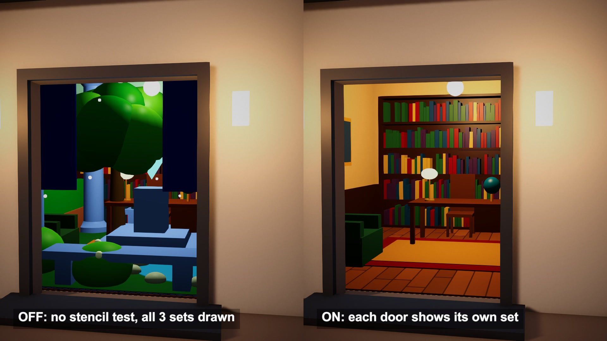

# Impossible geometry with stencil doorways

One 4.5 m room, three doors, three different interiors. All three sets of furniture sit in the same space, and a stencil ID written by each doorway picks which one you see.

## The problem

An impossible room looks different depending on which door you look through. Plain geometry cannot do that. Put two sets of furniture in one spot and both are visible, cutting through each other.

## How it works

This follows Daniel Ilett's URP stencil project, made for Antichamber-style impossible rooms.

Each doorway holds a quad with a mask shader. It outputs no colour and writes no depth. Where it passes the depth test, it replaces the stencil value with its own ID.

Each furniture set is then drawn with a stencil test: compare Equal against its ID. Pixels outside its doorway fail the test, so the set exists only through that opening. The depth buffer still sorts everything as usual.

The source runs that test in Render Objects renderer features, one per layer, placed after the opaque pass.

## What I hit

Order matters. The mask has to be in the stencil buffer before any set draws, and opaque sorting does not promise that. I gave the mask render queue 2001 and the sets 2002.

Shadow maps know nothing about the stencil. A hidden set would still drop shadows into the visible one, so my sets cast none and are lit by a small lamp model of their own.

With the test off, three room shells in one place fight over the same depth. Each shell is 1 cm smaller than the last, which keeps the comparison shot stable.

The mask is one-sided. Seen from inside through one door, another doorway's quad faces away and stays out of the stencil buffer.

## My build

Unity 6.3 with URP on an Apple M4 Mac mini. The mask keeps the source's render state. I moved the stencil test from renderer features into the sets' material, so the project's renderer asset stays untouched.

The pavilion is 5 x 5 m outside, with three doors of 1.8 x 2.4 m. Inside sit a study, a stone hall and a garden: 119 parts on stencil IDs 1, 2 and 3. The comparison half draws the same sets with compare Always. A debug pass tints the screen by stencil ID.

## Trade-offs

The illusion holds only while a mask sits between the camera and the room. Walk through the door and nothing writes the ID any more. The stencil buffer has 8 bits, and other effects may want them. Every set is submitted for drawing even when its doorway covers a few pixels. Shadows between the sets need a separate answer.

## When to use it

Showcase rooms and puzzle spaces seen from outside, or a window that opens onto somewhere else.

## Credits

Technique source: shaders-impossible-geom by Daniel Ilett, https://github.com/daniel-ilett/shaders-impossible-geom, commit 5cb1c9295251711661b68096253396cc98a77af2, MIT License, Copyright (c) 2022 Daniel Ilett. The render state of its stencil mask shader (no colour, no depth write, stencil reference replaced) is reused in my mask shader. The source's per-layer Render Objects renderer features are replaced by a stencil test inside my own material. The repo's models, scenes and other shader graphs are not used. The repo describes its subject as impossible geometry like that seen in the game Antichamber. This post has no connection to that game or its publisher and uses none of its assets.

Engine: Unity 6.3 LTS (6000.3.28f1) with the Universal Render Pipeline 17.3. Used for rendering. It is not the source of the technique.

My own code: the layered material with its lamp model and floor patterns, the debug tint pass, the pavilion and the three room sets built from code, the timeline, camera moves, labels and video. No external models or assets.

## Files

- `Editor/BuildScene.cs`
- `PortalDirector.cs`
- `StencilLayerLit.shader`
- `StencilPortal.shader`
- `StencilTint.shader`

## Build the scene

In the Unity editor: **Vidar Game Lab > Techniques**, then **Build** next to `impossible-geometry`. From the command line: `tools/capture.sh impossible-geometry GameTech.Posts.PortalScene.Build`.
