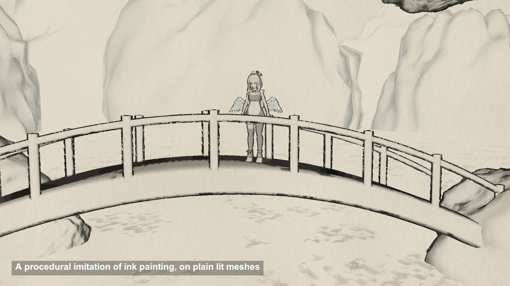

# Ink painting look: outlines, texture strokes and wash

Plain lit meshes turned into an ink painting in one Unity shader: brush outlines, stroke texture in the shadows and a grey wash on rice paper.

## The problem

Chinese ink painting is not cel shading. Near lines are dark, far ones fade into grey, the dry brush leaves gaps, and shadow is drawn with texture strokes instead of a darker fill. One outline plus a two-tone ramp looks like a cartoon, not a scroll.

## How it works

This follows sacshadow's 3D Chinese Ink Painting Style Shader, which splits the look into the three classic steps.

Gou, the outline. Two extra passes draw the back faces pushed outwards along the normal, at widths 12 and 14.5 on the scenery, each with its own noise, so the edge looks ragged. A rim term from the view angle adds lines inside the silhouette.

CunCa, the texture strokes. A stroke texture is projected from the top, front and side, one channel per direction, and only shows where the light and rim terms say the surface is dark.

Ran, the wash. The same dark area is tinted towards an ink colour, grey or a muted tint per material.

Distance does the rest. Distance over 64 m picks a grey from a remap texture, so far mountains get pale lines. A noise texture cuts holes in the lines, the dry brush effect called FeiBai.

## What I hit

The source was written for a gamma-space Built-in project. In a linear URP project the same numbers give lighter greys, so I do the colour maths on gamma values and convert at the end.

URP renders one pass per pass tag, so the three passes get three different tags.

The outline needs smooth normals. Split normals break the shell apart at hard corners, so my meshes are built with welded normals.

The ACES tonemapper turned the paper grey, so the ink halves render without post processing.

The source blends its projections with the signed normal. I use the absolute value, so faces pointing down get strokes too.

## My build

Unity 6.3 with URP on an M4 Mac mini. The shader keeps the source's property names and default values from its sample material.

The scene is built from code: displaced rocks and mountains, pines, an arched bridge, a pavilion, plus IA on the bridge. The stroke texture is the one from the repo; the remap, noise and paper grain are generated.

The video compares URP Lit with the ink version, adds the three steps one by one, toggles FeiBai and shows the distance remap.

## Trade-offs

Every object draws three times: the shaded pass and two outline passes.

Outlines are extruded geometry, so thin parts and sharp corners can show gaps or spikes.

Line width depends on distance and screen space, and needs tuning per scene scale.

The paper grain is fixed to the screen, so it does not move with the camera.

It is a procedural imitation. Real brushwork has stroke direction and ink pooling that a shader like this does not model.

## When to use it

Stylised landscapes where you want an ink look on ordinary meshes without painting textures for every asset.

## Credits

Technique source: 3D_ChineseInkPaintingStyleShader by sacshadow, https://github.com/sacshadow/3D_ChineseInkPaintingStyleShader, commit 2d83191e5c43c182241bae161ad6a2f2bf2854a5, MIT License, Copyright (c) 2023 sacshadow. Its shader CIPR_2_Ran_And_Other_RimLight (Gou inline and two back-face outline passes, CunCa triplanar strokes, Ran wash, distance remap, FeiBai noise) is rewritten for URP with the same property names and the default values of its sample material. The repo's scenes, models and materials are not used.

Texture: Stroke_3 from the same repository (MIT, Copyright (c) 2023 sacshadow), used unchanged as the stroke texture.

Engine: Unity 6.3 LTS (6000.3.28f1) with the Universal Render Pipeline 17.3. Used for rendering. It is not the source of the technique.

Character: IA. モデル：葉葉波、キャラクターデザイン：えびごはん (©はっぱろぐ！・えびごはん・EAUploader). Fan-made reproduction, not official. #いあ3D

This is a procedural imitation of Chinese ink painting, not painted by hand.

My own code: the URP passes and gamma-space conversion, the remap, noise and paper textures generated from code, the landscape, pines, bridge and pavilion built from code, the timeline, labels and video.

## Files

- `Editor/BuildScene.cs`
- `InkPaintDirector.cs`
- `InkPainting.shader`
- `PaperSky.shader`
- `Tex/Stroke_3.psd`

## Build the scene

In the Unity editor: **Vidar Game Lab > Techniques**, then **Build** next to `ink-painting`. From the command line: `tools/capture.sh ink-painting GameTech.Posts.InkPaintScene.Build`.

This scene uses the IA character model, which is not in this repository. See the main README.
