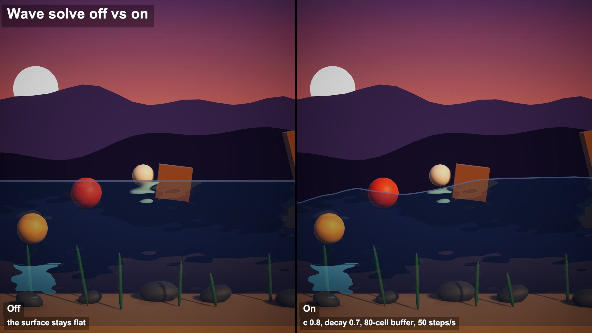

# 2D Interactive Water

Drop a crate into this pool and a ripple runs out from where it hit. The whole surface is one row of 80 numbers, stepped 50 times a second by a compute shader in Unity URP.

## The problem

Water in a side-on 2D scene is often a flat band of colour, or a canned wave that ignores what lands in it. A fluid solver is far too much for one line of water.

## How it works

This is a port of ruccho's WaterRW.

1. The surface is a 1D height buffer. Three copies rotate: two steps ago, last step, and the one being written.

2. Each step solves the 1D wave equation per cell: new height = 2 x last - previous + k x (left + right - 2 x last). Here k = c² dt² / dx². With the sample settings (c 0.8, 50 steps a second, cell size 0.125 / 4) k works out to about 0.26, well inside the stable range.

3. Decay pulls every cell toward zero. With decay 0.7 the wave keeps about 30% of its height per second.

4. Interaction: the script casts a 2D line along the surface from both ends. Every body it hits writes into the cells under it, from its sideways and vertical speed.

5. Rendering: the mesh vertices move up by the buffer value. The pixel shader mirrors the screen image about the surface line for the reflection, offsets it for the refraction and adds two scrolling normal maps.

## What I hit

The shader read a screen texture that only Unity's 2D renderer provides. I pointed it at URP's opaque texture instead, so it runs with the normal renderer, and drew everything behind the water as opaque so it shows up there.

The source water never pushes back on bodies. To make things float I added a simple buoyancy force by how deep each body sits, plus extra drag in the water. That part is mine.

The pool walls cross the surface line, so the line cast picked them up as bodies sitting in the water. I moved the static stone to a layer the water ignores.

At 1080p the source wave height scale of 0.1 per unit was hard to see in a wide shot. I raised it to 0.25. That only changes how high the mesh moves, not the solve.

## My build

Unity 6.3 URP. Solver and interaction script are the source code with small marked changes; the water shader is my URP port.

Water surface 14 units wide. Buffer 80 cells, 4 per unit, 50 solver steps a second, one dispatch per step.

Settings from the source's sample scene: c 0.8, decay 0.7, spatial scale 0.125, up to 32 bodies per step. At most 11 bodies sat on the surface line at once in this clip.

Two copies of the same water share the same bodies. The left panel's copy skips the solve, so the surface stays flat while the bodies still float.

No frame times measured.

## Trade-offs

It is a single height line. Waves move left and right only. There is no breaking, no spray and no volume of water.

The reflection is a mirrored copy of the screen, so anything off screen cannot appear in it.

A fully sunk body makes no waves.

## When to use it

Side-on 2D scenes where things fall into water. Not for 3D oceans or pooling water.

## Credits

Technique source: ruccho/WaterRW, https://github.com/ruccho/WaterRW, commit 688757f6fb5564197f329c586a1d8d41a2830e42. License: MIT, Copyright (c) 2020 ruccho.

Code reused: yes. The wave compute shader and the interaction interface are the source's code unchanged. The water component (wave buffers, interaction gathering, mesh) is the source's code with marked changes: the Unity 6 name for a 2D body's velocity, a switch that skips the solve for the comparison, and read-only counters for the on-screen numbers. The water shader is my URP port of the source's compute water shader: same vertex and pixel steps, reading URP's opaque texture instead of the 2D renderer's screen texture.

Engine: Unity 6.3 LTS, Universal Render Pipeline.

My own code: the simple buoyancy and drag on the bodies, the drop schedule and skimming hull, the scene, the generated normal maps and backdrop, the comparison layout and labels.

No external models or assets. Character: none.

## Files

- `Editor/BuildScene.cs`
- `WaterDirector.cs`
- `WaterRW/IWaterRWInteractionProvider.cs`
- `WaterRW/LICENSE.txt`
- `WaterRW/WaterRWCompute.compute`
- `WaterRW/WaterRWCompute.cs`
- `WaterRW/WaterRWURP.shader`

## Build the scene

In the Unity editor: **Vidar Game Lab > Techniques**, then **Build** next to `interactive-water-2d`. From the command line: `tools/capture.sh interactive-water-2d GameTech.Posts.WaterScene.Build`.
