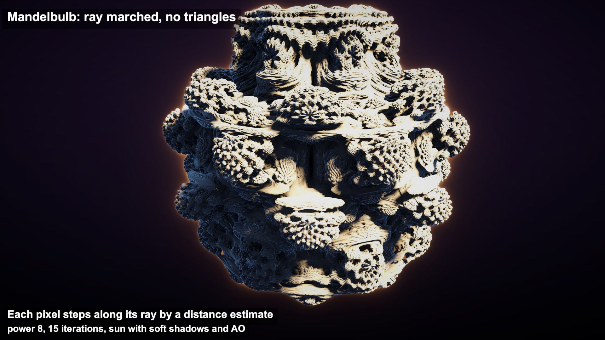

# Ray-Marched Mandelbulb

No triangles here. Every pixel walks along its ray using a distance estimate. Left: 3 iterations of the formula, a smooth blob. Right: 15 iterations, still new detail 100x closer.

## The problem

A fractal has detail at every scale. A mesh stops at its triangle size, so you either store millions of triangles or watch the detail run out as the camera gets close. Ray marching skips the mesh and asks the formula directly, per pixel.

## How it works

This follows Sebastian Lague's open-source Ray-Marching project for Unity.

1. For each pixel, start a ray at the camera.

2. Run the Mandelbulb formula on the current point: turn it into spherical coordinates, raise it to the power 8, add the start point, repeat up to 15 times.

3. From how fast the point flies away, the distance estimate gives a safe step: the surface is at least this far.

4. Step forward by that amount and repeat. When the step gets tiny, that is a hit.

5. The normal comes from the estimate at nearby points.

Fewer iterations give a smoother, simpler surface. Each extra iteration adds finer detail, so 3 iterations stay a blob however close you go.

## What I hit

The source stops at a fixed distance of 0.001. That hides small detail far away and stops working close up, so I scale the hit distance with the ray length, about one pixel wide.

Close to the surface some rays graze it for hundreds of steps. I give them 400 and count running out as a hit, otherwise they showed up as holes.

The source shades by surface direction, escape count and a glow from the number of steps. I kept that as a comparison and added my own lighting.

## My build

Unity 6.3 URP, one compute shader, no meshes. Power 8, 15 iterations.

Source parts: the distance estimate, the iteration loop, camera rays and the source shading on the left of the last split.

Added: a sun with soft shadows marched through the same distance field, AO from 5 samples along the normal, a cool rim light, colour from how close each point's orbit came to the centre.

The zoom moves each camera along the same ray toward its own surface, from 2.7 units to 0.027.

1920x1080 in about 8 ms per frame on an Apple M4 Mac mini (Metal), wide view. The video is rendered at 2x and averaged down.

## Trade-offs

Every pixel runs the formula dozens to hundreds of times, plus more for shadows and AO, so cost depends on the view.

Detail is not truly infinite: it ends where the 15 iterations end or 32-bit floats run out. I stopped at 100x.

No triangles also means no physics mesh and no standard shadow maps without extra work.

## When to use it

Fractals, demos, VFX shots, sky objects and alien landscapes. It suits shapes that are easy to describe with a formula and hard to model.

## Credits

Technique source: SebLague/Ray-Marching, https://github.com/SebLague/Ray-Marching, commit f7e44c15a212dec53b244b1f53cdaf318f6ec700. License: MIT, Copyright (c) 2019 Sebastian Lague.

Code reused: yes, ported. From the source's Fractal.compute: the Mandelbulb distance estimate and its iteration loop (power, 15 iterations, escape radius 2), the camera ray setup, the march loop, the central-difference normal and the source shading mode (normal and escape-count colours, step-count rim, the source scene's colours and darkness 75). The source credits the distance estimate to Mikael Hvidtfeldt Christensen's blog post on Mandelbulb distance estimators.

My own code: the distance-scaled hit threshold, bounding sphere and 400-step limit, soft shadows, distance AO, rim light and orbit-trap colours, the zoom and orbit cameras, the 2x render with averaging, the split-screen comparison and labels.

Engine: Unity 6.3 LTS, Universal Render Pipeline.

No external models, textures or HDRIs.

## Files

- `Editor/BuildScene.cs`
- `MBDirector.cs`
- `Shaders/MBComposite.shader`
- `Shaders/Mandelbulb.compute`

## Build the scene

In the Unity editor: **Vidar Game Lab > Techniques**, then **Build** next to `mandelbulb-raymarch`. From the command line: `tools/capture.sh mandelbulb-raymarch GameTech.Posts.MandelbulbScene.Build`.
