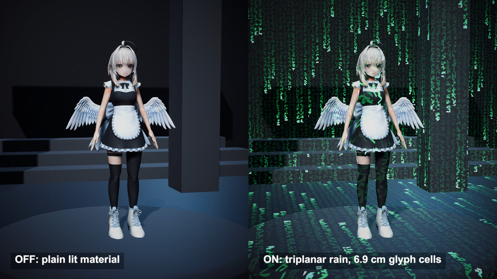

# Matrix-style digital rain on world geometry

Digital rain that wraps a whole 3D scene, after Shahriar Shahrabi's MatrixVFX project. Three world-space projections put falling glyphs on every surface, and then the surface drops away.

## The problem

The falling-glyph look from The Matrix is easy on a flat screen. On a 3D model it needs UVs, and UVs stretch, break at seams and differ from mesh to mesh. A room with a character in it would show a different glyph size on every object.

## How it works

The rain is two functions multiplied. The first splits a 2D coordinate into 16-pixel blocks and picks one glyph per block from a 16 by 16 atlas. The pick comes from a white noise texture that a compute shader keeps rewriting. The second gives each column its own speed and start offset, and fades the brightness along the drop.

On a mesh, the 2D coordinate comes from world position. The shader runs the rain on the XY, ZY and XZ planes and blends the results with the surface normal raised to the power 10. The pass is additive, so it sits on top of the lit surface.

The source switches in two steps. First the overlay opens from the middle of the screen. Then the surface under it is discarded by the same screen test, and only rain is left.

A second path feeds pixel coordinates into the same two functions and fills the frame.

## What I hit

The font texture in the source had no clear origin, so I generate 256 made-up glyphs from random strokes on a 3 by 4 lattice.

The atlas lookup jumps at every block border, and a jump like that makes the GPU pick a tiny mip level along the border. I pass explicit gradients taken from the smooth coordinate.

Brightness is divided by the position along the drop, which reaches zero at the head. I clamp it before dividing.

Additive green barely shows on white cloth under a bright light. I lowered the key light, and the rain still reads best on dark surfaces.

At the source's 6 glyph changes per second the 4 MB video turned to blocks. I re-roll 3 times per second.

## My build

Unity 6.3 with URP on an Apple M4 Mac mini. The shaders are rewritten from the source's built-in pipeline versions, and the noise compute shader is the source's own file. Scale 0.45 gives glyph cells of 6.9 cm and a drop length of 2.2 m. The scene has 34 overlay renderers, the character's skinned meshes among them. The switch runs at 0.4 per second, as in the source. The screen path uses cells of 26.7 pixels.

## Trade-offs

Every mesh is drawn twice. The rain lives in world space, so it slides across anything that moves. Once the surface is gone nothing writes depth, and rain from every layer behind adds up. Where two projections blend, two glyph sets overlap.

## When to use it

Scan or hologram states for a whole scene, or a transition into a simulated space.

## Credits

Technique source: MatrixVFX by Shahriar Shahrabi (IRCSS), https://github.com/IRCSS/MatrixVFX, commit 939d3713ced1b27ab65bdc791ef5927c380dd7b9, MIT License, Copyright 2020 Shahriar Shahrabi. Its white noise compute shader is used as is. The glyph, rain, hash and transition functions of its triplanar and screen-space shaders, and the screen-split discard of its dissolve shader, are rewritten for URP in my own shader files with the same logic. The repo's font texture and its scanned mesh are not used.

This is a recreation of the digital-rain look from The Matrix. It has no connection to the film or its rights holders and uses none of their assets or fonts.

Engine: Unity 6.3 LTS (6000.3.28f1) with the Universal Render Pipeline 17.3. Used for rendering. It is not the source of the technique.

My own code: the generated glyph atlas, the lit base shader, the Lab colour conversion, the hall built from code, the timeline, camera moves, labels and video.

Character: IA. モデル：葉葉波、キャラクターデザイン：えびごはん (©はっぱろぐ！・えびごはん・EAUploader). Fan-made reproduction, not official. #いあ3D

## Files

- `Editor/BuildScene.cs`
- `GenerateWhiteNoise.compute`
- `MatrixBaseLit.shader`
- `MatrixCommon.hlsl`
- `MatrixDirector.cs`
- `MatrixRain.shader`
- `MatrixScreen.shader`

## Build the scene

In the Unity editor: **Vidar Game Lab > Techniques**, then **Build** next to `matrix-rain`. From the command line: `tools/capture.sh matrix-rain GameTech.Posts.MatrixScene.Build`.

This scene uses the IA character model, which is not in this repository. See the main README.
