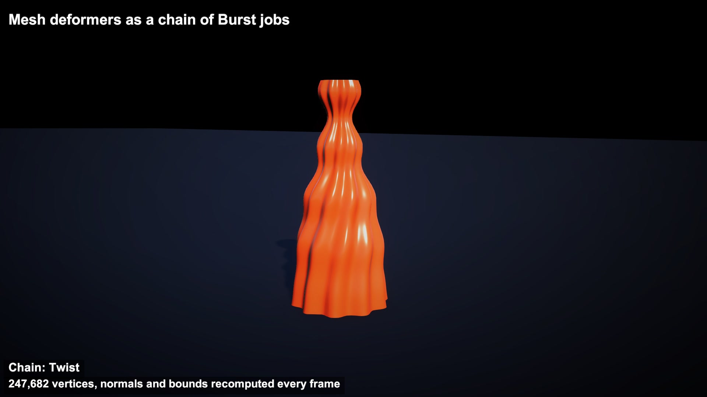

# Mesh deformers as Burst jobs

A 247,682-vertex sculpture twisted, bent, rippled and melted every frame by a chain of four deformers.

Burst + Job System: 8.6 ms per update. The same jobs as plain C# on one thread: 1,253 ms.

## The problem

Bending, twisting or melting a mesh at runtime means moving every vertex, every frame, then fixing the normals so the light still fits. On a dense mesh that is hundreds of thousands of vertices. Done in a plain loop on the main thread, it eats the whole frame and more.

## How it works

This uses Keenan Woodall's open-source Deform library for Unity.

1. Each deformer (Twist, Bend, Ripple, Melt and more than 25 others) is a small job that moves one vertex at a time in the space of its own axis object.

2. A Deformable keeps a copy of the mesh in native arrays and chains the jobs: twist, then bend, then ripple, then melt.

3. After the chain it adds jobs that rebuild the normals from the triangles and the bounds.

4. Every job is compiled with Burst and spread over the worker threads by the Job System. The result is copied into the mesh.

## What I hit

Burst off is not "a bit slower". The same job code running as plain C# with Unity.Mathematics took 1,253 ms on one thread and 229 ms on all workers. Burst on one thread: 39.3 ms.

Skipping the normal jobs saves time, but the lighting stays where the undeformed column was. Ripples become invisible and the twist reads as painted on.

Melt normalizes the direction from its axis, so a vertex exactly on the axis gives NaN. I moved my cap centres a hair off the axis.

## My build

Unity 6.3 URP. Procedural fluted column: 247,682 vertices, 492,800 triangles. Deformers are added one by one in the first shot.

Split 1: same chain, same frame. Left: normals not recalculated. Right: recalculated.

Split 2: 12 sculptures of 25,154 vertices, a 16.7 ms budget per frame. Plain C# needs 130 ms for one, so only one moves per frame. Burst + jobs needs 1.2 ms each, so all 12 move.

Times: Apple M4 Mac mini, Unity Editor play mode, median of 15 updates, deform + normals.

## Trade-offs

All of this runs on the CPU and the mesh is uploaded to the GPU every frame: about 1 ms more for the hero mesh. A vertex shader can do a single bend for free, but it cannot easily chain deformers, give you the deformed mesh back for colliders, or rebuild normals from neighbours.

The C# numbers are from the Editor with safety checks on. A built player would be faster without Burst, but I did not measure one.

## When to use it

Squash and stretch, wobbly props, melting or bending objects, tools that let players shape a mesh, and any effect where gameplay needs the deformed shape on the CPU.

## Credits

Technique source: keenanwoodall/Deform, https://github.com/keenanwoodall/Deform, commit 9e57dd3864ea6c742d819959724c99ca574a2f76. License: MIT, Copyright (c) 2019 Keenan Woodall.

Code reused: yes, the library runtime is included unchanged with its LICENSE (folder Deform/: Runtime/ with Deformable, Deformer, DeformableManager, MeshData and all deformer jobs; External/ Beans.Unity.Mathematics and Beans.Unity.Collections, which ship inside the same repository). Not included: the editor tools, editor resources and examples. The deformers used are Twist, Bend, Ripple and Melt (Melt is marked WIP in the library), plus the library's normal and bounds recalculation jobs.

My own code: the procedural fluted column mesh, the animation of the deformer settings, the timing harness (Burst on/off, 0 or all job workers), the 16.7 ms budget split, materials, lights, cameras and labels.

Engine: Unity 6.3 LTS, Universal Render Pipeline, Burst and Job System.

No external models, textures or images.

## Files

- `Deform/External/Beans.Unity.Collections/Beans.Unity.Collections.asmdef`
- `Deform/External/Beans.Unity.Collections/NativeArrayx.cs`
- `Deform/External/Beans.Unity.Mathematics/Beans.Unity.Mathematics.asmdef`
- `Deform/External/Beans.Unity.Mathematics/bounds.cs`
- `Deform/External/Beans.Unity.Mathematics/mathx.cs`
- `Deform/LICENSE.txt`
- `Deform/Runtime/Core/DeformableManager.cs`
- `Deform/Runtime/Core/DeformerAttribute.cs`
- `Deform/Runtime/Core/Interfaces/IData.cs`
- `Deform/Runtime/Core/Interfaces/IDeformable.cs`
- `Deform/Runtime/Core/Interfaces/IDeformer.cs`
- `Deform/Runtime/Data/CollapsibleSection.cs`
- `Deform/Runtime/Data/DisplayNameAttribute.cs`
- `Deform/Runtime/Data/Interfaces/IComponentElement.cs`
- `Deform/Runtime/Data/NativeCurve.cs`
- `Deform/Runtime/Data/NativeTexture2D.cs`
- `Deform/Runtime/Deform.asmdef`
- `Deform/Runtime/Enums/Axis.cs`
- `Deform/Runtime/Enums/BoundsMode.cs`
- `Deform/Runtime/Enums/BoundsRecalculation.cs`
- `Deform/Runtime/Enums/ColliderRecalculation.cs`
- `Deform/Runtime/Enums/CullingMode.cs`
- `Deform/Runtime/Enums/NoiseMode.cs`
- `Deform/Runtime/Enums/NormalsRecalculation.cs`
- `Deform/Runtime/Enums/StripMode.cs`
- `Deform/Runtime/Enums/TextureSampleSpace.cs`
- `Deform/Runtime/Enums/UpdateMode.cs`
- `Deform/Runtime/Mesh/Data/DeformerElement.cs`
- `Deform/Runtime/Mesh/Data/Enums/ColorChannel.cs`
- `Deform/Runtime/Mesh/Data/Enums/DataFlags.cs`
- `Deform/Runtime/Mesh/Data/Enums/UpdateFrequency.cs`
- `Deform/Runtime/Mesh/Data/ManagedMeshData.cs`
- `Deform/Runtime/Mesh/Data/MeshData.cs`
- `Deform/Runtime/Mesh/Data/MeshTarget.cs`
- `Deform/Runtime/Mesh/Data/NativeMeshData.cs`
- `Deform/Runtime/Mesh/Data/VertexCache.cs`
- `Deform/Runtime/Mesh/Deformable.cs`
- `Deform/Runtime/Mesh/Deformer.cs`
- `Deform/Runtime/Mesh/Deformers/BendDeformer.cs`
- `Deform/Runtime/Mesh/Deformers/BlendDeformer.cs`
- `Deform/Runtime/Mesh/Deformers/BoundedBendDeformer.cs`
- `Deform/Runtime/Mesh/Deformers/BulgeDeformer.cs`
- `Deform/Runtime/Mesh/Deformers/CubifyDeformer.cs`
- `Deform/Runtime/Mesh/Deformers/CurveDisplaceDeformer.cs`
- `Deform/Runtime/Mesh/Deformers/CurveScaleDeformer.cs`
- `Deform/Runtime/Mesh/Deformers/CylindrifyDeformer.cs`
- `Deform/Runtime/Mesh/Deformers/InflateDeformer.cs`
- `Deform/Runtime/Mesh/Deformers/Interfaces/IFactor.cs`
- `Deform/Runtime/Mesh/Deformers/LatheDisplaceDeformer.cs`
- `Deform/Runtime/Mesh/Deformers/LatticeDeformer.cs`
- `Deform/Runtime/Mesh/Deformers/MagnetDeformer.cs`
- `Deform/Runtime/Mesh/Deformers/Masking/MaskState.cs`
- `Deform/Runtime/Mesh/Deformers/Masking/Masks/BoxMask.cs`
- `Deform/Runtime/Mesh/Deformers/Masking/Masks/SphereMask.cs`
- `Deform/Runtime/Mesh/Deformers/Masking/Masks/VertexColorMask.cs`
- `Deform/Runtime/Mesh/Deformers/Masking/Masks/VerticalGradientMask.cs`
- `Deform/Runtime/Mesh/Deformers/MeltDeformer.cs`
- `Deform/Runtime/Mesh/Deformers/Noise/CellularNoiseDeformer.cs`
- `Deform/Runtime/Mesh/Deformers/Noise/NoiseDeformer.cs`
- `Deform/Runtime/Mesh/Deformers/Noise/PerlinNoiseDeformer.cs`
- `Deform/Runtime/Mesh/Deformers/Noise/SimplexNoiseDeformer.cs`
- `Deform/Runtime/Mesh/Deformers/RadialCurveDeformer.cs`
- `Deform/Runtime/Mesh/Deformers/RadialSkewDeformer.cs`
- `Deform/Runtime/Mesh/Deformers/RippleDeformer.cs`
- `Deform/Runtime/Mesh/Deformers/ScaleDeformer.cs`
- `Deform/Runtime/Mesh/Deformers/SineDeformer.cs`
- `Deform/Runtime/Mesh/Deformers/SkewDeformer.cs`
- `Deform/Runtime/Mesh/Deformers/SpherifyDeformer.cs`
- `Deform/Runtime/Mesh/Deformers/SquashAndStretchDeformer.cs`
- `Deform/Runtime/Mesh/Deformers/StarDeformer.cs`
- `Deform/Runtime/Mesh/Deformers/TaperDeformer.cs`
- `Deform/Runtime/Mesh/Deformers/TextureDisplaceDeformer.cs`
- `Deform/Runtime/Mesh/Deformers/TransformDeformer.cs`
- `Deform/Runtime/Mesh/Deformers/TransformOffsetDeformer.cs`
- `Deform/Runtime/Mesh/Deformers/TwirlDeformer.cs`
- `Deform/Runtime/Mesh/Deformers/TwistDeformer.cs`
- `Deform/Runtime/Mesh/Deformers/UVOffsetDeformer.cs`
- `Deform/Runtime/Mesh/Deformers/UVScaleDeformer.cs`
- `Deform/Runtime/Mesh/Deformers/Utility/AutoGroupDeformer.cs`
- `Deform/Runtime/Mesh/Deformers/Utility/GroupDeformer.cs`
- `Deform/Runtime/Mesh/Deformers/Utility/RecalculateBoundsDeformer.cs`
- `Deform/Runtime/Mesh/Deformers/Utility/RecalculateNormalsDeformer.cs`
- `Deform/Runtime/Mesh/Deformers/Utility/RepeaterDeformer.cs`
- `Deform/Runtime/Mesh/Deformers/WaveDeformer.cs`
- `Deform/Runtime/Mesh/ElasticDeformable.cs`
- `Deform/Runtime/Mesh/IO/ObjExporter.cs`
- `Deform/Runtime/Mesh/Utility/DataUtils.cs`
- `Deform/Runtime/Mesh/Utility/DeformerUtils.cs`
- `Deform/Runtime/Mesh/Utility/Jobs/AddFloat3ToFloat3sJob.cs`
- `Deform/Runtime/Mesh/Utility/Jobs/AddTriangleNormalToNormalsJob.cs`
- `Deform/Runtime/Mesh/Utility/Jobs/CopyFloat3sJob.cs`
- `Deform/Runtime/Mesh/Utility/Jobs/ElasticPointsUpdateJob.cs`
- `Deform/Runtime/Mesh/Utility/Jobs/NormalizeNormalsJob.cs`
- `Deform/Runtime/Mesh/Utility/Jobs/RecalculateBoundsJob.cs`
- `Deform/Runtime/Mesh/Utility/Jobs/ResetNormalsJob.cs`
- `Deform/Runtime/Mesh/Utility/Jobs/TransformPointsFromJob.cs`
- `Deform/Runtime/Mesh/Utility/Jobs/TransformPointsJob.cs`
- `Deform/Runtime/Mesh/Utility/MeshUtils.cs`
- `DeformDirector.cs`
- `Editor/BuildScene.cs`

## Build the scene

In the Unity editor: **Vidar Game Lab > Techniques**, then **Build** next to `mesh-deformers`. From the command line: `tools/capture.sh mesh-deformers GameTech.Posts.DeformScene.Build`.
