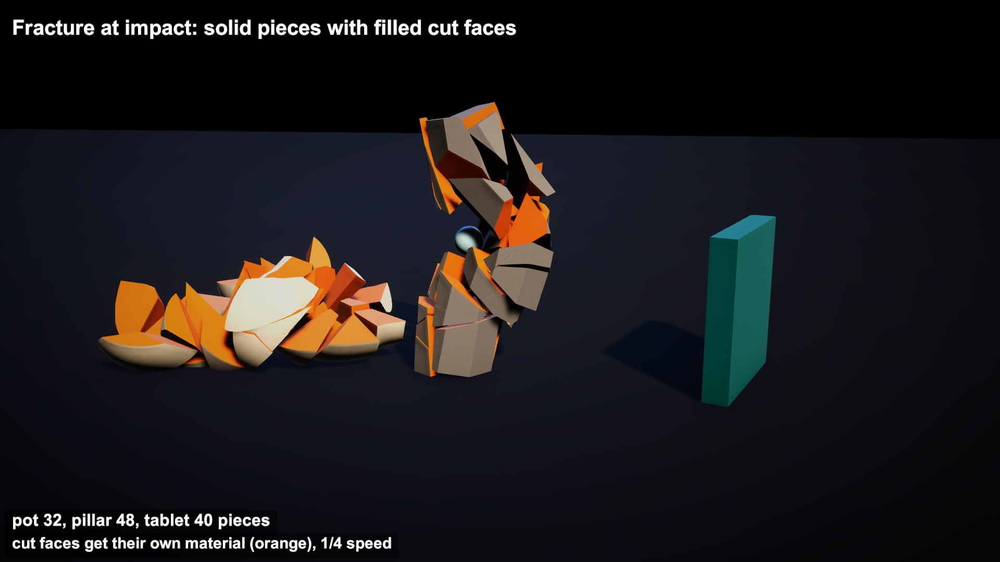

# Runtime mesh fracture

A pot, a pillar and a tablet break into solid pieces at the moment of impact, every cut face filled and given its own material. 24 pieces of a 1,840-triangle pot: about 40 ms on the CPU.

## The problem

Breakable props are usually cut ahead of time in a modelling tool. That is cheap at runtime, but every copy breaks the same way, and you ship all those pieces with the game. Cutting at runtime gives a new break every time, if the cut is fast and the pieces are closed solids.

## How it works

This uses Daniel Greenheck's open-source OpenFracture library for Unity. It does not use Voronoi cells. It cuts with planes:

1. Pick a random plane through the centre of the mesh's bounding box.

2. Split every triangle the plane crosses, and sort triangles into the two sides.

3. Collect the new edges on the plane and fill them with a constrained triangulation, so each half is a closed solid. The fill gets the second material.

4. Put both halves in a queue and repeat until there are as many pieces as you asked for.

5. Each piece gets a convex collider and a rigid body, with mass from its size.

## What I hit

The library cuts through the centre of each piece, not around the impact point, so the pieces are about the same size everywhere. I add the push from the projectile myself.

A pot shape is not convex, so one cut can leave two separate bits in one piece. I turned on the library's floating-fragment check, which splits those into separate bodies.

My meshes have to be closed and wound outward, or the cut faces can't be filled. I check the signed volume and flip if needed.

## My build

Unity 6.3 URP, procedural pot (1,840 triangles), octagonal pillar and tablet.

Split 1: the same pot hit 3 times. Left: cut once into 24 pieces and copies reused (0.2-0.8 ms per hit). Right: cut at each impact with a new random seed.

Split 2: the same pillar at 8 vs 64 pieces: 1.5 ms vs 15.9 ms per fracture, average of 5.

Times are the library call on the main thread of an Apple M4 Mac mini. Played at 1/4 speed.

## Trade-offs

Time grows with triangle count and piece count: the 1,840-triangle pot takes about 40 ms for 24 pieces, a 32-triangle pillar 16 ms for 64. That can cost a frame or two; the library also has an option to spread the cuts over frames.

Plane cuts give straight, sliced-looking breaks with no damage near the impact. Voronoi or impact-seeded methods look more like real cracks.

Many convex colliders at once cost physics time.

## When to use it

Props that break a few at a time: pots, crates, statues, glass panes, destructible cover. For big structures or many breaks per second, pre-fractured pieces are still cheaper.

## Credits

Technique source: dgreenheck/OpenFracture, https://github.com/dgreenheck/OpenFracture, commit 6d0ddff64173193f024638c2de2dbeb8a2525965. License: MIT, Copyright (c) 2021 Daniel Greenheck.

Code reused: yes, the library is included unchanged with its LICENSE (folder OpenFracture/: Fragment/ Fragmenter, FragmentData, MeshSlicer, Triangulator, ConstrainedTriangulator and helpers; Utilities/; Options/FractureOptions and SliceOptions). Not included: the Fracture/Slice/Prefracture components, samples, models and materials. My code calls Fragmenter.Fracture with the same fragment template the library's Fracture component builds (outer material + inside material, convex MeshCollider, Rigidbody).

Note: the library cuts with random planes through each piece's bounding-box centre (not Voronoi cells); the post says so.

My own code: procedural pot, pillar and tablet meshes, materials, the projectile and impact impulse, the pre-fractured baseline (fracture once, reuse copies), slow motion, timing, cameras, split screens and labels.

Engine: Unity 6.3 LTS, Universal Render Pipeline.

No external models, textures or images.

## Files

- `Editor/BuildScene.cs`
- `FractureDirector.cs`
- `OpenFracture/Fragment/ConstrainedTriangulator.cs`
- `OpenFracture/Fragment/EdgeConstraint.cs`
- `OpenFracture/Fragment/FragmentData.cs`
- `OpenFracture/Fragment/Fragmenter.cs`
- `OpenFracture/Fragment/MeshSlicer.cs`
- `OpenFracture/Fragment/MeshVertex.cs`
- `OpenFracture/Fragment/Quad.cs`
- `OpenFracture/Fragment/TriangulationPoint.cs`
- `OpenFracture/Fragment/Triangulator.cs`
- `OpenFracture/LICENSE.md`
- `OpenFracture/Options/FractureOptions.cs`
- `OpenFracture/Options/SliceOptions.cs`
- `OpenFracture/Utilities/BinSort.cs`
- `OpenFracture/Utilities/MathUtils.cs`
- `OpenFracture/Utilities/MeshUtils.cs`
- `OpenFracture/Utilities/Vector3Extensions.cs`

## Build the scene

In the Unity editor: **Vidar Game Lab > Techniques**, then **Build** next to `mesh-fracture`. From the command line: `tools/capture.sh mesh-fracture GameTech.Posts.FractureScene.Build`.
