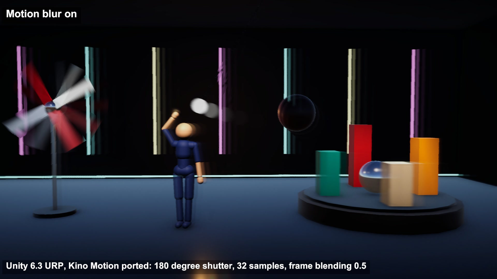

# Motion Blur

A fan turning 31° per frame strobes when every frame is one sharp instant. Blur each pixel along its own motion vector and the blades smear while the still room stays sharp. Unity URP, 1080p.

## The problem

A real camera keeps its shutter open for part of each frame, so fast things smear. A renderer draws one instant, and fast motion strobes. Blurring the whole picture is wrong. Still things must stay sharp while a fast object smears across them.

## How it works

This follows keijiro's KinoMotion, a reconstruction-filter motion blur.

1. Velocity setup: each pixel's motion vector is scaled by shutter angle / 360, clamped to a maximum radius and stored with its depth.

2. TileMax: the frame is cut into tiles and each tile keeps its largest velocity. NeighborMax takes the largest of the 3x3 tiles around it, so a still pixel knows something fast is near.

3. Reconstruction: each pixel samples colour along its neighbourhood's velocity and its own, alternating. A sample counts by depth (is it in front?) and by whether its own speed is enough to reach this pixel.

4. Optional frame blending mixes the 4 previous frames on top.

## What I hit

KinoMotion hooks Unity's old pipeline, which URP never calls. I moved its passes into a URP renderer feature before post-processing that asks URP for motion vectors and depth.

My first camera move orbited the scene and barely blurred: an orbit keeps the subject in place on screen, and this blur only sees screen motion. The comparison now uses a whip pan, the camera turning in place.

At a cut, the previous frame's camera belongs to the other shot. I turn the shutter off for 2 frames after each cut and clear the blend history.

The blur radius is capped at 5% of the screen height. In the shutter shot the fan tip moves about 120 px per frame, so 360° hits the cap.

## My build

Unity 6.3, URP 17.3, Forward+, Metal on an M4 Mac mini. The source's passes ported to HLSL, same order and maths.

1920x1080, 30 fps. Maximum blur radius 54 px, 56 px tiles. 180° shutter (source default 270°), 32 samples (source default 8).

A 4-blade fan at 2.6 turns per second, a turntable, a pendulum lamp, a bouncing ball and a stand-in figure waving one arm.

Measured on screen per frame: fan tip 68 to 123 px, waving hand 15 to 31 px. In the shutter shot that gives fan-tip streaks of about 30 px at 90°, 60 px at 180°, 108 px (capped) at 360°.

Frame blending at strength 1.0 weights the 4 previous frames 0.59, 0.34, 0.20 and 0.12.

No frame times measured.

## Trade-offs

The blur length is capped, so very fast motion is under-blurred.

One dominant velocity per neighbourhood: where fast things cross in different directions, one of them gets the wrong blur.

Everything that moves needs correct motion vectors. Anything without them stays sharp.

Frame blending adds ghost copies, not a longer exposure.

## When to use it

Fast action at 30 fps: racing, spinning parts, quick camera turns, cutscenes. Keep it low where players must read fast motion.

## Credits

Technique source: KinoMotion by keijiro (Keijiro Takahashi), https://github.com/keijiro/KinoMotion, commit 35d5d5179e60703d1db5eac967715f5ea416e387. License: MIT, Copyright (c) 2016, 2017 Keijiro Takahashi. Used: the reconstruction filter (velocity setup, TileMax, NeighborMax, reconstruction pass) and the frame blending filter (raw path, weight formula), ported from the built-in pipeline shaders and scripts to HLSL and a URP renderer feature. The repo's test scenes, debug pass and compressed frame history are not used.

Engine: Unity 6.3 LTS (6000.3.28f1) with the Universal Render Pipeline 17.3, Forward+. It is the renderer and supplies the motion vectors, not the source of the technique.

My own code: the URP renderer feature and render graph wiring, per-camera history, the room, fan, turntable, pendulum and ball built from code, the animation, the split-screen comparisons, labels, measurements and video. The stand-in figure is a primitive mannequin built from code.

No external models or assets.

## Files

- `Editor/BuildScene.cs`
- `KinoMotion/KinoMotionCamera.cs`
- `KinoMotion/KinoMotionFeature.cs`
- `KinoMotion/KinoMotionURP.shader`
- `KinoMotion/LICENSE.txt`
- `MotionDirector.cs`

## Build the scene

In the Unity editor: **Vidar Game Lab > Techniques**, then **Build** next to `motion-blur`. From the command line: `tools/capture.sh motion-blur GameTech.Posts.MotionScene.Build`.
