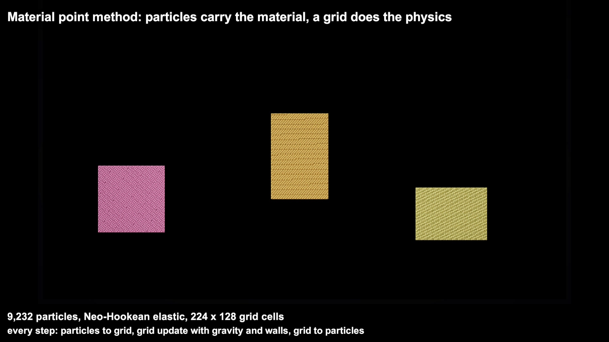

# MLS-MPM: elastic vs fluid

One particle method, two materials. Same block, same throw: one stress function makes it jelly, another makes it water.

2D MLS-MPM on the CPU, 9,232 particles at 0.32 ms per step.

## The problem

Jelly, water, mud and snow look like they need four different solvers. Mass-spring meshes tear or tangle, particle fluids cannot hold a shape. The material point method handles all of them with one loop: only the rule that turns deformation into stress changes.

## How it works

This is a port of nialltl's open-source incremental_mpm (MLS-MPM in Unity, C# jobs).

1. Particles carry mass, velocity, an affine velocity matrix C and, for solids, a deformation gradient F.

2. Particles to grid: each one spreads mass, momentum and its stress force to the 3x3 nearest cells (quadratic weights).

3. Grid update: divide by mass, add gravity, zero the velocity into the walls.

4. Grid to particles: read velocity and C back, move, update F.

The only material-specific line is the stress. Elastic: Neo-Hookean from F (Lamé λ 10, μ 20). Fluid: pressure from the density found on the grid, plus viscosity.

## What I hit

The repo has exactly two materials, Neo-Hookean elastic and a Newtonian fluid. There is no snow or sand model (those need plasticity, which clamps F), so the video compares the two it has.

With the repo's soft Lamé values, a landing squashes the block and tears it. MPM has no mesh holding particles together, so stretched regions just separate. I checked the same update in a small numpy copy and it tears there too.

My first throws landed hard enough to shred the blocks, so the elastic vs fluid split uses a lower drop (about 14 cells).

## My build

Unity 6.3 URP, Burst jobs: clear grid, scatter (one thread, as in the repo, because cells are shared), grid update and gather in parallel.

Split 1: 4,096 particles each. Elastic 0.16 ms per step, fluid 0.45 ms (two scatter passes: density, then pressure).

Split 2, same dam break: 1 particle per cell is 2,304 particles at 0.26 ms; 16 per cell is 36,864 at 3.65 ms.

Apple M4 Mac mini, Unity Editor, CPU times.

## Trade-offs

Cost grows with the particle count, and the scatter is serial here, so 16x the particles cost about 14x the time.

Explicit steps: stiffer materials need smaller time steps.

Low particle counts give blobby surfaces and holes in thin sheets.

## When to use it

Use MPM when one effect mixes materials that deform hugely: mud, jelly, snow, sand, a splash hitting soft ground. For plain rigid debris or a water surface, cheaper tools win.

## Credits

Technique source: nialltl/incremental_mpm, https://github.com/nialltl/incremental_mpm, commit 2c4659230ec1added189913da11ed67f182f5b4d. License: MIT, Copyright (c) 2019 niall tl.

Code reused: ported, not copied verbatim. From MLS_MPM_NeoHookean_Multithreaded.cs I ported the particle and cell layout, the volume precompute, the Neo-Hookean P2G (Lamé lambda 10, mu 20, fused MLS-MPM force term), the grid update (gravity -0.3, slip walls 2 cells thick) and G2P with the deformation gradient update, dt 0.1. From MLS_MPM_Fluid_Multithreaded.cs I ported the two-pass fluid P2G (density from the grid, equation of state rest density 4, stiffness 10, power 4, viscosity 0.1, including the repo's strain trace handling), the wall push in G2P and dt 0.2.

My own code: rectangular grids, the scene setups (three thrown blocks, elastic vs fluid split, dam break at 1 and 16 particles per cell), Burst job chain, ball renderer and shader, walls, timing, cameras and labels. Not ported: mouse interaction, the repo's renderer.

Engine: Unity 6.3 LTS, Universal Render Pipeline, Burst jobs on the CPU.

No external models, textures or images.

## Files

- `Editor/BuildScene.cs`
- `MpmDirector.cs`
- `MpmSim.cs`
- `Shaders/MpmDots.shader`

## Build the scene

In the Unity editor: **Vidar Game Lab > Techniques**, then **Build** next to `mpm-elastic-fluid`. From the command line: `tools/capture.sh mpm-elastic-fluid GameTech.Posts.MpmScene.Build`.
