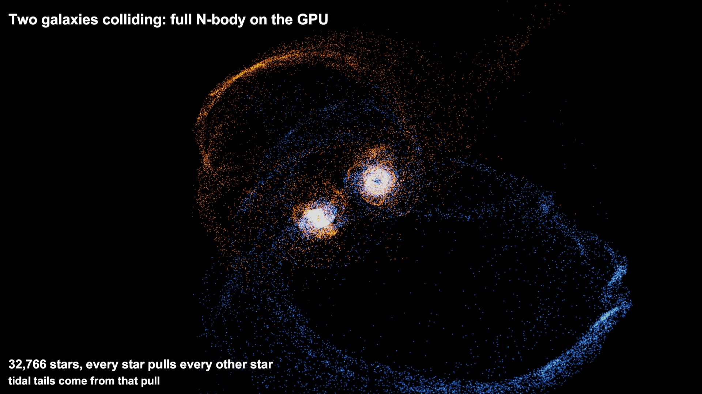

# N-body galaxy collision

Two galaxies, 32,768 bodies, and every one pulls on every other: about 1.07 billion pairs per step on the GPU. The tidal tails and the merger are not animated, they fall out of gravity.

## The problem

Gravity has no cutoff. Every star pulls on every other star, so N stars need N x N force terms per step. The cheap shortcut, each star orbiting its own galaxy's centre, gives nice spinning discs. But stars stop pulling on each other, so the discs only smear as their centres swing past, and the two galaxies fly apart instead of merging.

## How it works

This follows the all-pairs method from GPU Gems 3 (chapter 31), as ported to Unity in Scrawk's open-source GPU-GEMS-NBody-Simulation.

1. One GPU thread per body.

2. A group of 64 threads loads 64 positions into shared memory, every thread adds their pull, then the group moves on to the next 64.

3. Pull = mass x r / (r² + eps²)^1.5. The softening eps² stops the force from blowing up when two bodies pass very close.

4. Then velocity += acceleration x dt, position += velocity x dt.

## What I hit

The source splits each body's sum across 4 rows of threads but only runs the first row, so each body summed a quarter of the others. I loop over every tile in one thread.

Its interaction uses the receiving body's own mass instead of the other body's. With equal masses that changes nothing. My galaxies have a heavy core, so I use the other body's mass.

Drawing 32k points straight from the buffer did not show up in my capture path. A mesh with 6 empty vertices per star, placed by a vertex shader that reads the buffer, did.

Star size and colour set on a shader with no property block came through as zero, so the first renders were black.

## My build

Unity 6.3 URP, one compute shader.

Two discs of 16,383 stars each around a core of mass 1, start speeds set for circular orbits, on a crossing course. Soft additive points and bloom.

Split 1: same start, stars pulled only by their own galaxy's centre (the two centres still pull each other) vs full N-body.

Split 2: softening eps² 0.0004 vs the source's 0.1.

10.1 ms per step for 32,768 bodies on an Apple M4 Mac mini (Metal). That leaves room for fewer than two steps per frame at 60 fps, so the video is rendered offline at 16 steps per frame.

## Trade-offs

Cost grows with N squared: twice the stars, four times the work. 32k is fine, a million is not. Tree and grid methods get much further but give up some accuracy and add a lot of code.

Small softening gives sharp close passes but kicks stars around, so the discs puff up (left side of split 2), and it needs a smaller time step.

## When to use it

Tens of thousands of bodies that all matter to each other: galaxy and star cluster shots, space backdrops baked from a short run, swarms with mutual attraction. If particles only need to look pulled, a few attractor points cost far less.

## Credits

Technique source: Scrawk/GPU-GEMS-NBody-Simulation, https://github.com/Scrawk/GPU-GEMS-NBody-Simulation, commit f72de84b893e0a1d3ebfbefb194f76ccbfc562f8. License: MIT, Copyright (c) 2017 Justin Hawkins. Method: GPU Gems 3, chapter 31, "Fast N-Body Simulation with CUDA" (Nyland, Harris, Prins).

Code reused: yes, ported and changed. From IntegrateBodies.compute: the tiled all-pairs loop with a groupshared block of positions, the softened interaction r / (r^2 + eps^2)^1.5, and the integration order (velocity, damping factor, position). Source defaults read from NBodySim.cs: softening squared 0.1 (used on the right side of split 2), damping 0.96 (I use 1, no damping).

Changed: the sum now covers every tile in one thread (the source's 4-row split only ran row 0), and the pull uses the other body's mass (the source used the receiving body's own mass; same result with equal masses).

My own code: the two-galaxy start (cores of mass 1, exponential disc of 16,383 stars per galaxy, circular start speeds, crossing orbits), the centre-only comparison kernel, the star billboard shader read by vertex id, colours, bloom, cameras, split screens, labels and timing.

Engine: Unity 6.3 LTS, Universal Render Pipeline.

No external models, textures or images.

## Files

- `Editor/BuildScene.cs`
- `GalaxyDirector.cs`
- `Shaders/IntegrateBodies.compute`
- `Shaders/Stars.shader`

## Build the scene

In the Unity editor: **Vidar Game Lab > Techniques**, then **Build** next to `nbody-galaxy`. From the command line: `tools/capture.sh nbody-galaxy GameTech.Posts.GalaxyScene.Build`.
