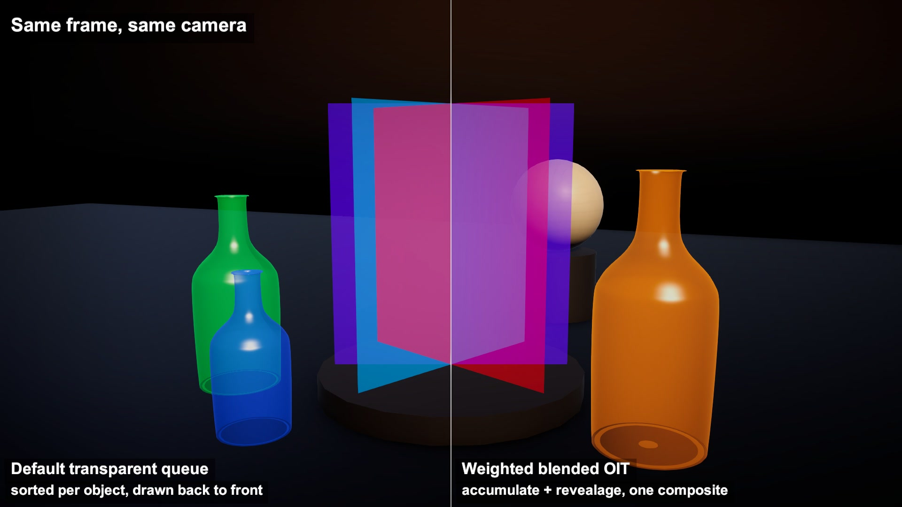

# Weighted Blended Order-Independent Transparency

Four tinted glass panes cut straight through each other. Left: the default transparent queue sorts whole objects and stacks the colours wrong. Right: weighted blended OIT, no sorting at all.

## The problem

Alpha blending only gives the right colour if surfaces are drawn back to front. Engines sort transparent objects by their centre, which works for separate things in a row. It breaks when objects cross each other or share a centre, and inside one mesh, where triangles draw in index order. You see one pane pasted on top, or the colours pop when the camera moves.

## How it works

Weighted blended OIT (McGuire and Bavoil) stops caring about order. This build ports Lele Feng's OIT_Lab version.

1. Draw the opaque scene as usual.

2. Accumulation target, cleared to 0, additive blend: every glass fragment adds colour x alpha x w and alpha x w.

3. Revealage target, cleared to 1, multiply blend: every fragment multiplies in (1 - alpha). What is left is how much background shows through.

4. One full-screen pass: average colour = accumulated colour / accumulated weight, mixed over the background by revealage.

Addition and multiplication do not care about order, so there is nothing to sort.

The weight w grows for nearer, more opaque fragments, so a front pane still reads stronger than the one behind it.

## What I hit

The source is built-in pipeline code: replacement shaders and a shared depth buffer. URP has neither, so my script draws the glass into the two targets with command buffers, and the glass tests itself against a linear depth texture of the opaque scene.

My first OIT frames had blocky noise. The glass shader was reading the engine's camera position inside my own command buffer, where it was not reliable. Passing the camera position myself fixed it.

The default side is not even stable: all four panes share one centre, so which one lands on top changed between two runs of the same scene.

## My build

Unity 6.3 URP. 7 transparent objects: 4 crossing panes and 3 two-sided bottles, plus a solid ceramic sphere behind the glass.

Accumulation in RGBA16F, revealage in R16F, the same formats and blend states as the source.

Weight: the source's depth-based Weight1, w = alpha x clamp(10 / (0.00001 + (z/5)^2 + (z/200)^6), 0.01, 3000).

The weight shot puts it next to the unweighted mode (w = 1). The difference is small here because the sculpture is shallow, about 1.5 m deep.

No GPU timings measured.

## Trade-offs

It is an approximation. Inside one pixel the layers are averaged, not ordered, so a strong front layer looks weaker than true blending would give.

Weights are tuned to a depth range. Outside it, near or far layers dominate the wrong way.

Two extra render targets and one extra full-screen pass.

Exact answers need depth peeling or per-pixel lists, with a layer limit or extra memory.

## When to use it

Glass, foliage cards, particles, holograms, anywhere many overlapping transparent surfaces make per-object sorting fail.

## Credits

Technique source: candycat1992/OIT_Lab, https://github.com/candycat1992/OIT_Lab, commit 54a2e5272dc5457bb01bdef7cc1b4f42c4eb73ad. License: MIT, Copyright (c) 2020 Lele Feng.

Code reused: yes, ported. The weighted blended path (WeightedBlendedManager.cs, WB_Accumulate, WB_Revealage, WB_Blend) is ported from the built-in pipeline to URP: same target formats, clear values, blend states, Weight1 function and final blend formula. The default-queue side follows the source's ODT shader (alpha blend, no depth write).

Engine: Unity 6.3 LTS, Universal Render Pipeline.

My own code: the URP integration (command buffers and a linear depth texture instead of a shared depth buffer), the glass shading, the procedural panes, bottles and studio, the split-screen display, cameras, lighting and labels.

No external models or assets.

## Files

- `Editor/BuildScene.cs`
- `OITDirector.cs`
- `Shaders/OITComposite.shader`
- `Shaders/OITEyeDepth.shader`
- `Shaders/OITGlass.shader`

## Build the scene

In the Unity editor: **Vidar Game Lab > Techniques**, then **Build** next to `order-independent-transparency`. From the command line: `tools/capture.sh order-independent-transparency GameTech.Posts.OITScene.Build`.
