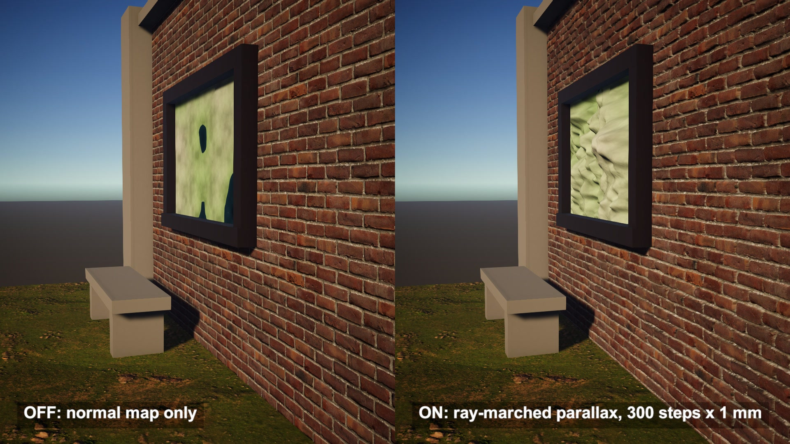

# Parallax occlusion mapping on flat quads

A brick wall, a hole in the ground and a valley behind a window. Each one is a single flat quad. The depth comes from a ray walking through a height map in the pixel shader.

## The problem

A normal map changes how light hits a surface, but every pixel still sits on the flat polygon. Look along a brick wall and the mortar lines stay painted on. Nothing in front ever covers what is behind it.

## How it works

This follows Erik Nordeus's parallax mapping shaders for Unity. For each pixel, the view direction is turned into the quad's own space: along the surface, and down into it.

A ray starts at the surface point and walks down in fixed steps. At each step it reads the height map under its current position. The first time the ray is below the stored height, it stops, and the colour and normal are read at that spot instead of at the original UV.

A brick that sticks out now hides the mortar behind it, and the hidden part changes as the camera moves.

To smooth the result, the last two positions are blended by how far each one is from the surface. That gives a hit point between two steps.

## What I hit

The source treats one UV unit as one metre. I gave my quads UVs in metres, so a depth of 5 cm on the wall is really 5 cm.

Step size decides everything. At 12 steps of 16 cm the hole breaks into flat slices. Blending the last two steps rounds the slices off, and 500 steps of 5 mm makes them go away.

Where the hole wall is nearly vertical, many pixels hit almost the same UV. The ground texture stretches into streaks down the wall.

The source reads its textures at the top mip level only. Far away that shimmers, so I sample colour with the slope of the original UV.

## My build

Unity 6.3 with URP on an Apple M4 Mac mini, Metal. The source is three Built-in surface shaders. I rewrote them as one URP shader with the same height functions and the same interpolation.

Wall: 7 x 3 m, bricks 5 cm deep, 300 steps of 1 mm.

Hole: 500 steps of 5 mm, depth curve of 2 to the power of grey times 1.5, minus 1, so 1.83 m at the bottom.

Window: 1.6 x 1.0 m, a landscape 0.97 m deep with 300 steps of 1 cm, grass low, stone high and water in the lowest fifth.

Lighting is plain Lambert as in the source, with the normal read at the hit point.

## Trade-offs

The silhouette stays flat. The edge of the wall is a straight line however deep the bricks look.

No self-shadowing: the sun does not march, so a brick never shadows the mortar under it.

Cost grows with steps per pixel, up to 500 height reads in the hole.

Steep walls stretch their texture.

The depth buffer still holds the flat quad, so other objects meet the surface, not the bricks.

## When to use it

Brick and stone walls, cobbles, cracks and fake windows seen at an angle, where a normal map looks painted on and real geometry costs too much.

## Credits

Technique source: Unity-Advanced-Shaders-Tutorial by Erik Nordeus (Habrador), https://github.com/Habrador/Unity-Advanced-Shaders-Tutorial, commit dffb55485ad23bcfe081dd5d69e309b2b19bc8c8, MIT License, Copyright (c) 2022 Erik Nordeus. Its parallax mapping shaders (BricksParallax, HoleInGround, MountainInPlane) are rewritten as one URP shader: the tangent-space ray, the fixed-step march, the height functions and the interpolation between the last two steps follow the source. The repo's textures, materials and scenes are not used.

Textures: red_brick_03 by Rob Tuytel and rocky_terrain_02 by Amal Kumar, Poly Haven, CC0.

Engine: Unity 6.3 LTS (6000.3.28f1) with the Universal Render Pipeline 17.3. Used for rendering. It is not the source of the technique.

My own code: the URP shader passes and lighting, the hole noise, hole mask and landscape noise generated from code, the courtyard built from code, the timeline, labels and video.

## Files

- `Editor/BuildScene.cs`
- `ParallaxDirector.cs`
- `ParallaxMarch.shader`
- `Tex/red_brick_03_diff_2k.jpg`
- `Tex/red_brick_03_disp_2k.jpg`
- `Tex/red_brick_03_nor_gl_2k.jpg`
- `Tex/rocky_terrain_02_diff_2k.jpg`
- `Tex/rocky_terrain_02_nor_gl_2k.jpg`

## Build the scene

In the Unity editor: **Vidar Game Lab > Techniques**, then **Build** next to `parallax-mapping`. From the command line: `tools/capture.sh parallax-mapping GameTech.Posts.ParallaxScene.Build`.
