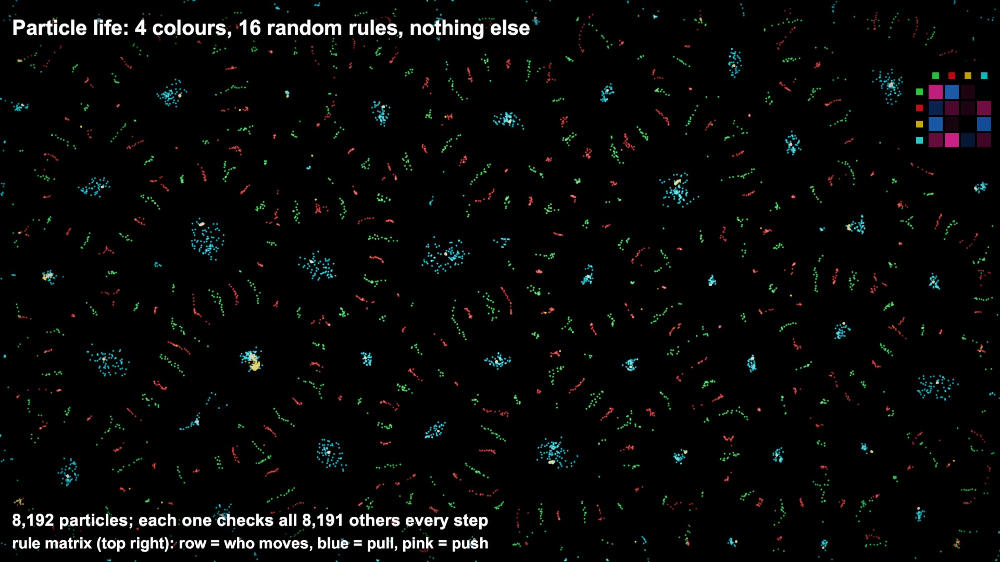

# Particle life on the GPU

Four colours of particles and a 4x4 table of push and pull. Nothing else, and they form cells, chains and swarms.

8,192 particles, every pair checked: 0.81 ms per step on the GPU.

## The problem

Particle life is a toy with one rule, and people love it because it looks alive. The catch: every particle looks at every other particle. The original runs that double loop on the CPU, which caps it at a few thousand particles.

## How it works

This is a port of Hunar Ahmad's open-source particle life (the JavaScript version) to a Unity compute shader.

1. Each particle has a colour. A 4x4 table says how hard colour A is pushed (positive) or pulled (negative) by colour B.

2. Every other particle closer than 80 px adds a force of that fixed size along the line between them.

3. Velocity keeps 30% of itself each step (viscosity 0.7), plus a soft push away from the walls.

4. Rows and columns of the table do not have to match: A can be pulled towards B while B is pushed away from A.

On the GPU, one thread per particle reads all others in tiles of 256 through shared memory.

## What I hit

At the original density, 8,192 particles on a 1080p screen shown 1:1 were tiny dots with no visible shapes. I raised the density above what the original's slider allows (4 x 1,000 particles on a full-window canvas).

I ported the original's seeded random generator, so the same seed gives the same table and start positions.

"Moves a lot" is hard to show in a still, so I read positions back once a second and print how far particles travelled.

## My build

Unity 6.3 URP. Hero: 8,192 particles, seed 91651088029 (the original's default).

Split 1: seed 1906214, same start. Left: table made symmetric (averaged like the original's symmetricRules). Right: as drawn. Symmetric settles into nearly still cells, 7-14 px per second. Asymmetric keeps swarming, 138-199 px per second.

Split 2: two random tables, 4,096 particles each: 11-13 vs 33-42 px per second.

Times: Apple M4 Mac mini, Metal, 1080p.

## Trade-offs

All pairs is simple and exact, but cost grows with the square of the count: 8,192 particles took 0.81 ms, 4,096 took 0.40 ms. The same force loop in plain C# on one CPU thread: 126 ms. For hundreds of thousands, use a spatial grid, since nothing beyond 80 px matters.

I update all particles at once from the previous step. The original JavaScript does the same; the C++ version moves each colour group in turn, which behaves a bit differently.

## When to use it

Background life in menus, alien swarms, music visualisers, or a sandbox where players draw the rule table and watch.

## Credits

Technique source: hunar4321/particle-life, https://github.com/hunar4321/particle-life, commit 256278714c4f6a1ce900d24faafcc101769c54c2. License: MIT, Copyright (c) 2022 Hunar Ahmad.

Code reused: ported, not copied. From particle_life.html I ported the update rule (constant-size force per neighbour within the colour's radius, rules matrix row = acting colour), the constants (radius 80, viscosity 0.7, wall repel 40 with strength 0.1, time scale 1), mirrored borders, the seeded mulberry32 generator with its draw order (rules first, then start positions colour by colour, 50 px margin) and the symmetricRules averaging. The original's default seed 91651088029 is used for the hero shot.

My own code: the compute shader (one thread per particle, all pairs read in tiles of 256 through group shared memory, Jacobi update), the particle renderer, the rule-matrix inset, the travel measurement, the C# timing loop, scene, cameras and labels. Not ported: the GUI, the adaptive time scale, pulses, cluster drawing.

Engine: Unity 6.3 LTS, Universal Render Pipeline, compute shader on Metal.

No external models, textures or images.

## Files

- `Editor/BuildScene.cs`
- `LifeDirector.cs`
- `Shaders/ParticleLife.compute`
- `Shaders/Particles.shader`

## Build the scene

In the Unity editor: **Vidar Game Lab > Techniques**, then **Build** next to `particle-life`. From the command line: `tools/capture.sh particle-life GameTech.Posts.LifeScene.Build`.
