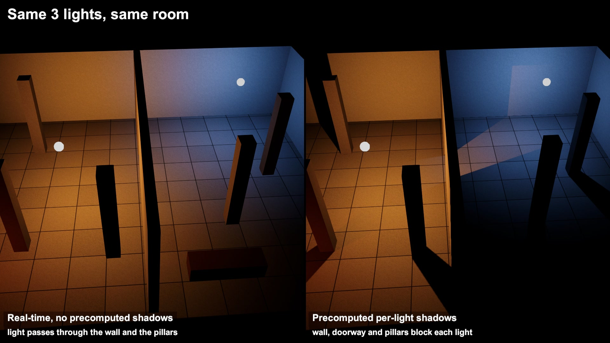

# Per-Light Baked Shadows, Live Light Changes

Same room, same three lights. On the left the light walks straight through the wall. On the right each light's shadows were raytraced once, and the colour and flicker still change live. Unity URP.

## The problem

Real-time shadows cost a shadow map per light per frame, so most lights in a scene go without. Then they leak: a lamp lights the room next door through solid brick. Classic lightmaps fix the leak, but they bake the colour and brightness in, so a lamp can no longer flicker or change colour.

## How it works

This uses Henry00IS's DynamicLighting package. The idea: bake visibility, not light.

1. Lights are fixed in place. Geometry is marked static.

2. The tracer walks every surface texel and casts a ray to each light in range. The answer is one bit per light per texel: lit or blocked.

3. At runtime the shader computes each light's falloff and colour as usual, then multiplies by that bit.

4. Because only visibility is stored, colour, intensity, pulse and flicker can change every frame and the shadows stay correct.

This is not a lightmap rebaked every frame, and not probe-based relighting for a moving sun. The lights never move.

## What I hit

The package shaders include each other through the package path. Copying the folder into Assets turned every material pink. Installing it as an embedded package fixed that.

My generated wall meshes had their triangles wound the wrong way. Faces were culled and the tracer cast only 722,484 rays. After the fix it cast 8,452,333.

The tracer needs a lightmap UV set on every mesh, the scene saved to disk first, and static geometry with Contribute GI.

The package's volumetric fog runs as a built-in pipeline image effect, so I left it out in URP.

## My build

Unity 6.3 URP. Three identical rooms with a partition, a doorway, five pillars and the same three fixed point lights.

Room A: lights on the package's real-time channel, no precomputed shadows. Room B: raytraced, steady. Room C: raytraced; one lamp changes colour, one pulses, one flickers like fire.

Bake: 6 raytraced lights, 128 texels per square metre, 8,452,333 rays, 1.15 s on an M4 Mac mini. Shadow data on the GPU: about 3 MiB.

No frame times measured.

## Trade-offs

A light with baked shadows cannot move. Move it and it becomes a real-time light with no shadows.

Moving objects do not cast these shadows; the package has a real-time shadow mode for the few lights that need it.

Memory grows with lights times lit surface.

## When to use it

Interiors, dungeons, corridors with many small lamps: torches, alarms, broken neon. Anywhere lights stay put but should flicker, pulse or change colour. For a moving sun or moving lamps, use shadow maps instead.

## Credits

Technique source: Henry00IS/DynamicLighting, https://github.com/Henry00IS/DynamicLighting, commit e2a51ad6ebdfddd3cf525b83d8c090b4d7bb8274. License: MIT, Copyright (c) 2022-2024 Henry de Jongh.

Code reused: yes, as a package. The per-light raytracer (bake), the light components and effects (pulse, fire), the runtime light manager and the Diffuse shader are the source package, installed unmodified at that commit. My code only builds the scene, calls the package's raytrace once (2048 maximum lightmap size) and changes light parameters at runtime.

Engine: Unity 6.3 LTS, Universal Render Pipeline.

My own code: the procedural rooms (box meshes with generated lightmap UVs, tile and plaster textures), the three-room comparison setup, the runtime colour change, cameras, layout and labels.

No external models or assets. Character: none.

## Files

- `DLDirector.cs`
- `Editor/BuildScene.cs`

## Requires

The DynamicLighting package by Henry de Jongh (MIT), at commit `e2a51ad`. Add it in the Package Manager from the git URL `https://github.com/Henry00IS/DynamicLighting.git#e2a51ad6ebdfddd3cf525b83d8c090b4d7bb8274`. It is not copied into this folder.

## Build the scene

In the Unity editor: **Vidar Game Lab > Techniques**, then **Build** next to `per-light-baked-shadows`. From the command line: `tools/capture.sh per-light-baked-shadows GameTech.Posts.DLScene.Build`.
