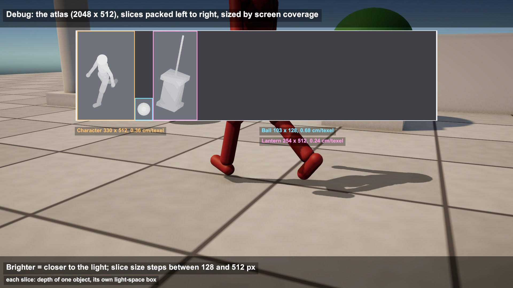

# Per-Object Shadows

Shadows for moving objects without a bigger shadow map: each mover gets its own slice of one atlas, sized by how much of the screen it covers, then the slices are resolved on screen in one instanced draw.

## The problem

Cascaded shadow maps spread one texture over everything within the shadow distance: floor, walls, props. The character you care about gets whatever texels its cascade can spare, and that gets worse as the shadow distance grows.

## How it works

This follows GavinKG's per-object shadow for URP.

1. For each registered object, take its bounds in light space and fit an orthographic box around it.

2. Pick a slice size from its screen coverage: the longer side steps between 128 and 512 px.

3. Pack the slices left to right into one shadow atlas and draw each object's depth into its slice.

4. Resolve: draw one box per object, stretched along the light, all in one instanced draw. Each pixel inside a box rebuilds its world position from the camera depth, projects into that slice and does a 4-tap shadow test.

5. Blend black over the frame where it is shadowed, or write a screen-space shadow mask.

## What I hit

The source's blend defaults are swapped against its own comments, so shadowed and lit came out inverted. I set source alpha / one minus source alpha, as the comments say.

With culling off, the box draws both faces and blends twice. I draw back faces only.

Its passes use a render target API URP 17 dropped, so I run the same steps from a script, with my own depth pass for the camera depth.

On Metal the inverse view-projection must use the same flipped projection the depth was drawn with, or the shadows land in the wrong place.

## My build

Unity 6.3, URP, Apple M4 Mac mini, Metal. Four movers: a stand-in mannequin, a bouncing ball, a drone and a swinging lantern. Static props keep URP shadows.

Atlas 2048 x 512 (4 slices of up to 512). Character slice: 512 px and 0.31 to 0.38 cm per texel up close, 128 px and 1.2 to 1.5 cm across the courtyard.

URP comparison: 2048 map, 4 cascades, 50 m, soft shadows high.

Shadow darkness matched to URP on the video frame: shadowed / lit ground 0.21 to 0.25 for URP, 0.23 to 0.24 with black at 75%.

No frame times measured.

## Trade-offs

The atlas is allocated for the worst case: 4 x 512 even when every slice is 128.

The shadow is a flat black blend, not lighting: it also darkens surfaces that are already in shadow, such as a mover's own far side or a prop's shadow.

Overlapping boxes blend twice.

I did not measure URP's texel size, only the atlas's.

## When to use it

A few hero objects on a large map: characters, vehicles, props you pick up. Keep the main shadow map cheap and spend texels where the eye goes.

## Credits

Technique source: PerObjectShadowSRP by Gavin_KG (GavinKG), https://github.com/GavinKG/PerObjectShadowSRP, commit dc1b288efd094a3781d29cd8d8827f64374aa468, MIT License, Copyright (c) 2021 Gavin_KG. Used: the per-object shadow core (slice data, light-space bounds and matrices, adaptive slice resolution, atlas packing, resolve data) and its settings, copied unchanged; the resolve shader, copied unchanged except its name; and the logic of the shadow atlas pass and the resolve pass, re-done as a script-driven command buffer because their render target API is gone in URP 17. The repo's example assets, scenes and other render features are not used.

Engine: Unity 6.3 LTS (6000.3.28f1) with the Universal Render Pipeline 17.3. Used for rendering, and its own cascaded shadows for the comparison. It is not the source of the technique.

My own code: the command-buffer port of the two passes with a camera depth pass, the atlas debug view, the band compositor, the courtyard and the four movers built from code, the stand-in mannequin's walk, the timeline, labels and video.

No external models or assets.

## Files

- `Editor/BuildScene.cs`
- `POSAtlasView.shader`
- `POSChain.cs`
- `POSCompose.shader`
- `POSDirector.cs`
- `PerObjectShadowImpl.Utils.cs`
- `PerObjectShadowImpl.cs`
- `PerObjectShadowResolve.shader`
- `PerObjectShadowSettings.cs`

## Build the scene

In the Unity editor: **Vidar Game Lab > Techniques**, then **Build** next to `per-object-shadows`. From the command line: `tools/capture.sh per-object-shadows GameTech.Posts.POSScene.Build`.
