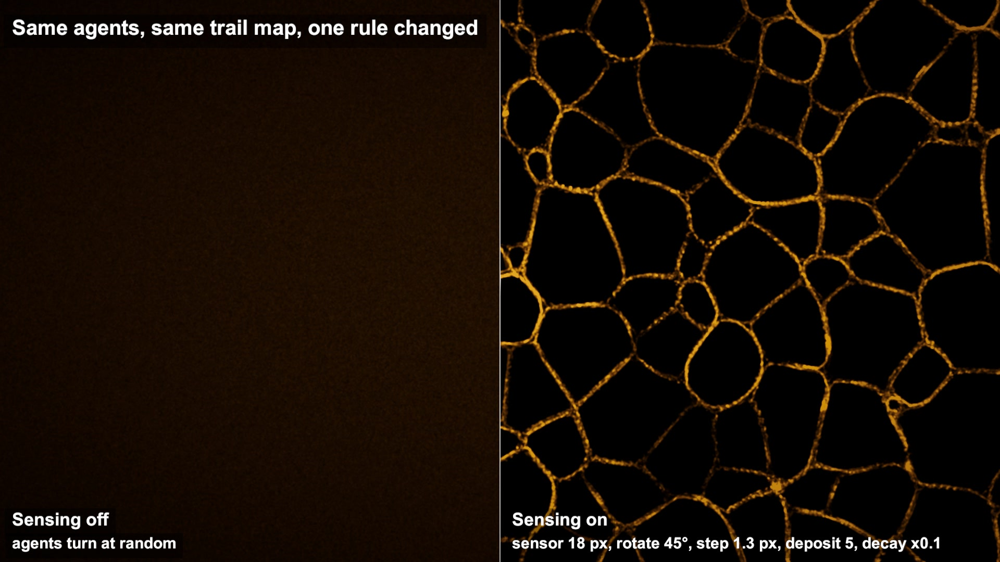

# Physarum Transport Network

8.4 million agents, three sensors each, one rule: turn toward the strongest trail. Left: the same agents turning at random. Right: a network grows, with no global plan in the code.

## The problem

Networks like veins, roads or slime mold look designed. Drawing them by hand or with a graph algorithm gives you one fixed layout. This model gets a living, rearranging network from tiny local decisions.

## How it works

This follows Michael Fogleman's open-source physarum project, based on the agent model by Jeff Jones (2010).

1. A trail map covers the screen. Every agent has a position and a heading.

2. Each step, an agent reads the map at three points ahead: straight, a bit left, a bit right.

3. Strongest straight ahead: keep going. Weakest straight ahead: turn left or right at random. Otherwise turn toward the stronger side.

4. Move forward and drop 5 units of trail where it lands.

5. Blur the map a little and multiply it by 0.1, so old trails fade.

Agents follow trails, which makes those trails stronger, which pulls in more agents. Weak paths fade, strong ones merge into a network.

With several species, each one has its own map. It is attracted to its own trail and pushed away by the others.

## What I hit

The source is a Go program that runs on the CPU. I ported it to Unity compute shaders: one GPU thread per agent.

Thousands of agents can land on the same cell in one step, so the deposit uses atomic adds into a counter, then a second pass turns counts into trail.

The source needs power-of-two maps. I wrap with modulo so the map can be exactly 1920 x 1080.

## My build

Unity 6.3 URP. 8,388,608 agents on a 1920 x 1080 map, about 4 per cell like the source.

Source values: deposit 5, decay x0.1 per step, blur radius 1, two passes.

My picks inside the source's random ranges: sensor 18 px ahead, sensor angle 45°, turn 45°, step 1.3 px.

One step takes 34 ms on an Apple M4 Mac mini (Metal, GPU timed waiting for the result).

The video runs 2 steps per frame. "Sensing off" is my comparison: same agents, but each turn is random.

## Trade-offs

34 ms per step at this size is too slow for a game every frame. Fewer agents or a smaller map scale it down.

Small setting changes give very different patterns, so expect to tune.

It never settles into one final answer. The network keeps moving.

## When to use it

Generative backgrounds, organic VFX, maps of roads or rivers for level ideas, and any time you want growth that looks alive rather than drawn.

## Credits

Technique source: fogleman/physarum, https://github.com/fogleman/physarum, commit 704dda780d899f2795a4c9419f2aa0b5618b5384. License: MIT, Copyright (C) 2020 Michael Fogleman.

Code reused: yes, ported from Go to Unity compute shaders. From pkg/physarum (model.go, grid.go, blur.go, config.go, image.go): the per-species trail grids starting at random 0..1, the attraction-table combine step, the three-sensor agent update with the source's direction() rule, deposit 5 per agent, box blur radius 1 with two passes and the decay factor 0.1 on the last pass, and the display mapping (trail / (agents per cell x 10), then ^(1/2.2), as in the source viewer). The source README points to Sage Jenson's write-up of the algorithm; the agent model is from Jeff Jones (2010).

My own code: the GPU version (one thread per agent, atomic deposit counters, modulo wrapping for a 1920 x 1080 map), the fixed settings picked inside the source's random ranges, the "sensing off" comparison with random turns, colours, split-screen comparison and labels.

Engine: Unity 6.3 LTS, Universal Render Pipeline.

No external models, textures or images. No code from SebLague/Slime-Simulation.

## Files

- `Editor/BuildScene.cs`
- `PhysarumDirector.cs`
- `Shaders/Physarum.compute`
- `Shaders/PhysarumComposite.shader`

## Build the scene

In the Unity editor: **Vidar Game Lab > Techniques**, then **Build** next to `physarum-network`. From the command line: `tools/capture.sh physarum-network GameTech.Posts.PhysarumScene.Build`.
