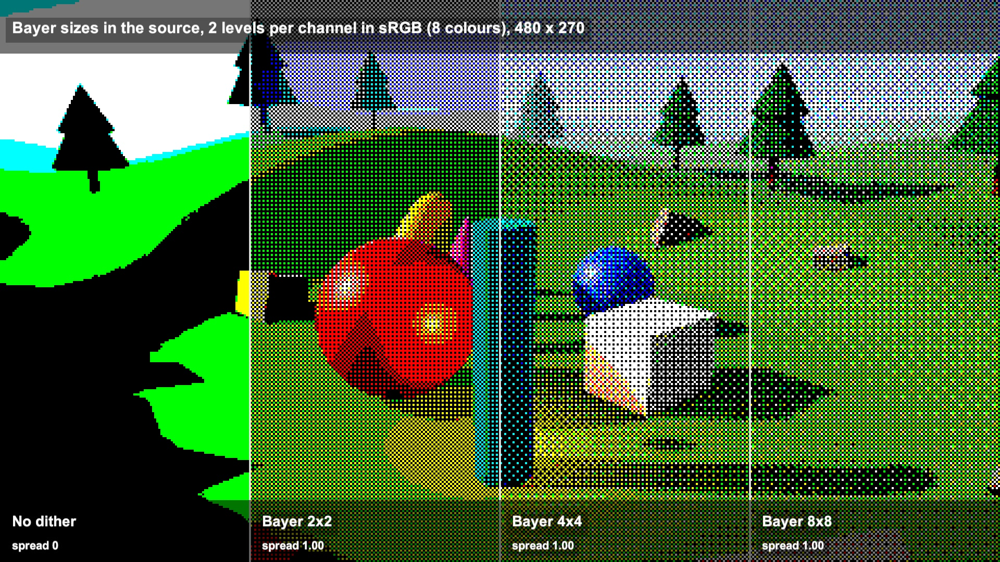

# Pixel-art post-process: downsample, Bayer dither, palette

Render at full size, shrink to 480 x 270, add an ordered dither pattern, round each channel to a few levels, then map grey to a palette. Three small shaders.

## The problem

A 3D scene shown at low resolution with few colours gets jagged edges and hard colour bands. Ordered dithering swaps the bands for a fixed pattern of pixels, and a palette keeps every frame in the same few colours.

## How it works

This follows Garrett Gunnell's Post-Processing shaders for Unity.

1. Halve the image N times. Here N = 2, so 1920 x 1080 becomes 480 x 270.

2. Add spread x a Bayer value: a fixed threshold per pixel from a 2x2, 4x4 or 8x8 matrix, scaled to -0.5 to 0.5.

3. Round each channel to its level count (2 to 16 per channel).

4. Scale back up with point sampling, so each small pixel becomes a 4 x 4 block.

5. Palette: read the grey level and look it up in a strip of colours.

## What I hit

Spread is one number, but it should match the gap between levels: 1 / (levels - 1), so 1.00 for 2 levels, 0.33 for 4, 0.14 for 8. The script's default of 0.5 at 2 levels only mixes values within 0.25 of the middle and leaves the rest flat.

The project renders in linear colour, so the levels are even steps of light. With 4 levels they show at 0, 0.61, 0.84 and 1 on screen, leaving one level for the dark tones. I added a switch that rounds the sRGB value instead.

The palette lookup blends the two entries around grey x palette width. With 6 grey levels into 6 colours, 94.9% of the pixels in my test frame were not palette colours. With 7 levels it was 0%, but the top two levels share the last colour. I added a nearest-entry lookup: 0% at 6 levels.

The palette pass reads only the red channel, so I added a luminance step before the dither.

## My build

Unity 6.3 with URP on an Apple M4 Mac mini, Metal. URP never calls OnRenderImage, so the same blit chains run once per frame from a script.

Colour path: 2 averaging halvings, Bayer 4x4, 4 levels per channel. Palette path: luminance, 6 levels, 6 colours.

The 3 palettes are generated hue-shifted ramps.

The dither pass runs at 480 x 270: one texture read, one matrix lookup and 3 roundings per pixel. I did not measure frame times.

## Trade-offs

The Bayer grid is fixed to the screen. When the camera moves, surfaces slide under it and the pattern crawls.

The pixelate filter keeps 1 of every 4 pixels per halving, so thin edges flicker. The ditherer's default 2 x 2 average is steadier but softer.

An n x n matrix gives n² + 1 mixes between two levels: 5 for 2x2, 17 for 4x4, 65 for 8x8. More steps, coarser repeat.

Rounding in sRGB spaces levels evenly to the eye, but the averaged light is no longer exact.

A palette driven by luminance drops the original hues.

## When to use it

Retro-styled 3D games, stylised cut-scenes, a low-res render mode or a photo filter. Keep the camera slow, or snap it to whole low-res pixels.

## Credits

Technique source: Post-Processing by Garrett Gunnell, https://github.com/GarrettGunnell/Post-Processing, commit 871a7ffcc44174f237b4c0127db51026c438d7a4, MIT License, Copyright (c) 2022 Garrett Gunnell. Its pixel-art effects are used: the pixel-art filter shader (point-sampled downsampling), the dither shader (Bayer 2x2, 4x4 and 8x8 matrices, spread and per-channel level count) and the palette swapper shader, with the halving chains and parameters of their C# scripts, ported to Unity's Universal Render Pipeline. The three shaders are copied with changes marked in the code: the names, an optional luminance step, an optional sRGB-space quantisation and a nearest-entry palette lookup. The repo's other effects, scenes, palette textures and assets are not used.

Engine: Unity 6.3 LTS (6000.3.28f1) with the Universal Render Pipeline 17.3. Used for rendering. It is not the source of the technique.

My own code: the URP port of the blit chains, the three generated palettes, the off-palette pixel count, the band and zoom compositor, the gradient sky shader, the scene built from code, the timeline, labels and video.

No external models or assets.

## Files

- `Dither.shader`
- `Editor/BuildScene.cs`
- `GradientSky.shader`
- `PaletteSwapper.shader`
- `PixelArtFilter.shader`
- `PixelChain.cs`
- `PixelCompose.shader`
- `PixelDirector.cs`

## Build the scene

In the Unity editor: **Vidar Game Lab > Techniques**, then **Build** next to `pixel-art-dither`. From the command line: `tools/capture.sh pixel-art-dither GameTech.Posts.PixelScene.Build`.
