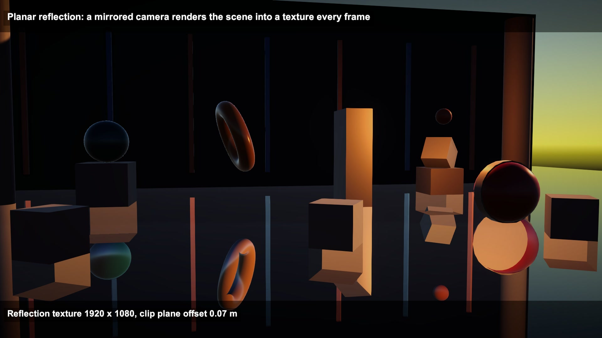

# Planar Reflections

A polished floor that shows everything above it, moving objects included: render the scene a second time through a mirror into a texture, and let the floor read that texture at its own pixel.

## The problem

A sky or cube map reflection is cheap, but it only holds what was captured. Objects that move, or were never in the capture, are missing from the floor. A flat floor or calm water can do better: everything it reflects is the same scene seen from below the surface.

## How it works

This follows William MacLeod's planar reflection script for URP.

1. Build a reflection matrix for the plane (normal up, height = offset).

2. Mirrored view = camera view x reflection matrix.

3. Turn the plane into camera space and bend the projection so its near plane is that plane (an oblique projection). Nothing below the mirror is drawn.

4. Flip the culling order, because the mirror turns triangles inside out.

5. Render into a texture, fog off. The floor shader samples it at its own screen position and blends it in with a Fresnel weight.

## What I hit

In my setup a separate reflection camera came back with the normal, unmirrored view. I render the scene camera itself a second time with the mirrored matrix, then put its settings back.

The floor has to be left out of its own reflection with a layer mask. Otherwise it reads the texture it is writing.

The offset does not only move the clip plane. It moves the mirror itself. At 0.40 m every reflection is shifted 80 cm up and the bottom 40 cm of every object is cut away. 0.07 m is the script's default.

## My build

Unity 6.3 with URP on an Apple M4 Mac mini, Metal.

Reflection texture in HDR at the view size: 1920 x 1080 = 2073k pixels. Half: 960 x 540 = 518k. Quarter: 480 x 270 = 129k.

Floor: Schlick Fresnel with a base reflectance of 0.3, scaled by 0.85, over a dark lit base colour.

Scene built from code: a back wall with coloured strips, pillars, pedestals, a rolling ball, a floating torus, a sliding slab and an orb with a point light.

I did not measure frame times.

## Trade-offs

The whole scene is drawn twice. A smaller texture saves pixels, not draw calls.

One texture serves one plane. Every extra mirror height is another full render.

Only one bounce: a mirror inside the reflection stays empty.

It needs a flat surface. Ripples or bumps have to be faked with a small offset when sampling.

The skybox reflection costs almost nothing and is enough for floors that only see sky.

## When to use it

Wet streets, polished halls, showroom floors, calm lakes and wall mirrors. Pick it when moving objects must appear in a flat surface and one extra render fits the budget.

## Credits

Technique source: URP_PlanarReflections by draftPRD (William MacLeod), https://github.com/draftPRD/URP_PlanarReflections, commit 2dd35cedd37ea1fdfaa5527b21aeeef4dacfb0cd, MIT License, Copyright (c) 2020 William MacLeod. Its planar reflection script is ported to Unity 6.3 and URP 17.3: the settings (direction, clip plane offset, reflected layers, resolution multiplier, shadows, HDR, MSAA, black clear, occlusion), the reflection matrix, the camera-space clip plane, the oblique projection (with the script's 1.05 constant), fog off during the mirror pass, inverted culling and the global reflection texture. Single level only. The script's Entities, Jobs and Burst code (the three jobs are plain functions here), recursion, frame skipping and separate reflection camera are not used; the scene camera renders the mirror pass. The repo's scenes, models, materials and other assets are not used.

Engine: Unity 6.3 LTS (6000.3.28f1) with the Universal Render Pipeline 17.3. Used for rendering. It is not the source of the technique.

My own code: the floor shader (screen-position lookup, Fresnel blend, skybox-only comparison), the band compositor, the scene built from code, the timeline, labels and video.

No external models or assets.

## Files

- `Editor/BuildScene.cs`
- `PlanarCompose.shader`
- `PlanarDirector.cs`
- `PlanarFloor.shader`
- `PlanarReflectionPort.cs`

## Build the scene

In the Unity editor: **Vidar Game Lab > Techniques**, then **Build** next to `planar-reflections`. From the command line: `tools/capture.sh planar-reflections GameTech.Posts.PlanarScene.Build`.
