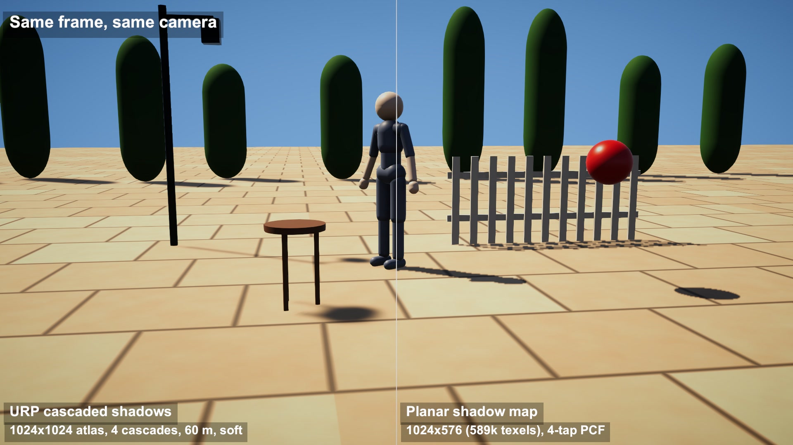

# Camera-Space Planar Shadow Map

Same sun, same frame. Left: a regular cascaded shadow map blurs the stool and the feet. Right: a shadow map drawn in the camera's own screen space, crisp with fewer texels.

## The problem

A normal shadow map is rendered from the light. It has to cover everything the camera might see, so most of its texels land on ground that is off screen or far away. Near the camera, one texel ends up covering a big patch of floor, and contact shadows under feet and furniture turn into soft blobs.

## How it works

This follows DreamFairy's open-source planar shadow map for Unity. It only handles one flat ground plane and a light from above, and in return it skips the light camera completely.

1. Caster pass: every vertex of every caster is slid along the light direction down to the ground. That is one similar-triangles step: move sideways by height / light slope.

2. That ground point is projected with the main camera, so the shadow map is a screen-space image of where shadows land on the visible floor.

3. Each texel stores the lowest caster height on that light ray.

4. The ground does the same slide for its own pixels, looks up the map and compares heights. Four filtered taps soften the edge.

Because the map is the camera's view of the floor, almost every texel is spent on ground you can actually see.

## What I hit

The source is a 2021 URP render feature that writes height into a hardware depth map. I wrote it into a half-float colour target with a min blend instead, so I did not have to handle each platform's depth direction.

The figure is skinned, and the source draws plain meshes, so I draw each renderer instead.

My first shading pass found the map but cast no shadow: passing the texture into a helper function read nothing on Metal. Reading it directly fixed it.

## My build

Unity 6.3 URP. Sun 52 degrees above the horizon.

Planar map 1024x576 (589k texels), 4-tap PCF, against URP's cascaded shadows: 1024x1024 atlas (1,048k texels), 4 cascades, 60 m distance, soft shadows on.

The resolution shot runs the same planar method at 256x144 (36k texels).

Casters: a stand-in figure, a stool, a fence, a lamp post, a bouncing ball and a row of trees.

No GPU timings measured.

## Trade-offs

One flat receiver. Steps, slopes and walls do not get these shadows.

The light has to come from above. As it gets close to the horizon, objects in front and behind start to mix up.

Overlapping casters can resolve wrong, since only the lowest height on each ray is kept.

The map moves with the camera, so edges can crawl when the camera moves.

The cascade side would look sharper with a bigger atlas or a shorter shadow distance. Here the planar map has about half its texels.

## When to use it

Top-down and three-quarter games on flat floors, mobile scenes with tight bandwidth, character contact shadows on a stage or arena.

## Credits

Technique source: dreamfairy/Unity_URP_Planear_Shadowmap, https://github.com/dreamfairy/Unity_URP_Planear_Shadowmap, commit bf81fea4993082713b574ba16458ffdf752c7830. License: MIT, Copyright (c) 2024 DreamFairy.

Code reused: yes, ported. The caster projection (slide each vertex along the light to the ground plane, project with the main camera, write in screen space), the receiver lookup and the 4-tap PCF layout follow the source's render feature and shaders. Changed for Unity 6.3: height is stored in a half-float colour target with a min blend instead of a hardware depth shadow map, casters are drawn per renderer, and the map is drawn from a script before the cameras render.

Engine: Unity 6.3 LTS, Universal Render Pipeline. The comparison side uses URP's own cascaded shadow maps.

My own code: the ground shader built on URP's lighting, the split-screen and map view, the procedural courtyard, stool, fence, lamp post, ball and trees, cameras, lighting and labels. The figure is a plain stand-in mannequin built in code.

No external models or assets.

## Files

- `Editor/BuildScene.cs`
- `PlanarShadowDirector.cs`
- `Shaders/PlanarComposite.shader`
- `Shaders/PlanarShadowCaster.shader`
- `Shaders/PlanarShadowGround.shader`

## Build the scene

In the Unity editor: **Vidar Game Lab > Techniques**, then **Build** next to `planar-shadow-map`. From the command line: `tools/capture.sh planar-shadow-map GameTech.Posts.PlanarShadowScene.Build`.
