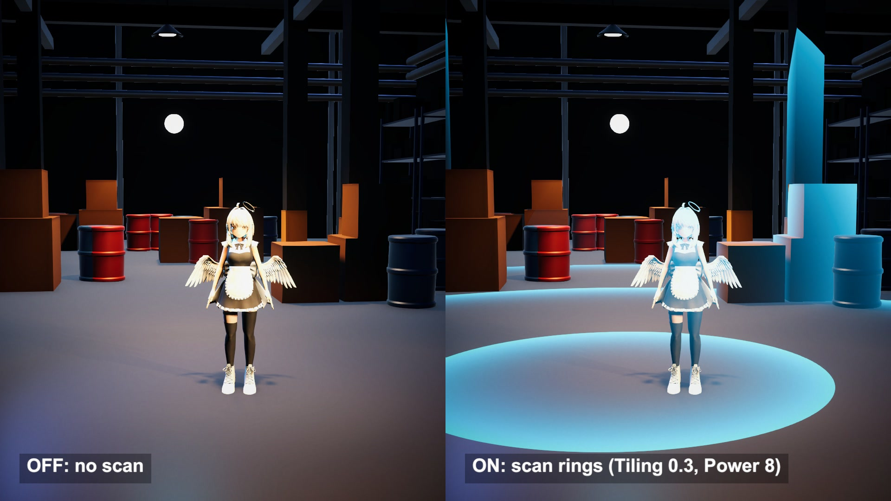

# World-space scan pulse from the depth buffer

A sonar-style scan pulse in Unity, after Mirza Beig's Post-Processing Scan. Each pixel's world position is rebuilt from the depth buffer, and its distance to one point becomes a ring.

## The problem

A scan pulse has to wrap around everything in the scene: floor, crates, a character. Putting it into the materials means touching every shader. A post-process pass sees the finished frame once, yet a flat image has no positions to measure from.

## How it works

The depth buffer fixes that. For each pixel, the depth value and the screen coordinate go through the inverse view-projection matrix and come out as a world position.

The distance from that position to an origin is a spherical distance field. Multiply it by Tiling, subtract time multiplied by Speed, keep the fractional part, and you get a sawtooth that repeats outwards. Raising it to Power (5 in the source material) squeezes the sawtooth into a bright front with a fading tail.

A second term limits the range: a smoothstep that runs from Mask Radius + 1 down to a point set by Mask Hardness, raised to Mask Power.

The product blends the frame towards an HDR colour.

## What I hit

Speed is a phase rate. A ring travels at Speed divided by Tiling: 2.5 m/s at Tiling 0.2 and Speed 0.5, then 0.625 m/s at Tiling 0.8 with the same Speed.

The mask ends at Mask Radius + 1. With Radius 6 my rings stopped 7 m from the origin.

With Tiling 0.2 and Power 5 the tail behind each front was metres long, and after tone mapping it read as a filled disc. For the main shot I used Tiling 0.3 and Power 8, and lowered the colour's strongest channel from 2.1 to 1.6.

Sky pixels have no surface, so I set the scan to zero where the depth sits on the far plane.

## My build

Unity 6.3 with URP on an Apple M4 Mac mini. The source project targets Unity 2020 and ships its shader as generated Amplify code. I rewrote the fragment maths in HLSL and draw it as one full-viewport quad after the opaque pass, so bloom still picks up the rings. The quad reads URP's depth texture, and alpha blending does the final mix.

The origin is the floor point under a small beacon that a script moves. The last part of the video shows three debug outputs: world position in 1 m cells, distance with one line per metre, and the ring mask alone.

The room is a 16 x 25 m warehouse built from code, with 14 racks and 21 barrels.

## Trade-offs

The distance is a straight line, so rings pass through walls where sound would be blocked. Transparent surfaces are missing from the depth buffer and the rings ignore them. The pass only replaces colour: it casts no light on the scene. One pass has one origin, and a second scan needs a second pass.

## When to use it

Scanner pulses, detective vision and placement previews: effects where the whole screen reacts at once and occlusion does not matter.

## Credits

Technique source: Post-Processing Scan by Mirza Beig, https://github.com/MirzaBeig/Post-Processing-Scan, commit 97dcf563c070328d7e9457b29127c9e2fa34cb70, released into the public domain (Unlicense). The maths of its Post-Processing Scan shader (world position from depth, distance to an origin, tiled rings raised to a power, radius mask, blend towards a colour) is rewritten in HLSL for URP 17 with the same parameter names. No file from the repo is used.

Engine: Unity 6.3 LTS (6000.3.28f1) with the Universal Render Pipeline 17.3. Used for rendering. It is not the source of the technique.

Character: モデル：葉葉波、キャラクターデザイン：えびごはん (©はっぱろぐ！・えびごはん・EAUploader). Fan-made reproduction, not official. #いあ3D

My own code: the HLSL rewrite and its three debug outputs, the timeline script that sets the parameters and moves the origin, the warehouse scene built from code, lighting, camera moves, labels and video. No external models or textures besides the character.

## Files

- `Editor/BuildScene.cs`
- `PostScan.shader`
- `ScanDirector.cs`

## Build the scene

In the Unity editor: **Vidar Game Lab > Techniques**, then **Build** next to `post-processing-scan`. From the command line: `tools/capture.sh post-processing-scan GameTech.Posts.ScanScene.Build`.

This scene uses the IA character model, which is not in this repository. See the main README.
