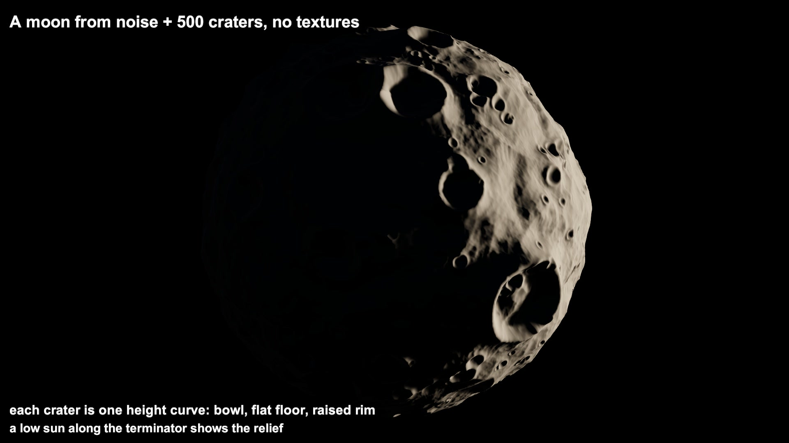

# Procedural planet

No textures, no sculpting. This moon is a sphere pushed in and out by two layers of ridge noise and 500 crater curves, all computed on the GPU. A low sun across the terminator shows every rim.

## The problem

Making a planet surface by hand is slow, and a texture wrapped on a sphere looks flat when the light grazes it. You want real geometry, a new moon from every seed, and craters that still read as craters up close.

## How it works

This follows the moon generator in Sebastian Lague's open-source Solar-System project.

1. Start from a cube, split each face into a grid, and push every point onto a sphere.

2. A compute shader gives each vertex a height: 1 + craters + noise.

3. Noise: ridge noise, 1 - |simplex| raised to a power. Each layer is weighted by the one before, so the detail gathers on the ridges. Each sample averages 5 nearby points to soften spikes.

4. Craters: x = distance from the crater centre in crater radii. The bowl is x² - 1. A smooth max with a floor height flattens the bottom, a smooth min with a rim curve adds the raised lip. All craters add up.

5. Sizes are random with a bias toward small ones. Big craters get flatter floors for their size, small ones are softer bowls.

## What I hit

The cube faces don't share vertices along their edges, so the lighting showed seams. I weld matching positions before computing normals.

My four test moons first sat in a row along the light direction, so each one shadowed the next in the split screen. I stacked them apart.

In the source's moon settings the low-frequency shape noise has a height of 0, so only the two ridge layers shape it. I kept that.

The source also jitters vertices and uses its own planet shader. I left both out and used plain grey rock, so all the relief comes from geometry and light.

## My build

Unity 6.3 URP. A 320 x 320 grid per cube face: 614,402 vertices, 1.23 million triangles.

Heights for every vertex with 500 craters: 12.0 ms (compute + readback) on an Apple M4 Mac mini (Metal). Normals on the CPU.

One sun at a grazing angle, soft shadows, almost no ambient light.

Split 1: same seed, noise only vs noise + 500 craters, radius 1-15% of the moon (the source's moon values).

Split 2: two presets from the source's randomiser: 50 craters of 1-20% vs 1,500 of 1-8%.

## Trade-offs

Every vertex loops over every crater. 500 is fine; tens of thousands would need a grid to look up nearby craters.

The mesh has a fixed resolution, so craters smaller than a few triangles disappear. Landing on the surface needs chunks and level of detail.

Heights are computed once. Changing them every frame costs the readback and new normals.

Craters simply add up: no ejecta rays, no erosion.

## When to use it

Moons, asteroids and rocky planets seen from orbit, background bodies in space scenes, and quick variety from a seed.

## Credits

Technique source: SebLague/Solar-System, https://github.com/SebLague/Solar-System, commit 0c60882be69b8e96d6660c28405b9d19caee76d5. License: MIT, Copyright (c) 2020 Sebastian Lague.
Included noise file: SimplexNoise.cginc as shipped in that repo (Keijiro Takahashi's NoiseShader translation of Ashima Arts' webgl-noise, MIT, Copyright (C) 2011 Ashima Arts), copied unchanged with its header.

Code reused: yes, ported. From MoonHeight.compute: height = 1 + crater depth + (shape + ridge + ridge2) x 0.01. From Craters.cginc: the crater curve (bowl x² - 1, smooth max with the floor, smooth min with the rim curve, scaled by radius). From FractalNoise.cginc: simpleNoise, ridgidNoise, smoothedRidgidNoise. From Math.cginc: smoothMin, smoothMax. From CraterSettings.cs and PRNG.cs: crater placement (random point on the sphere, size, floor and smoothness from a biased random value). Settings from the repo's moon shape asset (500 craters, size 0.01-0.15, rim steepness 0.42, rim width 1.23, ridge noise values) and from MoonShape.cs's randomiser presets ("a few large craters", "many small craters").

My own code: the cube-sphere mesh with welded edges, the Unity dispatch and readback, normals, the plain grey material, sun, shadows, four-moon setup, cameras, split screens, labels and timing. The source's vertex jitter and planet shading are not used.

Engine: Unity 6.3 LTS, Universal Render Pipeline.

No external models, textures or images.

## Files

- `Editor/BuildScene.cs`
- `LICENSE_Solar-System.txt`
- `PlanetDirector.cs`
- `Shaders/Includes/SimplexNoise.cginc`
- `Shaders/PlanetHeight.compute`

## Build the scene

In the Unity editor: **Vidar Game Lab > Techniques**, then **Build** next to `procedural-planet`. From the command line: `tools/capture.sh procedural-planet GameTech.Posts.PlanetScene.Build`.
